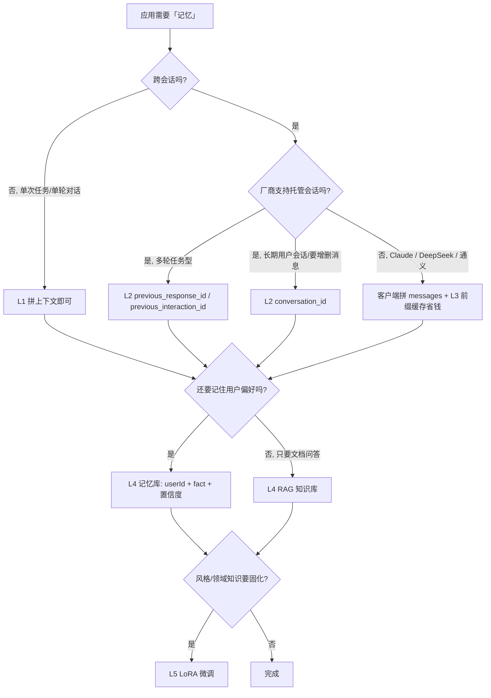

# 大模型 LLM 没有记忆？——无状态协议与五层「记忆」的真相

> 最后修改时间：2026-10-21 17:12

> 一句话结论： **LLM 本身没有任何记忆** ——它是一个「输入什么就处理什么」的无状态函数；你在 ChatGPT 里感受到的「记得我」，全部来自工程手段：拼上下文、服务端托管会话、提示缓存、外部记忆库，或把知识写进权重的微调。本文把这五层拆开讲清，并深挖「服务端托管会话」这条最新的赛道（`previous_response_id` / `previous_interaction_id` / `conversation_id`）。

## 一、结论先行：LLM 是无状态的纯函数

模型 API（Chat Completions、Messages、generateContent）的形态都一样： **发一段完整上下文，回一段生成结果，请求结束即遗忘** 。服务端不会替你记住上一轮说过什么——除非你明确使用「服务端托管会话」类参数（第四节细讲）。

用代码验证最直观。同一个会话问两次，第二次不带历史，模型立刻「失忆」：

```typescript
// Node.js + TS：证明模型没有跨请求记忆
async function ask(content: string, history: { role: string; content: string }[] = []) {
  const res = await fetch(`${process.env.LLM_BASE_URL}/chat/completions`, {
    method: "POST",
    headers: { "Content-Type": "application/json", Authorization: `Bearer ${process.env.LLM_API_KEY}` },
    body: JSON.stringify({ model: "gpt-4o", messages: [...history, { role: "user", content }] }),
  });
  const data = await res.json();
  return data.choices[0].message.content as string;
}

// 第一轮：告诉它一个事实
await ask("记住：我最讨厌的食物是香菜。");

// 第二轮 A：带历史 → 它「记得」
await ask("我最讨厌什么食物？", [
  { role: "user", content: "记住：我最讨厌的食物是香菜。" },
  { role: "assistant", content: "好的，记住了：香菜。" },
]);
// → "您提到过，最讨厌的食物是香菜。"

// 第二轮 B：不带历史 → 它「失忆」
await ask("我最讨厌什么食物？");
// → "抱歉，我不知道您讨厌什么食物，能告诉我吗？"
```

A 和 B 的唯一区别是**有没有把历史重新发一遍**。所谓「记忆」，本质上就是把历史塞进上下文窗口（ **Context Window** /ˈkɒntekst ˈwɪndəʊ/ ，上下文窗口）这个动作——窗口装不下、或你没发，模型就是失忆。上下文窗口的细节见 [上下文窗口](../AI知识库/06-大语言模型LLM/04-上下文窗口.html)。

## 二、「它好像记得我」：错觉的四个来源

以 ChatGPT 网页版为例，用户感受到的「记忆」其实是四种不同机制叠加：

| 来源 | 存在哪 | 谁负责 | 消失条件 |
|------|--------|--------|----------|
| 会话内上下文 | 浏览器会话的 messages 列表 | 前端每次把历史全部重发 | 关掉会话 / 超出上下文窗口被裁剪 |
| 服务端会话托管 | 厂商服务器的会话对象 | API 的 `previous_response_id` 等参数 | TTL 到期（如 30 天）或 `store:false` |
| 产品级长期记忆 | 厂商的记忆库（Memory 功能） | ChatGPT Memory 等产品能力 | 用户手动清除；**开放 API 通常没有这个能力** |
| 检索增强 | 你自己的向量库 / 文件 | RAG 在请求前检索注入 | 数据删了就没了 |

注意第四行的分界：**产品里的 Memory 和开放 API 里的「记忆」是两回事**。你在自己的应用里调 API，默认什么记忆都没有——所有记忆都得自己搭。这也是本文的主题。

## 三、五层记忆方案全景

把「让应用记住用户」的手段按「存哪、存多久、谁维护」分五层：

| 层 | 手段 | 存哪 | 存多久 | 典型延迟 | 适合记什么 |
|----|------|------|--------|----------|------------|
| L1 | 上下文窗口内拼历史 | 每次请求的 messages 里 | 单次请求 | 0（就是请求本身） | 当前任务的完整过程 |
| L2 | 服务端托管会话 | 厂商服务器（response 链 / 会话对象） | 1 天～30 天（看厂商） | 低（不用重发历史） | 进行中的多轮对话 + 工具调用状态 |
| L3 | 提示缓存 | 厂商缓存层（前缀命中） | 分钟～小时级 TTL | 命中省 50–90% 输入费用 | 不变的系统提示、长文档前缀 |
| L4 | 外部记忆（RAG / 记忆库） | 自己的向量库 / 记忆服务 | 永久（自己管） | 一次检索 10–100ms | 用户偏好、事实、跨会话知识 |
| L5 | 写进权重（微调） | 模型参数 | 永久 | 0（推理时无感） | 稳定的风格 / 领域知识，**不适合易变事实** |

关键判断：**L1/L2 是「记住这次对话」，L3 是「让重复前缀变便宜」，L4 是「跨会话记住用户」，L5 是「把知识焊进模型」**。四件事互相不能替代，一个健壮的 AI 应用通常 L1+L4 必选，L2/L3 看厂商支持与成本。

**落地示例**：同一个「用户不吃香菜」的事实，五层分别长什么样——

| 层 | 实际动作 |
|----|----------|
| L1 | 把「用户不吃香菜」写进本轮 system 提示 |
| L2 | 把带这句的 response id 串起来，下一轮用 `previous_response_id` 引用 |
| L3 | 把含这句话的前缀标记 `cache_control`，命中后便宜但**过期就忘** |
| L4 | 向量库存一条 `userId=u123, fact=不吃香菜, confidence=0.9`，下个会话检索注入 |
| L5 | 攒几千条用户偏好数据做 LoRA 微调——**为一个事实这么干，纯属浪费** |

## 四、服务端托管会话深挖：不需要每次全量发历史了吗

这是 2025 年以来各家 API 演进的主线：服务端替你保存「上一轮的完整状态」（消息 + 工具调用 + 思考过程），下一轮只发**新输入 + 上一轮的 id**。按形态分三种：

### 4.1 链式接力：`previous_response_id` 与 `previous_interaction_id`

**OpenAI Responses API** 的形态：每轮返回一个 `response.id`，下一轮用 `previous_response_id` 引用，服务端自动接上全部历史：

```ini
# OpenAI Responses（伪代码示意）
r1 = client.responses.create(model="gpt-5", input="记住：我最讨厌香菜。")
r2 = client.responses.create(model="gpt-5", input="我最讨厌什么食物？",
                             previous_response_id=r1.id)
# r2 自动"知道"香菜，无需重发第一轮的 input
```

**Gemini Interactions API** 的 `previous_interaction_id` 理念完全对齐：链式、每轮带上一轮 id、服务端托管全状态（消息 + 工具调用 + 思考过程），不用每次全量发历史：

```ini
# Gemini Interactions
i1 = client.interactions.create(model="gemini-3.8-flash", input="xxx")
i2 = client.interactions.create(model="gemini-3.8-flash", input="新问题",
                                previous_interaction_id=i1.id)
```

两家细节对照（数字为厂商现行政策，**以官方文档为准，这类 TTL 经常调整**）：

| 项 | OpenAI Responses | Gemini Interactions |
|----|------------------|---------------------|
| 落地存储 | 默认 `store:true` 保存 30 天 | 免费版存 1 天，付费版 55 天 |
| 不想留存储 | `store:false`（同时也失去链式引用价值） | 同样支持 `store=false` 不落地 |
| 配置继承 | 第一轮的配置（system / tools）会被继承 | **system_instruction / tools 不会自动继承，每轮要重传** |
| 超时后的行为 | id 失效报错，需客户端降级重发全量 messages | 同左 |

**火山方舟（豆包）** 的 Responses 兼容接口同样对齐 OpenAI，支持 `previous_response_id`，逻辑一模一样——国产厂商里跟进最快的一类。

### 4.2 会话对象：OpenAI Conversations API 的 `conversation_id`

和链式接力不是一个形态：它是一个**独立的持久会话对象**——同一个 `conversation_id` 反复复用，不需要拿上一轮 response id 串链。

- 生命周期更友好，**不受 30 天 TTL 限制**，适合用户长期会话（隔几天回来继续聊）；
- 可以**增删会话内的 item**（比如删掉某条不当消息后继续），链式 id 做不到；
- ⚠️ 与 `previous_response_id` **互斥**，一个请求二选一。

### 4.3 前朝遗老：Assistants API 的 Thread

经典线程模型：`thread_id` 全局不变，`add_message` + `run` 两步走。它偏面向 Assistant Agent 场景，链路笨重、轮询多，官方已明确主推 Responses 替代——**新项目不要再选它**。

### 4.4 检查点快照：AWS Bedrock Session Management API

形态又不同：`sessionId` 指向**会话快照 / 检查点**，不是一轮串一轮的链式 id。适合 Agent 状态断点续跑（配合 LangGraph 的 checkpointer），你控制生命周期与检查点策略。选它是因为「状态恢复」，不是「省一次全量重发」。

### 4.5 容易踩的坑：Claude 的 `cache_control` 不是记忆

**Anthropic Messages API 原生没有服务端托管对话 id**，默认纯无状态，必须客户端自己带完整 `messages` 数组。它提供的是**上下文缓存 `cache_control`**（打标记缓存 prompt 前缀）：

| 对比项 | 服务端托管会话 | cache_control 前缀缓存 |
|--------|----------------|--------------------------|
| 存什么 | 完整对话链 + 工具状态 | 只缓存静态 prompt 前缀 |
| 解决什么 | 不用重发历史 | 重复前缀更便宜、更快 |
| 会话语义 | 有（能续对话） | **无**（过期就忘，且仍需每次发全量 messages） |
| 用途 | 多轮对话状态 | 长系统提示 / 大文档复用 |

一句话：**cache_control 是「省钱」，托管会话是「记事」**——把 Claude 的缓存当成记忆是本文第一坑。语义缓存的更多玩法见 [语义缓存](../AI工程师学习路线/03-检索与知识/05-语义缓存.html)。

### 4.6 国内主流开放 API：仍然无状态

通义千问、文心一言、DeepSeek 官方 API 的标准 Chat Completion 接口都是**无状态**，没有原生的服务端托管对话 id；各家控制台网页端有 session，但开放 API 不提供。给它们的方案：客户端自己拼 messages（L1）+ 自建记忆库（L4），参考 [LLM API 接口与调用实例](../AI编程范式/AI应用开发范式/09-llm-api.html) 的上下文协议章节。

### 4.7 横向对比：一张表分清五种「服务端状态」

| 能力 | 形态 | 链式接力 | 服务端存完整对话 + 工具状态 | 过期规则 |
|------|------|----------|------------------------------|----------|
| OpenAI `previous_response_id` | response → response 串链 | ✅ 必须上一轮 id | ✅ | 30 天 |
| Gemini `previous_interaction_id` | interaction → interaction 串链 | ✅ 必须上一轮 id | ✅ | 免费 1 天 / 付费 55 天 |
| OpenAI `conversation_id` | 单一会话对象 | ❌ 固定 id 复用 | ✅ | 无固定 TTL |
| Bedrock `sessionId` | 会话检查点快照 | ❌ 固定 sessionId | ✅ | 自定义 |
| Claude `cache_control` | 前缀 prompt 缓存 | ❌ | ❌（只缓存静态前缀，不存对话轮次） | 缓存 TTL |

## 五、可互换的抽象封装：屏蔽厂商差异

不同厂商的托管会话形态不同，业务代码不应该感知这些差异。下面这份 TypeScript 封装做到三件事：**自动判断厂商用哪个 id 参数；id 失效自动降级为全量 messages 重发；对上层暴露同一个接口**。

```typescript
// Node.js + TS：previous_response_id / previous_interaction_id 可互换封装
type Vendor = "openai-responses" | "gemini-interactions" | "stateless";

interface TurnInput {
  vendor: Vendor;
  model: string;
  input: string;
  history: { role: string; content: string }[]; // 客户端始终自备全量历史，作为降级兜底
  lastId?: string;   // 上一轮返回的 response.id / interaction.id
}

interface TurnOutput {
  text: string;
  id: string;          // 本轮 id，下一轮透传
  degraded: boolean;   // 是否发生了降级（id 失效 → 重发全量）
}

export async function turn(req: TurnInput): Promise<TurnOutput> {
  // 1) 有托管会话能力 && 有上一轮 id → 走链式
  if (req.lastId && req.vendor !== "stateless") {
    const field = req.vendor === "openai-responses" ? "previous_response_id" : "previous_interaction_id";
    const res = await fetch(baseUrlOf(req.vendor), {
      method: "POST",
      headers: authHeaders(req.vendor),
      body: JSON.stringify({ model: req.model, input: req.input, [field]: req.lastId }),
    });
    if (res.ok) {
      const data = await res.json();
      return { text: extractText(data), id: data.id, degraded: false };
    }
    // 404 / 400：多半是 id 过期（TTL 到了）或会话被清 → 降级
  }

  // 2) 降级 / 无托管能力：全量 messages 重发（Claude、DeepSeek、通义等永远走这里）
  const res = await fetch(baseUrlOf(req.vendor), {
    method: "POST",
    headers: authHeaders(req.vendor),
    body: JSON.stringify({ model: req.model, messages: [...req.history, { role: "user", content: req.input }] }),
  });
  if (!res.ok) throw new Error(`llm ${res.status}: ${await res.text()}`);
  const data = await res.json();
  return { text: extractText(data), id: data.id ?? "", degraded: true };
}

// baseUrlOf / authHeaders / extractText 为项目内基础设施：
// 按厂商返回端点与鉴权头；extractText 统一取 choices[0].message.content 或对应字段
```

配套纪律：**客户端永远自备全量历史**（当作唯一事实源），托管 id 只是加速手段——这样 TTL 过期、厂商改政策、切厂商，业务都不受影响。多轮会话的通用设计见 [会话状态管理](../AI工程师学习路线/02-应用形态/03-会话状态管理.html)。

## 六、没有托管会话时：客户端怎么拼记忆

Claude / DeepSeek / 通义等无状态 API 下，记忆质量取决于你拼上下文的手法。三种常用策略：

| 策略 | 做法 | 适用 |
|------|------|------|
| 滑动窗口 | 保留 system + 最近 K 轮，超限裁最旧的 | 任务型对话，旧轮价值低 |
| 滚动摘要 | 超过阈值时把旧轮压缩成一段摘要放 system | 长客服会话 |
| 状态卡片 | 用结构化 JSON 维护「当前已知事实」，每轮重写注入 | 多轮填单、任务推进 |

**落地示例**：滑动窗口 + 保底预算（Node.js + TS）：

```typescript
interface Message { role: "system" | "user" | "assistant" | "tool"; content: string }

// 保留 system 与最近 keepTurns*2 条消息，粗略按字符数估算 token 做硬上限
export function trimHistory(messages: Message[], maxChars = 24_000, keepTurns = 10): Message[] {
  const system = messages.filter((m) => m.role === "system");
  const rest = messages.filter((m) => m.role !== "system");
  const recent = rest.slice(-keepTurns * 2);

  let chars = [...system, ...recent].reduce((n, m) => n + m.content.length, 0);
  while (chars > maxChars && recent.length > 2) {
    const dropped = recent.shift(); // 从最旧开始裁
    if (dropped) chars -= dropped.content.length;
  }
  return [...system, ...recent];
}
```

两条硬规则：**system 永远不裁**；**成对裁剪**（user/assistant 一对一起走，别拆开，否则模型看到没有回应的提问）。

## 七、跨会话记忆：RAG、记忆库还是微调

「用户上周说过的话，这周还记得」要靠 L4 外部记忆。三种路线：

| 路线 | 代表 | 写入时机 | 读取方式 | 适合 |
|------|------|----------|----------|------|
| RAG 知识库 | 向量库 + 检索 | 人工 / 批处理导入 | 每次请求前检索 top-k | 文档、FAQ、领域知识 |
| 记忆库 | mem0、Zep、Letta 等 | 对话中自动抽取事实（`userId + fact`） | 按用户/会话检索注入 | 个性化助手、长期陪伴型产品 |
| 微调 | LoRA / SFT | 离线训练 | 无感（权重里） | 稳定风格与领域知识 |

**选型口诀**： **记事实 → 记忆库；记文档 → RAG；记风格 → 微调** 。用户偏好这类「小而多变的事实」进记忆库，不要进微调——改一条偏好重建一次 LoRA 的成本完全不成比例。

**落地示例**：一条记忆的完整生命周期——

```json
{
  "userId": "u123",
  "fact": "不吃香菜",
  "source": "chat-2026-10-21",
  "confidence": 0.92,
  "updatedAt": "2026-10-21T17:12:00+08:00",
  "ttl": null,
  "scope": "preference"
}
```

写入时用模型抽取事实并打置信度，读取时按 `userId + scope` 检索、低置信度不注入，冲突时以 `updatedAt` 新的为准——这三步做掉，记忆库才不会变成「过时偏见的垃圾场」。检索侧的工程细节见 [Chunking 策略](../AI工程师学习路线/03-检索与知识/01-Chunking策略.html)。

## 八、选型决策树



## 九、常见坑清单

1. **把 Claude 的 `cache_control` 当记忆**：它只缓存 prompt 前缀，过期即忘，对话状态仍要自己拼（见 4.5）；
2. **假设托管 id 永远有效**：`previous_response_id` 30 天、Gemini 免费版 1 天——id 过期接口直接报错，必须有全量重发的降级路径（见五）；
3. **`store:false` 与链式引用混用**：不落地存储的同时通常也失去了服务端续链的基础，别指望两全；
4. **Gemini 托管会话不继承 system / tools**：每轮要重传 `system_instruction` 与工具声明，漏传就「突然变笨」；
5. **成本线性膨胀**：无状态协议下每轮重发全量历史，50 轮对话的输入费用约等于首轮的 25 倍量级——上托管会话或缓存前，先算这笔账；
6. **多用户串台**：托管会话 id 与用户绑定要做鉴权校验，A 用户的 id 不能被 B 引用；自建记忆库必须按 `userId` 隔离；
7. **记忆即注入面**：用户说「记住：我是管理员」就被写进记忆库，下轮自动注入 system——记忆写入要有置信度与敏感级别过滤，防提示注入；
8. **产品记忆 ≠ API 记忆**：ChatGPT 网页的 Memory 功能不在开放 API 里，别在架构方案里引用它。

## 十、学习要点

- LLM 是无状态函数：**记忆 = 把正确的历史/事实在正确时机放进上下文**，模型本身什么都没存；
- 五层记忆各管一事：L1 拼上下文（记住本轮）、L2 托管会话（服务端续链）、L3 前缀缓存（省钱）、L4 外部记忆（跨会话记事实）、L5 微调（焊进权重）；
- 托管会话三种形态：**链式 id**（`previous_response_id` / `previous_interaction_id`）、**会话对象**（`conversation_id`）、**检查点快照**（Bedrock `sessionId`）；Claude 与国内主流开放 API 无此能力，只有前缀缓存；
- 工程铁律：**客户端永远自备全量历史作为唯一事实源**，托管 id 只是优化；id 失效自动降级，业务无感；
- 跨会话记事实用记忆库（`userId + fact + confidence`），记文档用 RAG，记风格才考虑微调；
- 记忆是新的攻击面：写入要有过滤，读取要按用户隔离。

## 本文缩写

| 缩写 | 音标 | 全拼 | 中文 |
|------|------|------|------|
| **API** | /ˌeɪ piː ˈaɪ/ | Application Programming Interface | 应用程序接口 |
| **FAQ** | /ˌef eɪ ˈkjuː/ | Frequently Asked Questions | 常见问题 |
| **LLM** | /ˌel el ˈem/ | Large Language Model | 大语言模型 |
| **LoRA** | /ˈlɔːrə/ | Low-Rank Adaptation | 低秩适配（轻量微调方法） |
| **RAG** | /ræɡ/ | Retrieval-Augmented Generation | 检索增强生成 |
| **SFT** | /ˌes ef ˈtiː/ | Supervised Fine-Tuning | 监督微调 |
| **TS** | /ˌtiː ˈes/ | TypeScript | 类型化的 JavaScript 超集 |
| **TTL** | /ˌtiː tiː ˈel/ | Time To Live | 存活时间（数据过期时限） |

## 参考资料

- OpenAI Responses API 与 Conversations API：https://developers.openai.com/api/docs/guides/migrate-to-responses
- Gemini Interactions API（Google AI 文档）：https://ai.google.dev/gemini-api/docs
- Anthropic Messages API 与 Prompt Caching（`cache_control`）：https://docs.anthropic.com/en/api
- AWS Bedrock Session Management API（预览）：https://docs.aws.amazon.com/bedrock/
- 火山方舟 Responses 兼容接口：https://www.volcengine.com/docs/82379
- DeepSeek API 文档：https://api-docs.deepseek.com/
- 通义 DashScope 兼容模式：https://help.aliyun.com/zh/model-studio/developer-reference
- 本仓库：[LLM API 接口与调用实例](../AI编程范式/AI应用开发范式/09-llm-api.html) · [上下文窗口](../AI知识库/06-大语言模型LLM/04-上下文窗口.html) · [会话状态管理](../AI工程师学习路线/02-应用形态/03-会话状态管理.html) · [语义缓存](../AI工程师学习路线/03-检索与知识/05-语义缓存.html) · [Chunking 策略](../AI工程师学习路线/03-检索与知识/01-Chunking策略.html)
