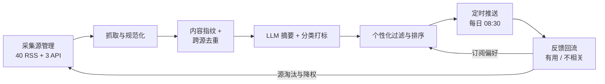

# IM Bot 与信息推送

> 最后修改时间：2026-11-07 14:00

> 状态：✅ 已补齐（2026-11-07）  
> 一句话定义： **IM Bot（即时通讯机器人）** 在渠道侧只有三种形态——命令、对话、推送；本篇讲渠道接入差异与「AI 资讯聚合 → 摘要 → 去重 → 推送 → 反馈回流」这条管道的通用工程模式。

## 大纲

1. [Bot 的三种形态与触发模型](#一bot的三种形态与触发模型)
2. [IM 渠道全景与接入差异](#二im-渠道全景与接入差异)
3. [AI 资讯聚合与推送的通用管道](#三ai-资讯聚合与推送的通用管道)
4. [工程要点：幂等、限频、成本与免打扰](#四工程要点幂等限频成本与免打扰)
5. [端到端落地示例：四周迭代](#五端到端落地示例四周迭代)

## 已有相关文档（先读这些）

- [Chatbot 概念与形态演进](01-Chatbot概念与形态演进.html) —— **分工**：那篇讲「对话 Bot」的形态演进（回合、意图、NLU、LLM 分化），只在「多端触达」一句带过渠道；本篇不重复任何对话概念，专讲 **渠道怎么接、消息怎么推** 。看懂那篇的「推送 Bot 不在其讨论范围」即可过来。
- [限流、重试与幂等](../05-工程与生产/06-限流重试与幂等.html) —— 本文第四节只引用其幂等键与退避结论，不重复展开公式与装饰器实现。
- [语义缓存](../03-检索与知识/05-语义缓存.html) —— 本文的去重管道复用其中的嵌入向量与相似度阈值标定思路。

## 学习要点（读后应能回答）

- 命令 / 对话 / 推送三种 Bot 怎么选？误用会怎样？→ 见 [1.4](#14-形态选型表与误用代价)
- 同一个 Bot 要上 Slack、飞书、企微，接入差异最大的三件事是什么？→ 见 [2.2](#22-接入差异最大的三件事)
- 为什么去重必须发生在 LLM 摘要 **之前** ？→ 见 [3.3](#33-去重嵌入相似度与跨源合并)
- 同一条资讯怎么保证绝不推两次？→ 见 [4.1](#41-推送幂等同一条资讯绝不推两次)
- 点踩数据怎么变成源淘汰决策？→ 见 [5](#五端到端落地示例四周迭代)

---

## 〇、贯穿案例：小北的团队早报 bot

本篇全程使用同一个虚构但有真实感的案例——「小北」是一家 30 人 AI 创业团队的工程师，团队在飞书群里每天被资讯刷屏，他决定自建一个 **团队早报 bot**：

| 项目 | 配置 |
|------|------|
| 渠道 | 飞书群（自定义机器人 webhook 起步，后换自建应用拿卡片交互） |
| 节奏 | 每日 08:30（Asia/Shanghai）推 5 条精选 |
| 采集源 | 40 个 RSS + 3 个官方 API（论文榜、模型发布页） |
| 数据漏斗 | 日均采集 800 条 → 跨源去重后 120 条 → 打分精选 5 条 |
| 摘要 | LLM 生成 60 字中文摘要 + 1 个分类标签 |
| 反馈 | 卡片按钮「有用 / 不相关」，驱动源淘汰与排序 |

记住这组数字： **800 → 120 → 5** 。后面每一节都在复用它算账。

---

## 一、Bot 的三种形态与触发模型

### 1.1 触发方决定形态

**Bot** /bɒt/ （机器人，替人自动收发消息的程序）在 **IM** /ˌaɪ ˈem/ （Instant Messaging，即时通讯，如 Slack、飞书、企业微信）渠道侧的形态，不取决于它内部跑的是规则还是 LLM，而取决于一个更朴素的问题： **这条消息是谁发起的？**

| 形态 | 触发方 | 用户视角 | 系统视角 |
|------|--------|----------|----------|
| 命令 Bot | 用户显式输入 | 「我敲 `/daily`，它给我今日精选」 | 收到一条结构化命令，无状态即可执行 |
| 对话 Bot | 用户自然语言输入 | 「我 @它问一句话，它回我」 | 收到一条文本，需会话状态与理解能力 |
| 推送 Bot | 系统自身（定时或事件） | 「它主动来找我」 | 没有入站消息，只有出站投递 |

前两种是「人找 Bot」，第三种是「Bot 找人」——这个方向差异决定了推送 Bot 的工程重心完全不同： **它没有用户输入可以借力，一切上下文（推给谁、推什么、几点推）都必须自己维护** 。

### 1.2 命令 Bot（斜杠命令）

**Slash Command** /slæʃ kəˈmɑːnd/ （斜杠命令，以 `/` 开头的结构化指令）是三个平台一致性最高的形态：Slack、Discord、飞书、钉钉都原生支持，且命令在输入框里由平台自动补全——用户不需要「知道 Bot 能干什么」，平台替你把菜单列出来了。

命令的三个工程红利：

1. **参数结构化** ：`/subscribe 每日 08:30` 传给后端的就是 `{command: "subscribe", args: ["每日", "08:30"]}`，不用做意图识别；
2. **零幻觉** ：能做什么、参数是什么，由注册清单决定，Bot 不可能「编」出一个不存在的命令；
3. **权限天然清晰** ：命令注册时就绑定了可见范围与权限点。

代价是封闭：所有能力都要一条条注册，用户记不住超过 10 个命令。所以命令 Bot 适合 **高频、封闭、参数固定的操作** （订阅、查询、开关），不适合开放问答。

### 1.3 对话 Bot（@提及与私聊）

**Mention** /ˈmenʃn/ （提及，即 @某人或某 Bot）与私聊（ **DM** /ˌdiː ˈem/ （Direct Message，私信/私聊））是对话 Bot 的两个入口。这一形态的全部概念——回合、会话、意图、槽位、DM 策略——见 [Chatbot 概念与形态演进](01-Chatbot概念与形态演进.html) ，本文只补 **渠道侧** 的三件事：

- **群聊里通常只响应 @提及** ：不 @ 不回复，否则 Bot 会对每条群消息触发回调，既烧钱又扰民；
- **私聊免 @** ：单聊里每条消息都是对它说的；
- **线程（thread）承载多轮** ：Slack 的 thread、Discord 的 thread、飞书的话题群，都是把「会话状态」映射到渠道消息结构的天然容器——会话 ID 可以直接用 thread ID。

### 1.4 形态选型表与误用代价

这是文首第一个学习问题。三种形态不是三选一，**成熟的信息类产品几乎都是「推送为主 + 命令调参 + 对话兜底」的组合**：

| 维度 | 命令 Bot | 对话 Bot | 推送 Bot |
|------|----------|----------|----------|
| 触发 | 用户敲命令 | 用户 @ / 私聊 | **Cron** /krɒn/ （类 Unix 定时调度器，按 cron 表达式周期触发）或事件 |
| 状态需求 | 无状态 | 会话状态管理 | 无对话状态，但需投放目标与内容池 |
| 理解要求 | 零（结构化） | 高（NLU / LLM） | 零入站理解，产出侧要摘要与排序 |
| 典型失败 | 命令太多记不住 | 群聊不 @ 乱回、烧钱 | 重复推送轰炸、免打扰缺失 |
| 适合 | 订阅 / 查询 / 开关 | 开放问答、临时求助 | 资讯早报、告警、审批通知 |

**误用代价**：用对话 Bot 承载本应是命令的操作（「帮我订阅早报」要靠 LLM 意图识别），一次识别错误就是一条脏订阅数据，且用户无法发现；用推送 Bot 承载本应是命令的操作（想查「今日精选」却只能等明早推送），用户被迫被动等待。小北的早报 bot 最终形态就是组合式： **推送为主干，`/subscribe`、`/unsubscribe`、`/top` 三条命令调参数，@提问走 LLM 兜底** 。

**落地示例**：三种触发统一成一张判别表（Node.js + TS）——Bot 收到的每条入站消息，先回答「谁触发了我」再路由：

```typescript
/** 触发源抽象：三种形态在接入层的统一形状 */
type Trigger =
  | { kind: "command"; slash: string; args: string[]; userId: string }
  | { kind: "mention"; text: string; threadId: string; userId: string }
  | { kind: "private"; text: string; userId: string };

interface RouteResult {
  handler: "commandRouter" | "chatPipeline" | "ignored";
  /** 群聊未 @ 的消息直接忽略，是省钱的第一道闸 */
}

export function routeInbound(msg: Trigger): RouteResult {
  if (msg.kind === "command") return { handler: "commandRouter" };
  if (msg.kind === "private") return { handler: "chatPipeline" };
  return { handler: "chatPipeline" }; // mention：进入对话管线（RAG / LLM）
}

// 而推送 Bot 根本不走这个入口——它由调度器直接调用，没有入站消息：
// cron("30 8 * * *", "Asia/Shanghai", () => pushDailyDigest());
```

---

## 二、IM 渠道全景与接入差异

### 2.1 渠道对比表

国内外主流渠道的接入模型差异很大。下表是工程选型视角的对比（ **限频数值随平台版本变化，以各平台官方文档为准** ；见文末参考资料）：

| 渠道 | 接入模型 | 富消息卡片 | 限频特点 | 门槛 | 备注 |
|------|----------|-----------|----------|------|------|
| Slack | Events API（公网回调）或 Socket Mode（长连接，免公网） | Block Kit，交互按钮齐全 | 按渠道桶限频，短时突发可容忍 | 创建 App 即用，自用不上架很宽松 | 命令体系最成熟 |
| Discord | Gateway WebSocket 长连接 + REST | Embed 与组件按钮 | 全局与每频道双层限频 | 建机器人即用 | 长连接模型对内网部署最友好 |
| Telegram | **Webhook** /ˈwebhʊk/ （网络钩子，事件到达时平台主动回调你的接口）或长轮询 | 内联键盘 + HTML/Markdown | 每 chat 约 1 条/秒、每群约 20 条/分钟 | **BotFather** 创建即用 | 个人与跨境团队首选 |
| 飞书 | 自定义机器人（仅出站 webhook）或自建应用（事件订阅 + 卡片交互） | 卡片 JSON，支持按钮回调 | 自定义机器人有每分钟条数上限 | 自建应用需企业管理员授权 | 国内企业团队首选 |
| 企业微信 | 群机器人 webhook（仅出站）或自建应用（回调 + 主动发消息） | markdown / 图文 / 模板卡片 | 每群每分钟有条数上限 | 需企业管理员开通 | 回调需企业可信域名 |
| 钉钉 | 自定义机器人 webhook（需加签或关键词安全设置）或企业内部应用 | ActionCard / markdown | 每机器人每分钟有条数上限 | 群内即可添加自定义机器人 | 加签是最简安全方案 |

三类接入模型值得记住：

1. **纯出站 webhook**（飞书 / 企微 / 钉钉的群机器人）：你只有一个 URL，POST 即发——没有入站事件、没有交互回调，适合推送 Bot，**做不了命令与对话** ；
2. **事件订阅 / 回调**（Slack Events、飞书自建应用、企微自建应用）：平台把消息 POST 给你，要求公网可达地址、验签、5 秒内应答——命令与对话 Bot 的标配；
3. **长连接**（Socket Mode、Discord Gateway、Telegram 长轮询）：无需公网 IP，开发机、容器内网都能跑，是小团队起步最快的路径。

### 2.2 接入差异最大的三件事

这是文首第二个学习问题。同一个 Bot 多渠道部署时，真正需要分别适配的就三件事：

| 事项 | 差异点 | 应对 |
|------|--------|------|
| **消息卡片结构** | Slack Block Kit / 飞书卡片 JSON / 企微模板是完全不同的 DSL，互不兼容 | 定义 **统一的出站卡片 DTO** ，由各渠道 adapter 翻译 |
| **交互回调** | 按钮点击后，平台回调你的接口，载荷格式与验签方式各家不同 | 回调统一入口 + 渠道字段分流 |
| **限频与重试语义** | 超限返回的 HTTP 状态、是否带 Retry-After、桶大小都不同 | 限频逻辑收敛到 adapter 内，上层只管发 |

**自建 vs 连接器**： **n8n** /ˌen eɪt ˈen/ （开源工作流自动化平台，可视化编排 webhook 与 API 调用）这类连接器（以及各类「消息网关」服务）把多渠道适配做成了现成节点，适合验证期与无后端人力场景；代价是交互回调、复杂卡片与细粒度限频控制受限，且多一跳依赖。小北的经验法则： **W1 用 webhook + 连接器验证内容价值，渠道一多或需要卡片交互就收编为自建 adapter** 。

**落地示例**：统一卡片 DTO 与渠道 adapter 接口（Node.js + TS）：

```typescript
/** 统一出站卡片：渠道无关的中间表示 */
interface OutboundCard {
  title: string;          // 条目标题
  summary: string;        // LLM 摘要（60 字）
  url: string;            // 原文链接
  tags: string[];         // 分类标签，如 ["模型发布"]
  feedback?: boolean;     // 是否附「有用 / 不相关」按钮
}

interface Target {
  channelId: string;      // 渠道侧会话 / 群 ID
  threadId?: string;      // 可选：线程/话题
}

interface ChannelAdapter {
  readonly name: "slack" | "feishu" | "wecom" | "telegram";
  /** 发送卡片，返回平台消息 ID（幂等记录与后续撤回都要用它） */
  sendCard(card: OutboundCard, target: Target): Promise<{ messageId: string }>;
  /** 限频由 adapter 内部消化：上层永远只管调 sendCard */
}
```

---

## 三、AI 资讯聚合与推送的通用管道

Muse 这类「AI 信息工具」（AI 资讯聚合 / 推送品类，同类产品众多，具体参数 **以各产品官方文档为准** ）剥开产品外壳，工程上都是同一条六段管道。本节按段拆解，小北的数字全程贯穿。



### 3.1 采集源管理（RSS / API / 爬虫 / 订阅列表）

**RSS** /ˌɑːr es ˈes/ （Really Simple Syndication，简易信息聚合，网站输出更新列表的标准 XML 格式）是采集源的主力：结构稳定、无需鉴权、带 `pubDate` 与全文或摘要。四类源的管理要点：

| 源类型 | 特点 | 工程要点 |
|--------|------|----------|
| RSS / Atom | 标准格式，成本低 | 校验 XML 合法性；`guid` 做一级去重键 |
| 官方 API（论文榜、发布页） | 数据最规整 | 按 API 的增量参数拉取，别全量翻页 |
| 爬虫 | 兜底没有 RSS 的站点 | 只在「源不可替代」时上；解析器随改版会碎 |
| 订阅列表（用户自己提交的源） | 个性化来源 | 入池前先跑一周观察期，不直接进推送池 |

源是带运营属性的资产：每个源要有 `sourceId`、健康度（最近成功抓取时间）、以及后面 5 节的点踩率档案。 **「源」而不是「条目」是运营的基本单位** ——点踩从来不是惩罚某条内容，而是惩罚它的来源。

### 3.2 抓取与规范化

规范化是把 43 个源的不同脏数据洗成统一形状：URL 去掉 tracking 参数（`utm_*` 等）、标题去渠道后缀、时间统一到 UTC 存储。**规范化做不好，去重就失灵**——同一篇文章在两个源里的 URL 一个带 utm 一个不带，精确指纹就撞不上了。

### 3.3 去重：嵌入相似度与跨源合并

这是文首第三个学习问题。去重发生在摘要 **之前** ，原因很简单： **摘要按条计费，而 800 条里真正独立的事件往往只有 120 个** ——先用便宜的去重砍掉 85%，再让贵的 LLM 只处理剩下的。

去重是两级漏斗：

1. **一级：精确指纹** ——规范化 URL + 规范化标题的哈希。零成本，抓掉完全相同的转发（约 45%）；
2. **二级：嵌入相似度** ——同一事件不同媒体的不同标题（「X 发布新模型」vs「X 推出新一代模型」），指纹不同但语义相同，用 **Embedding** /ɪmˈbedɪŋ/ （嵌入向量，文本映射成的稠密语义向量）相似度合并。阈值标定方法复用 [语义缓存](../03-检索与知识/05-语义缓存.html) 的正负对法——资讯场景的负对是「同主题不同事件」（同一家公司先后两次发布，相似度极易超阈值）。

合并用贪心聚类：新条目与当日候选池算相似度，超过阈值就并入既有簇（保留最早来源，其余记为「共源」），否则自成一簇。小北的实测：800 条 → 指纹去重剩 440 → 嵌入合并剩 **120 簇** ，其中约 30% 的簇含 2 个以上来源——这些「多源簇」本身就是重要性的强信号。

**落地示例**：跨源去重管道（Node.js + TS）：

```typescript
interface RawItem {
  sourceId: string;      // 来源源 ID
  title: string;
  url: string;           // 已规范化（去 utm_* 等 tracking 参数）
  publishedAt: Date;
}

interface Cluster {
  fingerprint: string;   // 簇代表条目的指纹
  title: string;         // 代表标题（取最早来源）
  sources: string[];     // 命中该事件的所有来源，多源 = 重要性信号
  publishedAt: Date;
}

/** 一级：精确指纹；二级：嵌入相似度贪心聚类 */
export async function dedup(items: RawItem[], embed: (t: string) => Promise<number[]>): Promise<Cluster[]> {
  const clusters: Cluster[] = [];
  const seen = new Set<string>();                       // 一级指纹表
  const clusterVecs: { c: Cluster; v: number[] }[] = [];

  for (const it of items.sort((a, b) => +a.publishedAt - +b.publishedAt)) {
    const fp = fingerprint(it.url, it.title);
    if (seen.has(fp)) continue;                         // 一级：完全相同，直接丢
    seen.add(fp);

    const v = await embed(normTitle(it.title));
    const hit = clusterVecs.find(({ v: cv }) => dot(cv, v) >= 0.86); // 阈值经正负对标定
    if (hit) {
      hit.c.sources.push(it.sourceId);                  // 二级：并入既有簇
    } else {
      const c: Cluster = { fingerprint: fp, title: it.title, sources: [it.sourceId], publishedAt: it.publishedAt };
      clusters.push(c);
      clusterVecs.push({ c, v });
    }
  }
  return clusters;
}
```

### 3.4 LLM 摘要与分类打标

对 120 个簇做一次 **批处理调用** ：每簇输入标题 + 原文摘要段（约 700 **Token** /ˈtəʊkən/ （词元，模型计费与计长的最小文本单位）），要求输出固定 JSON——60 字中文摘要、1 个分类标签（`模型发布` / `论文` / `工程实践` / `行业动态`）、1 个 0–5 的新颖度自评。批处理细节与并发限控见 [限流、重试与幂等](../05-工程与生产/06-限流重试与幂等.html) 的批量与队列一节，此处不重复。

摘要提示词的三条铁律：**只写事件本身、不写评论、保留实体名与数字** ——早报读者要的是「发生了什么」，不是「你怎么看」。

### 3.5 个性化过滤与排序

群推送没有个人 feed，个性化退化为 **群级偏好** ：团队订阅标签（如「模型发布 + 工程实践」加权）、黑名单标签、以及反馈回流学到的源权重。排序分是几个可解释信号的加权和——**推送场景的排序必须可解释** ，因为用户会问「为什么推这条」：

```text
score = 2.0 × 多源数(log)          // 3 个源都报的事件，大概率真的大
      + 1.5 × 新颖度自评
      + 1.0 × 团队标签匹配
      + Σ 源权重                    // 反馈回流调整，见第五节
      − 点踩源惩罚
```

取 top-5 出池。冷启动期（无反馈数据）全部权重用默认值即可跑通，见 [4.4](#44-冷启动内容池与免打扰时段)。

### 3.6 定时推送与反馈回流

推送由 cron 触发（工程细节见第四节），卡片上的「有用 / 不相关」按钮回调写回流表。回流数据只有三个去向，别做多余的事：

| 反馈 | 去向 |
|------|------|
| 不相关 | 源点踩计数 +1；连续走高的源进淘汰候选 |
| 有用 | 源权重上调；标签偏好上调 |
| 无反馈 | 不动。沉默不是负信号——多数人只划不看 |

---

## 四、工程要点：幂等、限频、成本与免打扰

### 4.1 推送幂等：同一条资讯绝不推两次

这是文首第四个学习问题。推送是典型的 **非幂等写** （用户会收到两条一模一样的早报），重试前必须带幂等键。幂等键的构造原则（键放哪一层、失败清除、running 占位）见 [限流、重试与幂等](../05-工程与生产/06-限流重试与幂等.html) 第三、四节，本文只给出推送场景的键形状：

```text
push:{channelId}:{itemFingerprint}      // 粒度：渠道 × 内容
digest:{channelId}:{yyyy-MM-dd}         // 粒度：渠道 × 期号（整份早报只发一次）
```

两个粒度都要：内容级防「同一条目因重跑被推两次」，期号级防「调度器重复触发导致整份早报发两遍」——后者是小北 W1 真实踩过的坑（cron 服务的 leader 选举抖动，08:30 触发了两次）。

**落地示例**：幂等推送包装（Node.js + TS）：

```typescript
interface KVStore {
  get(key: string): Promise<{ status: "done"; result?: unknown } | null>;
  set(key: string, val: unknown, ttlSec: number): Promise<void>;
  del(key: string): Promise<void>;
}

/** 幂等推送：同键第二次调用直接跳过；失败清键允许重试 */
export async function pushOnce(key: string, send: () => Promise<void>, kv: KVStore): Promise<"sent" | "duplicate"> {
  const marker = await kv.get(key);
  if (marker?.status === "done") return "duplicate";    // 已推过，静默跳过

  try {
    await send();
    await kv.set(key, { status: "done" }, 7 * 86400);   // 7 天去重窗口，覆盖重试与重跑
    return "sent";
  } catch (err) {
    await kv.del(key);                                  // 失败清键，调度器下轮可重试
    throw err;
  }
}

// 用法：整份早报一期一键，单条目各留一级保险
await pushOnce(`digest:${channelId}:2026-11-07`, () => sendDigest(picks), kv);
for (const p of picks) {
  await pushOnce(`push:${channelId}:${p.fingerprint}`, () => adapter.sendCard(p.card, target), kv);
}
```

### 4.2 平台限频与退避

推送侧的限频特征与对话侧不同： **突发量大（一次推 5 条卡片）、上游是 IM 平台而非 LLM、且 429 的代价是用户晚收到而不是报错** 。要点三条，退避公式与抖动不再展开（见 [限流、重试与幂等](../05-工程与生产/06-限流重试与幂等.html) 第二节）：

1. **客户端限速优先于被动 429** ：一次推 5 条时主动间隔 300–500ms，多数平台的群机器人限频就再也不会碰到；
2. **尊重 Retry-After** ：IM 平台的 429 常带明确等待时间，读它比指数退避更准；
3. **失败降级不阻塞主流程** ：某渠道持续失败时进死信并告警，而不是让整个推送 job 卡死在第一条。

### 4.3 摘要成本账：月账单表

推送 Bot 是 **每天固定跑批** 的负载，成本可以精确预测，这也是它比对话 Bot 好运维的地方。小北的账（单价示例：输入 ¥2/百万 Token、输出 ¥8/百万 Token、嵌入 ¥0.5/百万 Token，**以所用厂商现价为准**）：

| 项目 | 去重后摘要（实际方案） | 若不去重直接摘要 800 条 |
|------|----------------------|------------------------|
| 输入 Token | 120 簇 × 700 ≈ 8.4 万/日 → 252 万/月 | 800 × 700 ≈ 56 万/日 → 1,680 万/月 |
| 输出 Token | 120 × 120 ≈ 1.44 万/日 → 43.2 万/月 | 800 × 120 ≈ 9.6 万/日 → 288 万/月 |
| LLM 月费 | ≈ ¥5.0 + ¥3.5 = **¥8.5** | ≈ ¥33.6 + ¥23.0 = **¥56.6** |
| 嵌入月费 | 800 × 80 Token ≈ 6.4 万/日 → 192 万/月 ≈ **¥1** | 同左 |
| 服务器 / 调度 | **¥30**（最小规格常驻） | 同左 |
| **合计** | **≈ ¥40/月** | ≈ ¥88/月 |

结论有两条：去重前置把摘要成本砍掉 **85%** ；推送 Bot 的成本瓶颈从来不是 LLM，而是 **你愿意为「更聪明的排序」多付多少** ——小北后续把摘要模型升级为更强的型号，月费也只从 ¥8.5 涨到约 ¥30，对 30 人团队完全无感。

### 4.4 冷启动内容池与免打扰时段

**冷启动** （系统上线初期没有历史数据与反馈的状态）的两个标准解法：

- **内容池预热** ：上线前 3–5 天先抓取不入池，让首日推送就有完整候选（而不是「今天只抓到 3 条就推 3 条」）；
- **权重默认值** ：个性化权重全取默认，靠「多源数 + 新颖度」这类无需历史的信号先把排序立起来。

**免打扰** 是推送 Bot 特有且最容易漏的合规项：推送 Bot 的「用户」是整个群， **一个人嫌吵，退订的是全群** 。工程上两条：

1. **时区显式化** ：cron 表达式必须带时区参数，服务器在 UTC 时区上把 08:30 排成 00:30 是经典事故；
2. **窗口判定** ：免打扰时段（如 22:00–08:00）内不主动推，事件类推送（告警除外）顺延到窗口结束。

```typescript
/** 免打扰判定：窗口跨午夜也要正确 */
export function inQuietHours(now: Date, tz: string, start = "22:00", end = "08:00"): boolean {
  const hm = new Intl.DateTimeFormat("en-GB", {
    timeZone: tz, hour: "2-digit", minute: "2-digit", hour12: false,
  }).format(now);                                     // 如 "07:50"
  const [h, m] = hm.split(":").map(Number);
  const mins = h * 60 + m;
  const [sh, sm] = start.split(":").map(Number);
  const [eh, em] = end.split(":").map(Number);
  const s = sh * 60 + sm, e = eh * 60 + em;
  return s > e ? mins >= s || mins < e : mins >= s && mins < e; // 22:00–08:00 跨午夜
}
```

---

## 五、端到端落地示例：四周迭代

把小北的早报 bot 从零推到运营态，这是文首第五个学习问题的答案所在—— **点踩率如何变成源淘汰** ：

| 周 | 动作 | 产出 | 数字 |
|----|------|------|------|
| W1 | 飞书自定义机器人 webhook + cron 08:30 + 幂等键；无 LLM，直接推指纹去重后的 top-10 | 推送骨架上线，验证到达率 | 800 → 440 条；某日 cron 双触发被期号幂等键拦下 1 次 |
| W2 | 嵌入去重（阈值 0.86）+ LLM 摘要批处理；推 5 条精选卡片 | 六段管道全通 | 800 → 120 簇；摘要月费 ¥8.5；冷启动预热 4 天 |
| W3 | 卡片按钮「有用 / 不相关」+ 群级标签偏好 + 免打扰窗口 | 反馈回路建立 | 首周点踩率 9.6%（43/448 次曝光）；22:00–08:00 零推送 |
| W4 | 反馈驱动源运营：30 天滑动窗口点踩率 > 8% 的源降权，> 15% 进淘汰评审；`/subscribe`、`/top` 命令补齐 | 从「能推」到「越推越准」 | 2 个低质源淘汰、4 个降权；点踩率 9.6% → 3.1% |

W4 的源淘汰决策表（截取）就是整套方法论的落点：

| 源 | 30 天入池条数 | 点踩率 | 处置 | 理由 |
|----|--------------|--------|------|------|
| 源 A（某聚合站） | 210 | 16.2% | **淘汰** | 二手转载多，原创率低，去重后常是别的源的重复簇 |
| 源 B（某博客） | 45 | 11.1% | 降权 | 质量不稳定，保留但权重 ×0.5 观察 |
| 源 C（某论文榜 API） | 30 | 0 | 权重上调 | 点赞率最高的来源，加推送配额 |

注意点踩率的分母是 **曝光数** （推送次数 × 群成员可见），不是源条目数——分母选错，淘汰阈值就失去意义。四周后的状态：日均 800 → 120 → 5 的漏斗稳定、月成本约 ¥40、点踩率 3.1% 且持续下降，小北的下一步是把同一管道复制到周报（每周五 17:00，选 15 条）——管道不变，只改 cron 与选数逻辑。

## 自检清单

- [ ] 能说清命令 / 对话 / 推送三种 Bot 的触发方差异，推送 Bot 的上下文（推给谁、推什么、几点推）必须自建；
- [ ] 群聊对话 Bot 只响应 @提及，线程 ID 作会话 ID；
- [ ] 多渠道部署时，卡片结构、交互回调、限频语义收敛到各渠道 adapter，上层只面对统一卡片 DTO；
- [ ] 去重发生在 LLM 摘要之前，且分「精确指纹 + 嵌入相似度」两级，相似度阈值经正负对评测集标定；
- [ ] 推送幂等键分「内容级 + 期号级」两个粒度，失败清键允许重试；
- [ ] 批量推送主动限速、尊重 Retry-After、失败进死信不阻塞主流程；
- [ ] cron 显式带时区，免打扰窗口判定覆盖跨午夜情况；
- [ ] 点踩率的分母是曝光数；源淘汰按 30 天滑动窗口决策，降权先于淘汰。

## 本文缩写

| 缩写 | 音标 | 全拼 | 中文 |
|------|------|------|------|
| **API** | /ˌeɪ piː ˈaɪ/ | Application Programming Interface | 应用程序接口 |
| **Bot** | /bɒt/ | Robot | 机器人程序 |
| **DM** | /ˌdiː ˈem/ | Direct Message | 私信 / 私聊 |
| **IM** | /ˌaɪ ˈem/ | Instant Messaging | 即时通讯 |
| **KV** | /ˌkeɪ ˈviː/ | Key-Value | 键值对存储 |
| **LLM** | /ˌel el ˈem/ | Large Language Model | 大语言模型 |
| **RSS** | /ˌɑːr es ˈes/ | Really Simple Syndication | 简易信息聚合 |
| **SDK** | /ˌes diː ˈkeɪ/ | Software Development Kit | 软件开发工具包 |
| **UTC** | /ˌjuː tiː ˈsiː/ | Coordinated Universal Time | 协调世界时 |

## 参考资料

- [Slack API 文档](https://api.slack.com/apis)（Events API / Socket Mode / Block Kit）
- [Telegram Bot API](https://core.telegram.org/bots/api)（长轮询与 Webhook 两种接入、限频说明）
- [Discord 开发者文档](https://discord.com/developers/docs)（Gateway 长连接与限频）
- [飞书开放平台 · 自定义机器人](https://open.feishu.cn/document/client-docs/bot-v3/add-custom-bot)与[消息卡片](https://open.feishu.cn/document/uAjLw4CM/ukzMukzMukzM/feishu-cards/quick-start/overview)
- [企业微信群机器人配置](https://developer.work.weixin.qq.com/document/path/91770)（群机器人 webhook 与限频）
- [钉钉自定义机器人接入](https://open.dingtalk.com/document/robots/custom-robot-access)（安全设置：关键词 / 加签 / IP 白名单）
- [RSS 2.0 规范](https://www.rssboard.org/rss-specification)与 [Atom (RFC 4287)](https://datatracker.ietf.org/doc/html/rfc4287)（采集源格式标准）
- [限流、重试与幂等 · 本系列](../05-工程与生产/06-限流重试与幂等.html)（退避公式与幂等键的完整展开）
