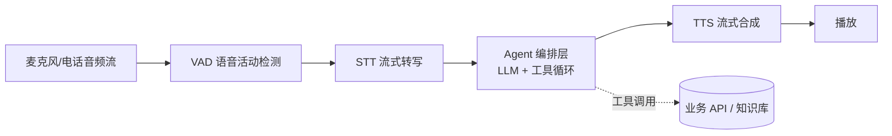
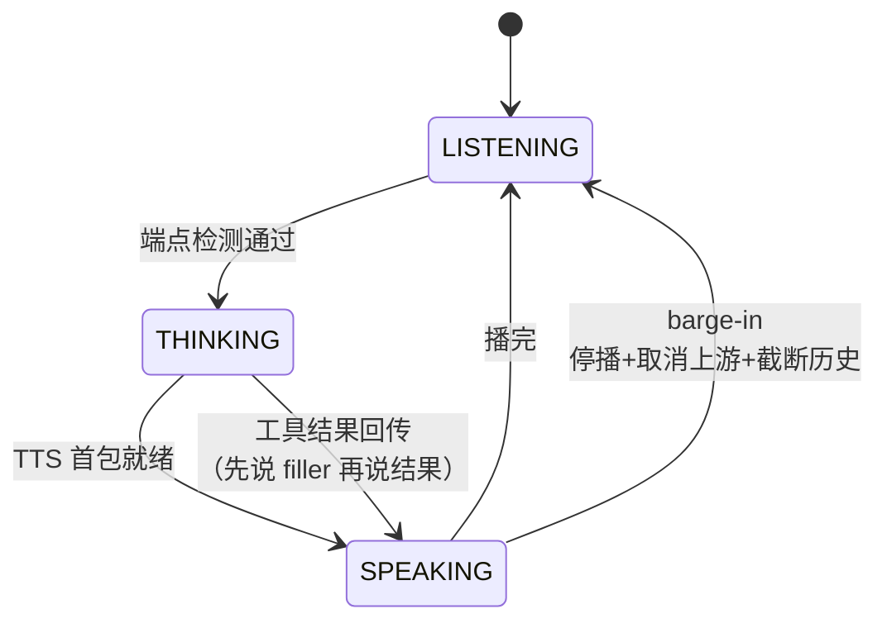

# Voice / Realtime Agent

> 最后修改时间：2026-11-07 13:30

> 状态：✅ 已补齐（2026-11-07）  
> 一句话定义：语音进、语音出的低延迟对话 Agent；核心工程题是级联 vs 端到端选型、打断（barge-in）处理、端到端延迟预算与工具循环瘦身。

## 大纲

1. [级联管道 vs 端到端 Realtime](#一级联管道-vs-端到端-realtime)
2. [Realtime API 形态](#二realtime-api-形态)
3. [barge-in、VAD 与延迟预算](#三barge-invad-与延迟预算)
4. [与文本 Agent 状态机的统一](#四与文本-agent-状态机的统一)
5. [成本与选型](#五成本与选型)
6. [端到端落地示例：四周迭代](#六端到端落地示例四周迭代)

## 已有相关文档（先读这些）

- [Agent 协议与形态前沿](../../Agent开发知识/13-进阶与工程化/10-Agent协议与形态前沿.html)（本篇是其第 3 节「语音 / 实时 Agent」的深挖版）
- [流式输出工程](../02-应用形态/04-流式输出工程.html)（SSE/WS 协议取舍、TTFT、流式 tool call 状态机——语音篇全程复用其结论）
- [语义缓存](../03-检索与知识/05-语义缓存.html)（语音客服的延迟与成本优化同样吃语义缓存的红利）
- [多模态基础](../../AI知识库/13-多模态/01-多模态基础.html)（语音作为模态的定位）
- [OpenAI](../../Agent开发知识/10-框架与工具/OpenAI.html)（Realtime API 所属的厂商 SDK 体系）

## 学习要点（读后应能回答）

- 级联管道和端到端 Realtime 各适合什么场景？怎么选？→ 见 [1.3](#13-取舍表与选型直觉)
- 为什么语音与工具调用能在同一连接里并存？→ 见 [2.2](#22-事件模型语音与工具调用并存)
- 用户一插话，系统要做哪三件事才算处理完打断？→ 见 [3.2](#32-barge-in-的三件事)
- 端到端 1 秒内的延迟账怎么拆？大头在哪一段？→ 见 [3.3](#33-延迟预算端到端-1-秒内的分解账)
- 优化端到端延迟，为什么先动「等待」而不是「推理」？→ 见 [3.3](#33-延迟预算端到端-1-秒内的分解账)
- 语音场景为何比文本更难做长工具链？→ 见 [4.2](#42-为什么工具循环要短)
- 电话场景和 App 内 RTC 场景，工程差异在哪？→ 见 [5.3](#53-电话-vs-rtc-场景差异)

---

## 一、级联管道 vs 端到端 Realtime

### 1.1 级联管道：三段流水线

级联（ **cascaded** /kæsˈkeɪd/ ，串联的多段流水线）管道是语音 Agent 的经典形态：把对话拆成「听懂 → 思考 → 说出」三段，每段独立建模、独立替换：



级联的最大好处是 **每一段都可观测、可替换、可单独降级** ：

- STT 出错率可以单独统计（字错率）、可以加热词、可以换供应商，不影响 LLM 段；
- LLM 段完全复用文本 Agent 的那套编排层（工具循环、护栏、缓存，见 [04 篇](../02-应用形态/04-流式输出工程.html) 的流式 tool call 状态机）；
- TTS 段可以按「首包延迟」与「音色成本」独立选型，坏了就降级为「转文字短信」。

代价是 **误差级联** （error cascade）：STT 认错的每个字都原样喂给 LLM——「我要退货」被听成「我要退款」，后面全错。且三段串行相加，延迟天然比端到端高。

### 1.2 端到端 Realtime：语音进、语音出

端到端（ **end-to-end** /end tuː end/ ，单一模型直通输入输出）Realtime 形态，以 OpenAI Realtime API 为代表：音频流直接进模型，模型直接输出音频流，中间不再有显式的 STT/LLM/TTS 三段。模型「听到」的是原始音频，能保留语气、停顿、笑声等韵律（ **prosody** /ˈprɒsədi/ ，韵律，语音的节奏与语调特征）。

它的三个结构性特征：

1. **同一连接里语音与工具调用并存** ：模型边说话边决定调工具（下一节展开）；
2. **延迟显著更低** ：省掉了 STT 尾字等待与 TTS 首包两大段串行；
3. **可观测性变差** ：没有独立的 STT 输出可以统计字错率，转写只是模型的内部产物；护栏也更难做——文本护栏拦「说出来的字」，语音还要考虑「语气」这个维度。

### 1.3 取舍表与选型直觉

| 维度 | 级联管道 | 端到端 Realtime |
|------|----------|-----------------|
| 端到端延迟 | 三段串行，优化后 p95 可压到 1s 内 | 天然更低（省两段首尾），语音进语音出 |
| 可观测性 | 每段独立埋点，STT 字错率可单独统计 | 转写是模型内部产物，归因难 |
| 可控性 | 每段可换供应商、可加热词/方言包 | 绑定单一厂商，音色与识别行为难单独调 |
| 护栏 | 文本护栏可拦截后再念出 | 边生成边说，拦截窗口更小 |
| 成本 | 各段便宜组件拼装，量大时可控 | 按 audio token 计费，单分钟成本显著更高（见第五节） |
| 工具循环 | 复用文本 Agent 编排层，成熟 | 工具在语音会话内执行，循环控制更紧 |
| 韵律自然度 | TTS 平铺，情感有限 | 保留语气停顿，接近真人 |

**选型直觉** （也是小北最终采用的路线）：

- **客服、IVR、外呼等任务型场景 → 级联** 。要可观测、要控成本、要对接知识库与工单系统，容错的是「略微机械」而不是「答错」；
- **陪伴、口语陪练、情绪疏导等体验型场景 → 端到端 Realtime** 。要韵律、要自然、要「像人」，能接受更高单价；
- 两者不互斥：同一 Agent 编排层（第四节）可以同时挂文本、级联语音、Realtime 三种通道，按渠道灰度。

**落地示例** ：级联管道核心类型（Node.js + TS，可跑通的形状）：

```typescript
// ===== voice/pipeline.ts =====
// 级联管道：音频流 → STT 流 → Agent 回合 → TTS 流 → 播放
export interface AudioChunk {
  pcm: Int16Array;
  sampleRateHz: 8000 | 16000 | 48000; // 电话窄带 vs RTC 全带，见 5.3
  ts: number;                          // 采集时间戳，用于延迟归因
}

export interface SttPartial {
  text: string;
  isFinal: boolean;    // true = 本句转写定稿
  stability: number;   // 0–1，部分转写的稳定度，投机启动的依据
}

export interface SttStream {
  write(chunk: AudioChunk): void;
  onPartial(cb: (p: SttPartial) => void): void; // 流式部分转写
  finish(): Promise<string>;                    // 本句最终转写
}

export interface TtsStream {
  speak(text: string): AsyncIterable<{ audio: Int16Array; isLast: boolean }>;
  stop(): void; // barge-in 时清空待播队列，见 3.2
}

export async function runVoiceTurn(
  audio: AsyncIterable<AudioChunk>,
  stt: SttStream,
  agent: (text: string) => Promise<string>, // 统一 Agent 编排层，见第四节
  tts: TtsStream,
): Promise<void> {
  for await (const chunk of audio) stt.write(chunk);

  const text = await stt.finish();          // 优化点：不等最终稿，用高稳定部分转写投机启动
  const reply = await agent(text);          // LLM + 工具循环，与文本通道同一套
  for await (const seg of tts.speak(reply)) {
    await play(seg.audio);                  // 边合成边播，不等整段
  }
}
```

## 二、Realtime API 形态

### 2.1 WebSocket vs WebRTC

Realtime API 的两端协议选型，正好是 [流式输出工程](../02-应用形态/04-流式输出工程.html) 第 1 节「文本用 SSE、双向才上 WS」结论的语音版延伸——语音既要持续上行音频，又要下行播放， **必然是双向连接** ，问题只剩 WS 还是 WebRTC（ **WebRTC** /ˈweb ɑːr tiː siː/ ，Web Real-Time Communication，浏览器原生的实时音视频通信协议栈）：

| 维度 | WebSocket | WebRTC |
|------|-----------|--------|
| 传输 | TCP 之上，可靠有序 | UDP 之上（SRTP），容忍丢包、低抖动 |
| 延迟 | 稳定但受 TCP 队头阻塞影响 | 更低，专为实时媒体设计 |
| 客户端 | 任何能开 WS 的环境 | 浏览器/端上原生支持，服务端接入需额外网关 |
| 媒体处理 | 音频编码、抖动缓冲（ **jitter buffer** /ˈdʒɪtər ˈbʌfər/ ，抖动缓冲，抗网络抖动的收包队列）自己搭 | 内建 AEC、AGC、降噪、Opus 编码 |
| 适用 | 服务端到模型厂商的中继段 | 浏览器/手机端到服务端的用户段 |

工程上的标准组合是 **两段式** ：用户端 ↔ 你的服务端用 WebRTC（白拿端上回声消除与编解码），你的服务端 ↔ 模型厂商用 WebSocket/SDK（复用鉴权与计费基建）。两段之间插入业务逻辑（鉴权、埋点、缓存、工具执行）。

### 2.2 事件模型：语音与工具调用并存

Realtime API 不是「一段音频进、一段音频出」，而是 **事件流** ：客户端持续送音频事件，服务端回吐「转写事件 + 音频事件 + 工具调用事件」的混合流。关键在于： **模型可以边说话边发起工具调用** ——说「我帮您查一下订单」的同时发出 tool call，工具结果回来后接着说「您的订单昨天已发货」。

与文本流式 tool call（[04 篇](../02-应用形态/04-流式输出工程.html) 第 3 节）对照，语音场景多了两条规则：

1. **工具执行期间不能冷场** ：文本场景工具跑 3 秒用户还在看屏幕，语音场景 3 秒静音等于「挂了」。必须先说一句过场话（filler，见 4.2）再进工具循环；
2. **打断会切断工具流** ：用户在工具执行期间插话（「算了不查了」），必须同时取消挂起的工具调用，否则查完的结果接在错误的话轮后面。

**落地示例** ：Realtime 事件分发骨架（Node.js + TS）：

```typescript
// ===== realtime/events.ts =====
type RealtimeEvent =
  | { type: "input_audio_buffer.speech_started" }        // VAD：用户开口 → 触发 barge-in
  | { type: "input_audio_buffer.speech_stopped" }        // 端点检测：用户说完
  | { type: "conversation.item.input_audio_transcription.completed"; transcript: string }
  | { type: "response.audio_transcript.delta"; delta: string }  // 回答的文本增量
  | { type: "response.output_item.added"; item: { type: "function_call"; name: string; callId: string } }
  | { type: "response.function_call_arguments.done"; callId: string; arguments: string }
  | { type: "response.audio.delta"; audio: Buffer };     // 回答的音频增量

export function handleRealtimeEvent(ev: RealtimeEvent, session: VoiceSession): void {
  switch (ev.type) {
    case "input_audio_buffer.speech_started":
      session.bargeIn();                     // 见 3.2：停播 + 取消上游 + 截断历史
      break;
    case "response.function_call_arguments.done":
      // arguments 已给全（与文本流式不同，这里等 done 事件再解析）
      void session.executeTool(ev.callId, ev.name, JSON.parse(ev.arguments));
      break;
    case "response.audio.delta":
      session.playback.push(ev.audio);       // 边收边播
      break;
    // 其余事件按需埋点：转写、音频增量都进延迟归因面板
  }
}
```

## 三、barge-in、VAD 与延迟预算

### 3.1 VAD 与端点检测

一切从两个「听」的问题开始：

- **VAD** /ˌviː eɪ ˈdiː/ （Voice Activity Detection，语音活动检测）：判断此刻是「人在说话」还是「安静/噪声」。这是 **持续** 判断，逐帧输出；
- **端点检测** （ **endpointing** /ˈendpɔɪntɪŋ/ ，端点检测，也叫 end-of-turn detection）：判断「这一轮说完了」。这是 **离散** 判断，决定何时把音频交给 LLM。

端点检测是语音 Agent 最隐蔽的体验杀手，它本质是在押注 **静音多长算说完** ：

| 策略 | 静音阈值 | 感受 | 小北教训 |
|------|----------|------|----------|
| 固定短阈值 | 300ms | 反应快，但「呃——让我想想」被切断 | 假打断率 18% |
| 固定长阈值 | 900ms | 不切断，但每轮都多等近 1 秒 | 延迟预算直接爆表 |
| 自适应阈值 | 按说话速度/上下文动态 350–600ms | 平衡点 | p95 端点延迟 300ms |

更进一步的 **语义端点检测** ：不用静音时长，而用一个小模型判断「这句话在语法/语义上完了吗」——「我要查一下」（没说完）与「我要查一下最近的订单」（说完）。研究界称之为 turn-taking 问题（话轮转换，见参考资料 Skantze 2021），对话系统的传统结论依然适用： **端点阈值值得用真实通话录音标定，而不是拍一个数** 。

### 3.2 barge-in 的三件事

**barge-in** /bɑːrdʒ ɪn/ （用户打断，语音还没说完就被插话）是语音 Agent 区别于文本 Agent 的标志性难题。文本场景用户「打断」只是点个停止按钮；语音场景用户直接开口说话，而系统正在播放 TTS—— **播放出去的声音会经麦克风绕回来** ，VAD 听到的是「用户和 TTS 混在一起的声音」，不做处理就会自己打断自己。

一次正确的 barge-in 必须做完三件事，缺一不可：

1. **立即停止播放** （并做回声消除）： **AEC** /ˌeɪ iː ˈsiː/ （Acoustic Echo Cancellation，声学回声消除）把播放出去的声音从拾音里减掉，VAD 才可能听到真正的用户声音。浏览器/WebRTC 端自带 AEC；电话链路没有，必须网关侧补；
2. **级联取消上游** ：与文本流式的取消逻辑（[04 篇](../02-应用形态/04-流式输出工程.html) 4.1）一致——停播的同时 abort 上游 LLM 生成与 TTS 合成， **不取消就是白烧 token** ，且被取消的生成若不清理，会接在错误话轮后面输出；
3. **截断历史** ：被打断的半句话要按实际「用户听到哪里」截断后写回会话历史，标注 `interrupted`——否则下一轮模型的上下文里存在一句用户从没听完整的话，越聊越错乱。

**落地示例** ：话轮状态机与 barge-in 处理（Node.js + TS）：



```typescript
// ===== voice/turn.ts =====
type VoiceState = "LISTENING" | "THINKING" | "SPEAKING";

export class VoiceTurnManager {
  private state: VoiceState = "LISTENING";
  private abort = new AbortController();

  constructor(
    private vad: { isSpeech(c: AudioChunk): boolean },
    private tts: { stop(): void },
    private history: { truncateAt(heardUntilMs: number): void },
  ) {}

  onUserAudio(chunk: AudioChunk): void {
    if (this.state === "SPEAKING" && this.vad.isSpeech(chunk)) {
      this.bargeIn(chunk.ts);          // AEC 之后再判，避免 TTS 自己触发
    }
  }

  private bargeIn(heardUntilMs: number): void {
    this.tts.stop();                   // 1. 停播
    this.abort.abort();                // 2. 级联取消上游 LLM/TTS，止损 token
    this.history.truncateAt(heardUntilMs); // 3. 按「用户实际听到哪」截断历史
    this.state = "LISTENING";
  }
}
```

### 3.3 延迟预算：端到端 1 秒内的分解账

这是文首核心问题之一。用户对「对话应答」的延迟容忍约 1 秒（人类对话的自然话轮间隙约 200–500ms，超过 1s 明显冷场）。小北把端到端应答延迟（用户说完 → Agent 出声）按环节拆账（ **实测口径** ：小北生产环境 7 日 p50/p95，非厂商宣称值）：

| 环节 | 优化前 p95 | 优化后 p95 | 手段 |
|------|-----------|-----------|------|
| 端点检测（静音阈值） | 900ms（固定长阈值） | 300ms | 自适应阈值 350–600ms |
| 上行网络 | 80ms | 60ms | 就近接入点 |
| STT 出可用转写 | 900ms（说完才出全文） | 180ms | 流式部分转写 + 高稳定度即投机启动 |
| LLM 首字（TTFT） | 600ms | 320ms | prompt 瘦身 + 语义缓存命中跳过生成 |
| TTS 首包音频 | 450ms（整段合成完才播） | 90ms | 流式 TTS + 按句切分，首句先合成 |
| 播放缓冲 | 60ms | 50ms | jitter buffer 调小 |
| **合计（出声）** | **≈ 2,990ms** | **≈ 1,000ms** | —— |

注意两点：

1. **表是串行相加口径，实际存在重叠** ：LLM 在 STT 高稳定度部分转写上投机启动，TTS 与 LLM 的后续 token 流水并行，所以小北实测端到端 p95 为 0.95s，比账面相加还略好；
2. **优化前的大头是「等」而不是「算」** ：等用户说完（固定 900ms 静音阈值）+ 等整段转写 + 等整段合成，三个「等」合计约 2.2s。流式化的本质就是把三个「等」变成「边进边出」——这与文本流式篇「TTFT 优先于 E2E」的结论完全同构。

## 四、与文本 Agent 状态机的统一

### 4.1 语音只是另一个通道

最重要的架构结论： **语音前端应该复用同一套 Agent 编排层，而不是另写一套「语音版 Agent」** 。级联管道里，STT 的最终转写就是一条文本消息；TTS 的输入就是回复文本。于是：

```text
文本聊天通道：  用户文本 ──┐
语音级联通道：  STT 转写 ──┼──> 统一 Agent 编排层（工具循环/护栏/缓存）──> 回复文本
Realtime 通道： 转写事件 ──┘                                      ├──> 渲染成 Markdown（文本）
                                                                └──> 送 TTS（语音）
```

统一后的收益是复用 [流式输出工程](../02-应用形态/04-流式输出工程.html) 第 3 节的整套 tool call 状态机、[护栏产品化](../06-安全与评测/02-护栏产品化.html) 的审核链与语义缓存——小北的语音客服与网页文本客服共用同一个 `runAgentTurn`，工具、知识库、缓存全部一致，只是渲染端不同。

**落地示例** ：统一通道适配器（Node.js + TS）：

```typescript
// ===== agent/turn.ts =====
export interface AgentTurnInput {
  channel: "text" | "voice";
  text: string;                      // 文本消息或 STT 最终转写
  session: SessionState;
  budget: { maxToolHops: number; deadlineMs: number }; // 语音通道更紧，见 4.2
}

export interface AgentTurnOutput {
  reply: string;                     // 文本通道渲染 Markdown，语音通道送 TTS
  steps: StepEvent[];                // 进度事件：文本渲染 checklist，语音转 filler 话术
  handoff?: "human";                 // 超时/低置信 → 转人工
}

export async function runAgentTurn(input: AgentTurnInput): Promise<AgentTurnOutput> {
  const budget = input.channel === "voice"
    ? { maxToolHops: 2, deadlineMs: 4_000 }   // 语音预算砍半
    : { maxToolHops: 6, deadlineMs: 30_000 }; // 文本预算宽松
  return orchestrate(input, budget);          // 同一套编排核心
}
```

### 4.2 为什么工具循环要短

这是占位文遗留的学习问题，答案是 **体验账** ：文本用户等 15 秒能接受（有「正在查询…」的视觉进度），电话用户等 15 秒会认为系统死了——挂断率随静音时长陡增。三条工程约束：

1. **工具跳数上限** ：语音通道把 `maxToolHops` 砍到 2。多跳规划类任务（查订单 → 查物流 → 查退款政策）改为 **预取并联** ：识别到「退货+订单号」意图时一次并行调两个工具，而不是串行三跳；
2. **每跳都有预算** ：工具调用设置硬超时（800ms/跳），超时不说「查不到」就说 filler 转人工——宁可不答，不能冷场；
3. **filler 兜底** ：进任何 > 500ms 的工具执行前，先让 TTS 说一句过场话（「我帮您查一下，稍等」）。filler 不是装饰，它把「静音 2 秒」改写成「回应 0.3 秒 + 静音 1.7 秒」，主观等待感完全不同。这与文本流式篇的「步骤级 UI 事件」是同一原则的语音化身： **文本通道用进度条填空窗，语音通道用过场话填空窗** 。

反例警示：小北 W3 之前语音通道直接复用了文本的 6 跳工具循环，遇到「帮我看看我上次买的东西能不能退」这种模糊问题，Agent 串了 4 跳工具，用户在电话里等了 11 秒后挂断—— **语音场景下「正确但慢」等于错误** 。

## 五、成本与选型

### 5.1 STT 选型

| 维度 | 看什么 | 行业常见量级（实测口径，2025–2026） |
|------|--------|----------------------------------|
| 流式 vs 批式 | 语音对话必须流式（部分转写）；录音转写用批式（更准更便宜） | 流式通常比批式贵 20–50% |
| 字错率 **CER** /ˌsiː iː ˈɑːr/ （Character Error Rate，字错率，中文 ASR 的核心精度指标） | 电话窄带 5–8%，RTC 全带 2–4%（中文，通用领域） | 热词/领域优化后可再降 1–2 个百分点 |
| 价格 | 云端流式约 ¥1.5–4/小时 或 $0.005–0.01/分钟 | 本地部署按卡算，量大才划算 |
| 延迟 | 部分转写首字 < 300ms，最终稿 < 500ms/句 | 决定能否投机启动（3.3） |
| 定制能力 | 热词、方言、行业词表 | 客服场景「工单/退款/DSLR」类专有词必须进热词 |

### 5.2 TTS 选型

| 维度 | 看什么 | 行业常见量级（实测口径） |
|------|--------|------------------------|
| 首包延迟 | 首包音频 < 200ms 才能进延迟预算 | 流式 TTS 首包 80–200ms |
| 音色与情感 | 预置音色便宜；克隆音色一次性授权 + 溢价 | 克隆音色贵 2–10 倍 |
| 价格 | 约 ¥0.2–2 / 万字 | 按字符计费，长欢迎语别浪费 |
| 可控性 | SSML（Speech Synthesis Markup Language，语音合成标记语言）控制停顿/重音； **是否支持边流边播、可打断** | 不可打断的 TTS 直接出局（barge-in 硬依赖） |

MOS（Mean Opinion Score，平均意见分，合成音质的主观评分 1–5）可作为验收指标，但 **线上应以「打断后用户继续说下去的比例」为金标准** ——听得下去才会插话。

### 5.3 电话 vs RTC 场景差异

同一套级联管道，电话（PSTN）与 App/网页 RTC 场景的工程参数完全不同：

| 维度 | 电话（PSTN） | App/网页 RTC（WebRTC） |
|------|-------------|------------------------|
| 音频带宽 | 8kHz 窄带（300–3400Hz） | 16–48kHz 宽带/全带 |
| 编解码 | G.711 等 | Opus 48kHz |
| 回声消除 | 链路无 AEC， **网关侧必须补** ，否则假打断 | 端上自带 AEC/AGC/降噪 |
| 中文 CER 量级 | 5–8%（窄带+信道噪声） | 2–4% |
| 单向上行延迟 | 高（100–300ms + 运营商抖动） | 低（50–100ms） |
| barge-in 难度 | 高：回声喂回 VAD 造成假打断 | 低 |
| 合规 | 录音告知、外呼时段、频控 | 隐私协议、麦克风权限 |

小北踩过的坑：电话网关没配 AEC，TTS 一出声 VAD 就判定「有人说话」，打断率虚高到看起来像 bug—— **电话场景先修 AEC，再谈端点阈值** 。

### 5.4 级联 vs Realtime 的成本账

以小北的客单（平均通话 3 分 40 秒 ≈ 3.67 分钟）粗算（ **实测口径** ：量级参考，具体单价随厂商浮动）：

| 方案 | 单通成本估算 | 说明 |
|------|-------------|------|
| 级联（STT + mini 级 LLM + TTS） | ≈ ¥0.22 | STT ¥0.08 + LLM ¥0.06（语义缓存命中 23% 再省）+ TTS ¥0.08 |
| 端到端 Realtime（audio token 计费） | ≈ ¥0.7–2.6 | 按 $0.03–0.1/分钟量级折算，随音频输入输出占比浮动 |

**级联方案约省 3–10 倍** ，这正是任务型场景选级联的第二个理由（第一个是可观测）。日均 1,200 通下，两个方案的月成本差约 ¥1.7 万–8.5 万，量级足以决定选型。

## 六、端到端落地示例：四周迭代

把贯穿案例「小北的语音客服」排进四周。背景：SaaS 公司售后电话客服，日均 1,200 通来电，平均通话 3 分 40 秒，人工坐席 12 人已满负荷。

### 6.1 基线（改造前）

| 指标 | 基线值 | 口径 |
|------|--------|------|
| 端到端应答延迟 p95 | 2.8s | 用户说完 → Agent 出声（3.3 的分解账） |
| 中文 CER（电话窄带） | 6.8% | 500 通抽检人工标注 |
| 有效打断率 | 9% | barge-in 成功（其余 22% 为回声假打断） |
| 一次解决率 | 54% | 无需转人工、24h 内无重复来电 |
| 转人工率 | 22% | —— |
| 单通成本 | ¥0.38 | 批式 STT + 非流式 LLM + 整段 TTS |

### 6.2 四周计划

| 周 | 动作 | 产出 | 指标变化 |
|----|------|------|----------|
| W1 | 全链路流式化：流式 STT（部分转写）+ 流式 TTS（按句切分）+ 端点自适应阈值（350–600ms，用 500 通历史录音标定） | 延迟账每环节埋点面板 | p95 2.8→1.4s；CER 6.8→5.2%（换流式窄带模型+热词） |
| W2 | 电话网关补 AEC；barge-in 三件事落地（停播/级联取消/截断历史）；假打断过滤（回声特征识别） | 可打断的对话体验 | 有效打断率 9%→18%，假打断 22%→4% |
| W3 | 统一 Agent 编排层接入：语音通道工具循环砍到 2 跳 + 并联预取 + filler 话术 + 语义缓存复用（见 [语义缓存](../03-检索与知识/05-语义缓存.html)，FAQ 命中 23%） | 与文本客服共用 `runAgentTurn` | p95 1.4→0.95s；一次解决率 54%→67% |
| W4 | 灰度 20%→100%；转人工兜底（LLM 置信低/用户爆粗/静音 8s）；成本账单分渠道拆分 | 全量上线 + runbook | 转人工率 22%→12%；单通 ¥0.38→¥0.22 |

### 6.3 结果与账单

| 指标 | 改造前 | 改造后 | 变化 |
|------|--------|--------|------|
| 端到端应答延迟 p95 | 2.8s | **0.95s** | −66% |
| 中文 CER | 6.8% | 4.1% | 热词 + 流式窄带模型 |
| 有效打断率 | 9% | 18% | 打得断了，且假打断被滤掉 |
| 一次解决率 | 54% | 71% | 缓存 + 工具并联 |
| 转人工率 | 22% | 12% | 坐席人力等量承接话务量 +60% |
| 单通成本 | ¥0.38 | ¥0.22 | 月省约 ¥5,800（1,200 通 × ¥0.16 × 30） |

### 6.4 复盘：三条反直觉的教训

- **先修链路，再调模型** ：W2 的 AEC 与打断处理对体验的提升（假打断 22%→4%）比换任何更大的模型都显著——语音工程的上半场是音频链路工程，不是 LLM 工程；
- **延迟的大头永远是「等」** ：3.3 的分解账里，优化掉的近 2 秒几乎全部来自等待（等说完/等转写/等合成），模型本身的推理时间只占小头——先流式化，再谈换模型；
- **语音与文本共用编排层是纪律，不是技巧** ：一旦允许「语音版 Agent」单独长出工具逻辑，缓存、护栏、埋点立刻分叉——W3 之前小北的两套代码已经出现过「同一次解决率口径对不上」的事故，统一到 `runAgentTurn` 才根治。

## 自检清单

- [ ] 能说清级联 vs 端到端的取舍：任务型选级联（可观测/省 3–10 倍成本），体验型选 Realtime（韵律/低延迟）；
- [ ] 端点检测阈值用真实通话录音标定过，而不是拍一个固定静音秒数；
- [ ] barge-in 三件事齐全：AEC 后停播、级联取消上游（止损 token）、按「用户听到哪」截断历史；
- [ ] 端到端延迟有分解账（端点/网络/STT/LLM TTFT/TTS 首包/缓冲），每环节有 p95 埋点，优化打大头（「等」）而不是「算」；
- [ ] 语音与文本共用同一 Agent 编排层（工具循环/护栏/缓存），语音通道工具跳数与 deadline 单独收紧；
- [ ] 任何 > 500ms 的工具执行前先说 filler，不允许电话里出现裸静音；
- [ ] 电话场景网关侧补 AEC，假打断率单独统计（不与有效打断混在一个指标里）；
- [ ] STT 有热词与 CER 抽检机制，TTS 选型验证过「可打断」，转人工兜底条件明确（低置信/情绪/长静音）。

## 本文缩写

| 缩写 | 音标 | 全拼 | 中文 |
|------|------|------|------|
| **AEC** | /ˌeɪ iː ˈsiː/ | Acoustic Echo Cancellation | 声学回声消除 |
| **CER** | /ˌsiː iː ˈɑːr/ | Character Error Rate | 字错率 |
| **IVR** | /ˌaɪ viː ˈɑːr/ | Interactive Voice Response | 交互式语音应答 |
| **LLM** | /ˌel el ˈem/ | Large Language Model | 大语言模型 |
| **MOS** | /mɒs/ | Mean Opinion Score | 平均意见分 |
| **SSML** | /ˈes es em ˈel/ | Speech Synthesis Markup Language | 语音合成标记语言 |
| **STT** | /ˌes tiː ˈtiː/ | Speech-To-Text | 语音转文本 |
| **TTS** | /ˌtiː tiː ˈes/ | Text-To-Speech | 文本转语音 |
| **VAD** | /ˌviː eɪ ˈdiː/ | Voice Activity Detection | 语音活动检测 |
| **WebRTC** | /ˈweb ɑːr tiː siː/ | Web Real-Time Communication | 网页实时通信 |

## 参考资料

- [OpenAI Realtime API Guide](https://platform.openai.com/docs/guide/realtime)（语音进语音出、事件模型与工具调用并存）
- [OpenAI Realtime WebRTC Guide](https://platform.openai.com/docs/guides/realtime-webrtc)（WebRTC 接入形态与两段式架构）
- [Deepgram Streaming Speech-to-Text](https://developers.deepgram.com/docs/streaming)（流式 ASR 的部分转写与端点检测语义）
- [阿里云智能语音交互 · 实时语音识别](https://help.aliyun.com/zh/intelligent-speech-interaction/)（中文流式 ASR、热词与电话窄带场景）
- Skantze, G. (2021). *Turn-taking in conversational systems and human-robot interaction*. Philosophical Transactions of the Royal Society B. <https://royalsocietypublishing.org/doi/10.1098/rstb.2020.0037>（话轮转换与端点检测的理论基础）
- Heldner, M. & Edlund, J. (2010). *Pauses, gaps and overlaps in conversations*. Journal of Phonetics. <https://doi.org/10.1016/j.wocn.2010.04.002>（自然对话话轮间隙 200–500ms 的实证来源）
- [LiveKit Agents Docs](https://docs.livekit.io/agents/)（开源 RTC 语音 Agent 框架，WebRTC 用户段的标准实现）
- [Pipecat Docs](https://docs.pipecat.ai/)（开源级联语音 Agent 编排框架，管道抽象可对照本文 1.1）
