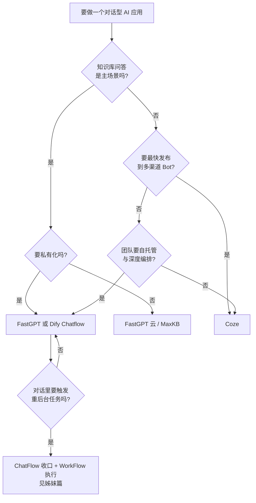
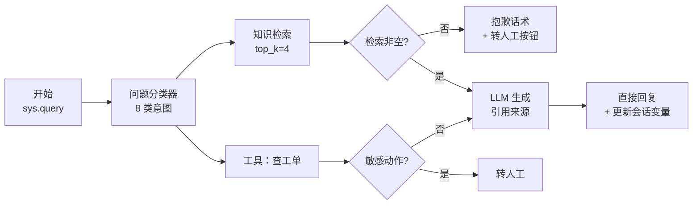

# ChatFlow 工具深挖（总纲与索引）

> 最后修改时间：2026-11-07 13:30

> 状态：✅ 已补齐（2026-11-07）  
> 一句话定义：把 **Dify Chatflow** /ˈdɪfaɪ tʃæt fləʊ/ 、**Coze（扣子）** /kəʊz/ 、**FastGPT** /fɑːst ˈdʒiː piː ˈtiː/ 等会话型编排工具拆成「会话 → 编排 → 知识/工具 → 渠道」四条主线，讲清每个工具在什么场景该上、怎么搭、什么时候该从低代码迁到代码级。

> 本页定位：**总纲 + 索引**。既是可直接学的正文，也是后续拆到 `posts/AI/ChatFlow/` 的成文计划（见 [十二](#十二成文计划后续拆分到-chatflow-目录)）。姊妹篇是 [WorkFlow 工具深挖索引](06-WorkFlow工具深挖索引.html)，两篇结构对称：那边讲「没人说话、系统自己在跑」的流水线，这边讲「有人跟它说话」的对话编排。

## 大纲

1. [为什么要单独深挖 ChatFlow 工具](#一为什么要单独深挖-chatflow-工具)
2. [工具地图与选型](#二工具地图与选型)
3. [Dify Chatflow 深挖](#三dify-chatflow-深挖)
4. [Coze（扣子）深挖](#四coze扣子深挖)
5. [FastGPT 深挖](#五fastgpt-深挖)
6. [三家横向对比与选型口径](#六三家横向对比与选型口径)
7. [从低代码迁到代码级](#七从低代码迁到代码级)
8. [生产工程化清单](#八生产工程化清单)
9. [端到端落地示例：四周迭代](#九端到端落地示例四周迭代)
10. [自检清单](#十自检清单)
11. [学习要点](#十一学习要点)
12. [成文计划：后续拆分到 ChatFlow 目录](#十二成文计划后续拆分到-chatflow-目录)

## 已有相关文档（先读这些）

- [什么是 ChatFlow](../../ChatFlow/00-什么是ChatFlow.html)（概念边界：Session / Orchestration / Knowledge / Tools / Channels）
- [ChatFlow 主流工具全景](../../ChatFlow/01-主流工具全景.html)（选型速查，本篇是它的深挖版）
- [WorkFlow 工具深挖索引](06-WorkFlow工具深挖索引.html)（姊妹篇：触发式流水线编排，与本篇互相引用）
- [形态选型决策树](../02-应用形态/02-形态选型决策树.html)（Chatbot / WorkFlow / Agent 三选一）
- [Chatbot 概念与形态演进 · 本系列](../02-应用形态/01-Chatbot概念与形态演进.html)（对话形态的前置认知）
- [语义缓存](../03-检索与知识/05-语义缓存.html)（第 8.5 节成本优化的本仓库长文）
- [人在环上 HITL](../04-Agent与编排/01-人在环上HITL.html)（转人工环节的方法论）
- [Token 成本估算](../05-工程与生产/02-Token成本估算.html)（第 8.5 节的计算口径）
- [Prompt Injection 深挖](../06-安全与评测/01-Prompt-Injection深挖.html)（对话输入是不可信输入）

## 学习要点（读后应能回答）

- ChatFlow 与 WorkFlow 的分工边界到底在哪？→ 见 [1.1](#11-会话型编排的三层抽象)
- 低代码 ChatFlow 上了生产会怎么崩？→ 见 [1.2](#12-低代码-chatflow-在生产上崩掉的三个真实数字)
- Dify 的会话变量怎么管多轮状态？→ 见 [3.1](#31-会话变量与多轮状态)
- Coze 的插件、数据库和长期记忆分别解决什么？→ 见 [4.1](#41-bot-智能体与插件生态) 与 [4.2](#42-工作流嵌套数据库与长期记忆)
- FastGPT 的 QA 拆分强在哪，标注怎么回流？→ 见 [5.1](#51-知识库-qa-导向与-qa-拆分) 与 [5.3](#53-highlight-标注与甩锅到人工)
- 三家到底怎么选？→ 见 [6.1](#61-六维对比表)
- 什么时候该从低代码迁到代码级？→ 见 [7.1](#71-五个迁移动信号)
- 一个人四周怎么把知识库客服落地？→ 见 [九](#九端到端落地示例四周迭代)

---

## 一、为什么要单独深挖 ChatFlow 工具

### 1.1 会话型编排的三层抽象

**ChatFlow** /tʃæt fləʊ/ （会话型编排，对话驱动的可视化流程）类工具看着也都是「拖拽画布」，内核同样分三层，但分层方式和 WorkFlow 不同——它的第一层不是图，而是**会话状态**：

| 层 | 负责什么 | 典型实现 | 出问题时的表现 |
|------|----------|----------|----------------|
| **会话层（Session）** /ˈseʃən/ | 多轮历史、会话变量、**槽位（Slot）** /slɒt/ （对话中待填的参数位）、长期记忆 | Dify 会话变量、Coze 数据库与记忆、自建 Session Store | 第 5 轮忘了第 2 轮说过的话、两个用户互相看到对方的上下文 |
| **编排层（Orchestration）** | 意图分类、条件分支、知识检索、工具调用、子流程 | Dify 画布节点、Coze 工作流、FastGPT 编排 | 该转人工的不转、检索到了却答非所问 |
| **渠道与运营层（Channel / Ops）** | 发布到 Web / IM、日志、标注、灰度 | Dify WebApp / API、Coze 渠道发布、FastGPT 站点 | 改一版提示词全量生效，线上行为突变没人知道 |

和 WorkFlow 篇同一个结论换个位置：**WorkFlow 的事故大多出在运行时（幂等、重试、执行历史），ChatFlow 的事故大多出在会话层（状态串号、上下文膨胀、记忆污染）**。画布画得再漂亮，会话隔离和评测没做，上了生产就是「偶尔答非所问但查不出原因」的悬案。所以本文的重点是「会话层 + 运营层」而不是「怎么拖节点」。

**落地示例**：三条真实事故（来自同类项目复盘）——

1. 前端把「新建会话」写成了「复用上一个 conversation_id」，结果用户 A 的第 3 轮问题收到了用户 B 的上下文续写——**会话隔离缺失**，这是 ChatFlow 最典型也最致命的事故；
2. 为了「让机器人更聪明」，把历史轮数从 5 调到 20，一个月后模型账单翻了 2.4 倍，且长对话尾部信息丢失导致答非所问率反而上升——**上下文没有预算控制**；
3. 运营在画布上改了一行提示词直接发布，当天晚上「退货政策」类问题集体答错——**没有评测集、没有灰度**。

### 1.2 低代码 ChatFlow 在生产上崩掉的三个真实数字

低代码平台做对话 PoC 通常半天上线，生产阶段暴露的问题集中在三处：

1. **上下文成本**：多轮对话每一轮都携带历史，第 10 轮的单轮输入 token 是第 1 轮的 **4–6 倍**；不设轮数上限和摘要压缩，月度模型成本轻松失控；
2. **多轮评测**：单轮问答好测，多轮脚本（「先问 A、追问 B、再换话题回 A」）很难在画布上回归，多数团队**上线前一条多轮测试用例都没有**；
3. **标注回流**：对话日志里的坏例如果不回流成知识库 QA 对，同一个问题会**每天被答错 20 次**，而知识库文档从来不会自己变好。

对应地，代码级方案（自建前端 + LLM SDK + 状态管理）的成本也要摆在明面上：会话状态机要自己写、渠道适配要自己接、运营后台要自己造。**没有哪个方案在所有维度最优，只有匹配当前阶段的取舍**。

### 1.3 贯穿案例：小北的知识库客服

本文所有示例都基于这个虚构但真实感足够的场景，后面每一节都会回到它（「小北」也是本仓库 [语义缓存](../03-检索与知识/05-语义缓存.html) 一篇的主角，设定保持一致）：

| 项 | 设定 |
|----|------|
| 业务 | 400 人 SaaS 公司「北纬云」的对外产品客服（工单系统 SaaS），小北是客服团队的 AI 工程师 |
| 流量 | 日均 **900** 轮会话（促销日 2,600 轮），每轮平均 4.2 条消息，工作时段 09:00–21:00 均匀分布 |
| 知识库 | 帮助中心 + 产品制度共 **1,240** 篇文档，切片后 8,600 段；高频 10 个意图占全部请求的 **62%** |
| 现状 | 4 人客服团队 + 一个纯 RAG 直答机器人；一次解决率 **38%**，转人工率 **41%**，每次人工会话成本约 ¥3.2 |
| 目标 | 4 周内：一次解决率 ≥ **70%**、转人工率 ≤ **15%**、P95 首响 ≤ **3s**、单轮模型成本 ≤ **¥0.03**、幻觉率 ≤ **0.5%** |
| 约束 | 用户消息**不可信**；退款、注销账号类动作必须人工确认；会话日志含用户数据，必须可审计 |

这个对话应用要做的事：用户发消息 → 意图分类 → 检索知识库（或查工具：查工单状态）→ 生成回复 → 更新会话状态 → 低置信度/敏感动作转人工。

---

## 二、工具地图与选型

### 2.1 三类工具的分工

| 类别 | 代表 | 谁用 | 强在哪 | 弱在哪 |
|------|------|------|--------|----------|
| AI 应用平台 · 对话编排 | **Dify Chatflow**、**FastGPT** | AI 应用团队 / 工程师 | 编排 + 知识库 + 发布一体，可自托管 | 会话变量模型受平台抽象约束 |
| Bot 搭建平台 | **Coze（扣子）**、Botpress | 运营 / 产品 / 个人开发者 | 上手最快、插件生态最丰富、渠道发布最全 | 深度私有化与定制弱 |
| 知识库问答产品 | FastGPT、MaxKB | 知识运营 / IT | RAG 链路打磨最细，QA 粒度可控 | 通用编排与工具生态弱于前两类 |

文首学习问题的答案在这里先给一半：**知识库问答是主场景选 FastGPT，要私有化 + 编排自由度选 Dify Chatflow，要最快发布到多渠道、接受平台生态选 Coze**。另一半（什么时候三家都不该选）见 [七](#七从低代码迁到代码级)。

### 2.2 选型决策矩阵

打分 1–5 分（5 = 该维度上表现最好），用来在候选里排序，不是绝对结论（各家版本迭代快，以试用实测为准）：

| 维度 | Dify Chatflow | Coze | FastGPT |
|------|---------------|------|---------|
| 上手速度（半天出活） | 4 | 5 | 4 |
| 知识库 RAG 深度 | 4 | 3 | 5 |
| 编排自由度（分支/子流程/变量） | 5 | 4 | 3 |
| 插件与工具生态 | 3 | 5 | 2 |
| 多渠道发布 | 3 | 5 | 2 |
| 私有化友好度 | 5 | 2 | 5 |
| 运营闭环（日志/标注/灰度） | 4 | 3 | 4 |

代入「小北的知识库客服」：第一版用 **Dify Chatflow**（公司要私有化、客服数据不出内网、且编排里要接查工单的工具）；如果公司没有私有化要求、且渠道主要在微信/飞书/抖音，则第一优先是 **Coze**。

### 2.3 决策树



---

## 三、Dify Chatflow 深挖

### 3.1 会话变量与多轮状态

**Dify** /ˈdɪfaɪ/ 平台里，**Chatflow** 与 Workflow 是并列的两种应用类型：Chatflow 带会话（conversation），Workflow 不带。判断口诀沿用姊妹篇：**有人跟它说话 = Chatflow；没人说话，系统自己在跑 = Workflow**。

Chatflow 的会话状态分两类（以官方文档为准）：

| 变量类型 | 生命周期 | 典型用途 | 小北的用法 |
|----------|----------|----------|------------|
| 系统变量（sys.query、sys.conversation_id 等） | 单轮 / 平台维护 | 取当前输入、定位会话 | 用 conversation_id 做日志主键 |
| 会话变量（Conversation Variables） | **跨轮持久**，同一会话内可读写 | 存用户身份、已收集的槽位、对话阶段 | 存 `user_tier`（套餐档位）和 `ticket_no`（已查到的工单号） |

会话变量是 Dify Chatflow 相对「纯 Prompt + 记忆」最大的增量：**它把「多轮对话里的业务状态」从提示词里解放出来，变成结构化的、可在节点里赋值的字段**。没有它，你只能把「用户说要退款」塞进历史消息里让模型自己记；有了它，「是否已核身」「退款单号」就是一个可判断、可展示、可审计的字段。

**落地示例**：小北画布里的变量设计（真实感样例）：

```json
{
  "conversation_variables": [
    { "name": "user_tier", "type": "string", "value": "", "description": "用户套餐：free/pro/enterprise" },
    { "name": "ticket_no", "type": "string", "value": "", "description": "会话中已定位的工单号" },
    { "name": "identity_verified", "type": "boolean", "value": false, "description": "是否已完成身份核验" }
  ]
}
```

对应的状态流转：开场问工单号 → 变量赋值节点写 `ticket_no` → 条件分支判断 `identity_verified` → 未核身走核身话术分支。**变量让分支条件变成可测试的表达式，而不是靠模型「记得」**。

### 3.2 核心节点组合

小北客服画布的高频节点（只列对话场景特有的，通用节点见姊妹篇 4.2）：

| 节点 | 作用 | 用法要点 |
|------|------|----------|
| 问题分类器 | 意图路由 | 类别 ≤ **10** 个；每个类给 3–5 条真实例句，别只给抽象描述 |
| 知识检索 | RAG 取片段 | 设 top_k 与 score_threshold；检索结果为空必须走「抱歉话术」分支，不能硬答 |
| 条件分支 | 路由 | 条件引用会话变量与分类结果，表达式可读性优先 |
| LLM | 生成回复 | 固定角色设定 + 检索片段拼上下文；限定「只依据片段回答，没有依据就说不知道」 |
| 变量赋值 | 写会话状态 | 每个写操作都要有明确的业务含义，禁止「先存起来再说」 |
| 直接回复 | 输出 | 回复里带引用来源；敏感动作回复里固定带「已转人工」提示 |

小北客服的画布主链路：



### 3.3 标注回复（Annotation Reply）

**标注回复** /ˌænəˈteɪʃən/ 是 Dify 的运营闭环能力：运营人员对某条回复人工给出「标准答案」后，平台把「相似问题 → 标注答案」存成一对；后续用户问到语义相近的问题时，**直接返回标注答案，跳过检索与生成**。

它解决的是小北案例里最痛的一类问题：**高频问题的答错率**。促销期「怎么开发票」一天被问 80 次，第一次答错了，标注之后当天剩下的 79 次全部直出正确答案——既省 token 又零幻觉。

三条使用纪律：

1. **标注答案也要复核**：标注的人就是客服，写错一条等于放大 80 次错误，标注要经第二轮审核；
2. **相似度阈值单独调**：标注命中的阈值比 RAG 更激进也要先过评测集（方法见 [语义缓存](../03-检索与知识/05-语义缓存.html) 的阈值标定，两者是同一个问题）；
3. **标注命中也要落日志**：否则「这轮为什么答得快」没法解释，A/B 对比也失真。

### 3.4 发布为 WebApp / API

Dify 应用发布后有两个出口：**WebApp** /ˈwebæp/ （平台托管的对话网页，可嵌入 iframe）和 **API**（chat-messages 接口，前端自建聊天界面时用）。生产上小北选的是 API + 自建前端，因为要把对话嵌进自家客服工作台。

**落地示例**：调用 chat-messages 维持多轮会话（Node.js + TypeScript）：

```typescript
interface DifyChatResponse {
  conversation_id: string;
  message_id: string;
  answer: string;
  metadata?: { usage?: { total_tokens: number } };
}

interface ChatTurn {
  query: string;
  userId: string;            // 必填：Dify 按 user 隔离会话，错传 = 会话串号
  conversationId?: string;   // 首轮不传，之后每轮必须回传上一轮返回的 conversation_id
}

export async function sendChatMessage(turn: ChatTurn): Promise<DifyChatResponse> {
  const res = await fetch(`${process.env.DIFY_BASE_URL ?? ""}/v1/chat-messages`, {
    method: "POST",
    headers: {
      "Content-Type": "application/json",
      Authorization: `Bearer ${process.env.DIFY_API_KEY ?? ""}`,
    },
    body: JSON.stringify({
      inputs: {},
      query: turn.query,
      user: turn.userId,
      response_mode: "blocking",   // 要打字机效果改 streaming（SSE）
      ...(turn.conversationId ? { conversation_id: turn.conversationId } : {}),
    }),
  });
  if (!res.ok) throw new Error(`dify http ${res.status}`);
  const data = (await res.json()) as DifyChatResponse;
  // 关键纪律：conversation_id 由服务端日志记录，前端只做透传，绝不自造
  return data;
}
```

两个最容易翻车的点：

1. **user 字段是会话隔离的锚**：同一个 conversation_id 配不同的 user 会被拒或串数据，前端传登录态用户 ID，禁止用「匿名 UUID 每次刷新换一个」；
2. **conversation_id 由服务端下发并落库**：前端刷新丢 id 就丢会话，小北把 `conversationId` 存进自家会话表（见 [8.1](#81-会话状态持久化)），客服接管时靠它拉全量上下文。

---

## 四、Coze（扣子）深挖

### 4.1 Bot / 智能体与插件生态

**Coze（扣子）** /kəʊz/ 是低代码 **Bot** /bɒt/ （对话机器人）搭建平台，核心理念和 Dify 不同：**Dify 的中心是「画布」，Coze 的中心是「Bot」**——一个 Bot = 人设与回复逻辑（Prompt）+ 知识库 + 插件 + 工作流 + 记忆的组合体，画布只是其中一种能力。

三件核心武器：

1. **插件（Plugin）** /ˈplʌɡɪn/ 生态：官方插件市场覆盖搜索、天气、出行、办公等高频场景；自定义插件基于 OpenAPI 描述接入。对小北的意义是**零成本验证**：接一个「查快递」插件只要 10 分钟，同样的东西在 Dify 里要自己写 HTTP 节点和鉴权；
2. **工作流嵌套**：Coze 的工作流本身是一个可独立发布的能力，**可以被 Bot 调用，也可以被另一条工作流当节点嵌套**。小北把「查工单 → 判断档位 → 决定话术」做成一条子工作流，主对话流里当一个节点用，画布不膨胀；
3. **数据库与长期记忆**：见下一节。

代价也明确：**生态绑定**。插件格式、发布渠道、计费都长在平台上，迁出成本随使用深度上升——这是 [7.1](#71-五个迁移动信号) 里「生态依赖」信号的来源。

### 4.2 工作流嵌套、数据库与长期记忆

Coze 的记忆体系分三档（能力持续演进，以官方文档为准）：

| 档 | 存什么 | 生命周期 | 小北如果用 Coze 会存什么 |
|----|--------|----------|--------------------------|
| **变量（Variable）** | 键值对 | 用户级，跨会话 | `user_tier`、常用收货地址 |
| **数据库（Database）** | 结构化表，Bot 可读写 | 用户/ Bot 级 | 「用户报过的故障」表，追访时直接查 |
| **长期记忆（Memory）** | 会话摘要 | 用户级 | 「该用户对响应速度敏感，回复要短」这类画像 |

**落地示例**：小北案例里「数据库」的真实用法——用户反馈过「导出功能报错」并建了工单，三天后再来问「上次那个问题好了吗」：

```text
第 1 轮（三天前）：
  用户：导出报表一直转圈，报错 code=5002
  Bot：  已记录 [故障表: {feature: "导出报表", code: 5002, date: 2026-11-04}]
         并创建工单 TK-20871，预计 24h 内回复

第 2 轮（三天后）：
  用户：上次那个导出的问题好了吗
  Bot：  [读故障表 + 查工单] TK-20871 已于 11-06 修复上线，
         您可以再试一次导出，如果还有问题我帮您升级工单。
```

没有结构化存储，第 2 轮只能靠把历史对话全部塞进上下文碰运气；有了数据库，**「跨会话的确定性查询」从生成问题变成了查表问题**。这是 Coze 相对纯对话编排最大的增量，也是最容易滥用的能力——业务事实放数据库，对话风格放记忆摘要，两者混用会让排错变成灾难。

### 4.3 多渠道发布与局限

Coze 的发布渠道是三家里最全的：Web SDK、API、以及国内外的 IM 渠道（飞书、微信生态、抖音等，具体清单以官方文档为准）。小北公司的场景里，这一点一度是 Coze 的决定性优势——客服渠道本来就在飞书，接上就能用。

局限三条：

1. **私有化受限**：平台型产品，数据驻留与合规要按业务评估，客服对话含用户手机号和订单时尤其敏感；
2. **运营闭环偏浅**：对话日志、标注回流、灰度发布的工程化程度弱于自建 + Dify 的组合；
3. **生态绑定**：插件与数据库的格式是平台私有的，迁出时要重写。

---

## 五、FastGPT 深挖

### 5.1 知识库 QA 导向与 QA 拆分

**FastGPT** /fɑːst ˈdʒiː piː ˈtiː/ 是开源 LLM 知识库平台，它和另外两家的根本差异在知识库的**索引粒度**：除了常规按段落切片，FastGPT 支持 **QA 拆分** /ˌkjuː ˈeɪ/ （把一段文档用模型拆成多条「问答对」再入库）。

为什么这很重要？小北的帮助中心里有一篇《发票制度》，2,000 字，常规切片切成 4 段；用户问「电子发票能开个人抬头吗」，答案藏在第 3 段中间一句话里——**段落检索召回的是整段，噪声大、答案准头差**；QA 拆分后这条知识变成一条独立 QA 对：「Q: 电子发票能开个人抬头吗？A: 可以，购买时填写个人抬头即可……」，**检索命中即答案，不需要模型再从长段落里捞**。

三家的知识库能力顺序很清楚：**FastGPT > Dify > Coze**（RAG 打磨深度），代价是 FastGPT 的通用编排和工具生态最弱。

### 5.2 编排节点与适用边界

FastGPT 的可视化编排覆盖对话主线：AI 对话节点、指定回复节点、问题分类、知识库搜索、判断器、HTTP 节点等。小北的判断是：

| 场景 | FastGPT 是否合适 |
|------|------------------|
| 制度问答、售后知识助手（80% 是「文档里写了什么」） | 非常合适，首选 |
| 需要复杂会话变量与多分支状态机 | 勉强，变量能力比 Dify 轻 |
| 需要丰富插件生态、快速接第三方 | 不合适，自己写 HTTP 节点 |
| 需要多渠道 IM 发布 | 不合适，偏自有 Web 站点与 API |

一句话：**FastGPT 是「知识库客服的专精工具」，Dify 是「对话应用的通用平台」，Coze 是「Bot 的发行渠道」**。

### 5.3 Highlight 标注与甩锅到人工

FastGPT 的运营闭环有两个值得单独说的能力（具体交互以官方文档为准）：

1. **标注（Highlight）** /ˈhaɪlaɪt/ 回流：运营在对话日志里看到答错的回复，可以选中并修正，**把「问题 + 正确答案」沉淀为新的知识库数据**。这正好接上 [1.2](#12-低代码-chatflow-在生产上崩掉的三个真实数字) 的第三个数字——小北的实测：每周从日志里标注回流约 **120** 条 QA 对，持续 3 周后，高频问题的二次答错率从 18% 降到 6%。**知识库不会自己变好，标注回流是唯一让它变好的路径**；
2. **甩锅到人工（Handoff）** /ˈhændhɒf/ （转人工）：低置信度检索（score 低于阈值）、敏感动作、用户明确说「找人工」三种情况都必须走转人工分支，话术里给排队状态或工单承诺，**禁止把原始报错或「我无法回答」裸抛给用户**。方法论的完整版见 [人在环上 HITL](../04-Agent与编排/01-人在环上HITL.html)。

小北的转人工判定规则（写成配置而不是散在提示词里）：

```json
{
  "handoff_rules": [
    { "trigger": "retrieval_score_below", "value": 0.55, "message": "这个问题我还没把握，已为您转接人工客服" },
    { "trigger": "sensitive_action", "actions": ["refund", "delete_account"], "message": "涉及账户资金/注销，需要人工为您确认" },
    { "trigger": "user_explicit", "keywords": ["人工", "客服", "投诉"] }
  ]
}
```

---

## 六、三家横向对比与选型口径

### 6.1 六维对比表

> 口径说明：三家迭代都很快，下表以**公开认知的通用能力**为准，用于建立选型直觉；具体版本的具体参数（额度、价格、渠道清单）**以各家官方文档为准**，不做冻结快照。

| 维度 | Dify Chatflow | Coze（扣子） | FastGPT |
|------|---------------|--------------|---------|
| 会话变量模型 | 画布级会话变量 + 系统变量，节点内读写，跨轮持久 | 变量（用户级键值）+ 数据库（结构化表）+ 长期记忆摘要，三层 | 偏知识库会话，自定义变量能力较轻 |
| 知识库集成深度 | 平台内建，检索节点可调 top_k / 阈值 / 重排 | 内建知识库 + 意图匹配，粒度偏 Bot 场景 | 最深：QA 拆分、分段调试、引用标注、标注回流 |
| 插件扩展 | 工具节点 + 自定义 API / 工具，生态中等 | 插件市场最丰富，自定义插件接入门槛低 | HTTP 节点为主，生态最小 |
| 发布渠道 | WebApp / API / 嵌入，IM 靠自接 | 渠道最全（Web SDK、API、主流 IM） | 自有 Web 站点 / API，渠道靠自接 |
| 私有化 | 开源可自托管，友好 | 平台型为主，私有化受限（以官方企业方案为准） | 开源可自托管，友好 |
| 计费 | 自托管只付模型成本；云版按订阅与额度 | 云版免费额度 + 订阅 / 积分（以官方为准） | 自托管只付模型成本；商业版订阅 |

### 6.2 怎么选：回到小北

把 [2.2](#22-选型决策矩阵) 的矩阵和上表合起来，小北的推理过程值得照抄：

1. 客服对话含用户手机号与订单 → **数据要出内网的方案直接排除** → Coze 云版出局；
2. 主场景 62% 是知识库问答，且要接「查工单」工具、要做会话变量状态机 → **编排 + 工具 + 私有化都过硬的是 Dify Chatflow**；
3. FastGPT 没选的原因不是不好，而是团队已经在 Dify 上有 Workflow 资产（姊妹篇的星野工单跑在 n8n + Dify 知识库上），**知识库资产复用权重高于 RAG 极致打磨**。

如果换成另一家公司：没有私有化约束、渠道在微信/抖音、团队是运营而不是工程师——同样的推理会指向 **Coze**。选型没有标准答案，只有约束排序。

---

## 七、从低代码迁到代码级

### 7.1 五个迁移动信号

与姊妹篇 [WorkFlow 篇 7.1](06-WorkFlow工具深挖索引.html#七从低代码迁到代码级) 的信号表对称，ChatFlow 的迁出信号集中在**会话与评测**上：

| 信号 | 阈值 | 说明 |
|------|------|------|
| 会话状态复杂度 | 槽位 > **8** 个，或需要跨会话继承状态 | 会话变量 + 分支表达式的组合开始失控 |
| 意图与分支规模 | 意图 > **30**，或画布节点 > **50** | 分类器变成巨型清单，改一类要回归全部 |
| 评测缺口 | 多轮测试脚本 < **100** 条，发布纯靠人点 | 需要把对话流当代码测，纳入 CI |
| 合规与数据驻留 | 会话日志必须自管、可审计导出 | 平台托管日志不满足时没有折中方案 |
| 渠道深度定制 | 需要自研 Widget /ˈwɪdʒɪt/ （可嵌入的聊天组件）或复杂卡片交互 | 平台渠道能力到顶 |

**有一条铁律：信号出现 2 条以上才开始迁，出现 1 条先用平台内手段解决**（比如状态复杂先整理变量设计，而不是直接迁代码）。

### 7.2 对照：低代码调用 vs 代码级会话状态

迁移的本质差异只有一句话：**低代码平台的会话状态长在平台里，代码级的会话状态长在你自己的数据库里**。对照着看（Node.js + TypeScript）：

```typescript
// 低代码侧（Dify）：状态由平台维护，你只回传 conversation_id
// 3.4 节的 sendChatMessage 就是全部——换到代码级后，这段变成：

interface ConversationState {
  conversationId: string;      // 自己生成的会话主键
  userId: string;
  slots: Record<string, string | boolean | undefined>;  // 槽位：ticket_no、user_tier...
  history: { role: "user" | "assistant"; content: string }[];
  stage: "collecting" | "answering" | "handoff";         // 对话阶段状态机
  updatedAt: number;
}

// 状态机 + 槽位填充，全部可单测
export function nextStage(s: ConversationState, userMsg: string): ConversationState {
  if (/人工|客服|投诉/.test(userMsg)) return { ...s, stage: "handoff" };
  if (!s.slots.ticket_no) return { ...s, history: push(s.history, userMsg), stage: "collecting" };
  return { ...s, history: push(s.history, userMsg), stage: "answering" };
}
```

低代码版半天上线、改分支靠拖拽；代码级版每个分支可写单测、状态可审计、上下文预算可精确控制（比如按 token 数裁剪 history）。**迁移不是「重写一个机器人」，而是把状态机和评测从平台抽象里拿回自己手里**，接口契约（见下）不变。

### 7.3 四步迁移路线与反模式

路线沿用姊妹篇 7.2 的骨架，换成对话场景：

1. **冻结与测绘**：导出画布配置，画出真实对话流（含所有转人工分支），把会话变量清单变成 JSON Schema 契约；
2. **骨架重建**：自建 Session Store + 意图分类 + LLM 生成的主干，**保留同一份变量 Schema**（前端与客服工作台无需改动）；
3. **双跑比对**：新链路 shadow 模式跑 7 天，同一批历史会话重放，比对新旧回复的差异率，门槛 **< 5%**（对话比流水线噪声大，阈值放宽但要人工抽检差异样本）；
4. **切流与兜底**：按 10% → 50% → 100% 灰度切流量，低代码通道保留 2 周作人工兜底。

反模式也对称：**最常见的失败姿势是「平台不满意 → 全部推倒自建 → 三个月后运营又要自己改话术 → 没有画布了，每次改话术都要发版」**。正确姿势是把「话术与知识」留在平台或配置中心，把「状态机与评测」收进代码——分层迁移，不要整体搬家。

---

## 八、生产工程化清单

### 8.1 会话状态持久化

会话状态的唯一权威来源（source of truth）必须是自己的数据库，平台的 conversation_id 只是引用。**每次会话轮次都要落一条记录**，否则「上周为什么有一批用户说机器人答非所问」一定查不出来：

```typescript
interface ConversationLog {
  conversationId: string;
  turnIndex: number;             // 会话内第几轮
  userId: string;
  channel: "web" | "feishu" | "api";
  flowVersion: string;           // 画布/代码版本
  promptVersion: string;         // 提示词版本
  intent?: string;               // 分类器结果
  retrievalScore?: number;       // 知识检索最高分
  answeredBy: "llm" | "annotation" | "handoff" | "fallback";
  tokenIn: number;
  tokenOut: number;
  costCny: number;
  latencyMs: number;
  userFeedback?: "up" | "down";
  inputSnapshot: string;         // 脱敏后的用户消息快照，便于回放
}
```

配套两条纪律：**输入快照必须脱敏**（手机号、订单号打码后入库）；**日志查询要能按 conversationId 拉全轮次**（客服接管的前提）。

### 8.2 多轮评测

上线前建三类评测集，纳入发布流程：

| 评测集 | 条数 | 测什么 | 门槛 |
|--------|------|--------|------|
| 单轮 FAQ | 200 | 检索命中与答案正确性 | 准确率 ≥ 90% |
| 多轮脚本 | 100 | 跨轮指代、槽位继承、话题切换 | 完成 ≥ 85% |
| 对抗样本 | 50 | Prompt 注入、诱导越权、敏感动作 | 拦截率 100% |

对抗集全绿是发布的一票否决项——威胁模型见 [Prompt Injection 深挖](../06-安全与评测/01-Prompt-Injection深挖.html)。发布前的回归就是跑这三套脚本，**跑不过就不发**，这是把 [1.2](#12-低代码-chatflow-在生产上崩掉的三个真实数字) 第二个数字关掉的全部秘密。

### 8.3 标注回流

标注回流是知识库型 ChatFlow 唯一持续变好的机制，固定成周节奏：

1. 每周从对话日志抽 **200** 条（优先负反馈 + 转人工样本）人工复核；
2. 答错的修成 QA 对回流知识库（Dify 用标注回复，FastGPT 用标注数据），每周约 **120** 条；
3. 回流的新 QA 对**先过 8.2 的评测集再生效**，防止错误标注扩散；
4. 每月盘点意图分布变化：某类意图占比涨过 **15%** 就值得单独做分支优化。

### 8.4 发布灰度

对话应用比流水线更需要灰度，因为坏回复直接对用户可见：

- **按渠道灰度**：新版本先上内部试用渠道（员工客服），观察 3 天再上外部；
- **按比例灰度**：API 入口按用户尾号切 10% → 50% → 100%，平台不支持时在前端路由层实现；
- **按意图灰度**：新分支只对新意图生效，高频老意图保持旧版，出问题爆炸半径最小；
- **一键回滚**：flowVersion + promptVersion 双版本保持可切换，回滚只改一个配置，**回滚演练至少做一次**。

### 8.5 成本测算

按小北案例的真实参数估算单轮成本（假设：分类 1 次调用 + 生成 1 次调用，中档模型，历史轮数上限 5）：

| 项 | 输入 token | 输出 token | 单价（¥/千 token） | 成本 |
|----|-----------|------------|--------------------|------|
| 意图分类（提示 300 + 当前消息 120 + 摘要历史 200） | 620 | 40 | 输入 0.004 / 输出 0.012 | ¥0.0030 |
| 生成（角色设定 500 + 检索 4 段 × 350 + 历史 700） | 2,600 | 300 | 同上 | ¥0.0140 |
| 检索与重排（向量检索 + rerank） | — | — | — | ¥0.0020 |
| **合计** | 3,220 | 340 | — | **≈ ¥0.0190** |

对照目标预算 ¥0.03，**余量 37%**——余量留给促销日流量 2.9 倍峰值和标注命中直出（直出轮成本接近 0，会进一步摊薄均值）。月 27,000 轮时模型成本约 **¥513/月**；转人工率从 41% 降到 13%，人工会话成本每月省约 **¥2.4 万**（27,000 × 28% × ¥3.2）。这是可以拿去跟老板讲清楚的数字。计算口径详见 [Token 成本估算](../05-工程与生产/02-Token成本估算.html)，命中复用优化见 [语义缓存](../03-检索与知识/05-语义缓存.html)。

---

## 九、端到端落地示例：四周迭代

把上面所有零件拼成小北知识库客服的四周排期（1 名 AI 工程（小北）+ 1 名客服主管兼职标注）：

| 周 | 动作 | 产出 | 数字 |
|----|------|------|------|
| W1 | 用 Dify 搭出「分类 + 检索 + 生成 + 回复」最小画布；导 1,240 篇文档建知识库；从历史工单整理 30 条真实会话样本 | 可对话的 v0.1；评测集 v1（单轮 100 条） | 一次解决率 38% → 52% |
| W2 | 会话变量设计（user_tier / ticket_no / identity_verified）；问题分类器扩到 8 类；接「查工单」工具节点；建多轮脚本 50 条 | v0.5 带状态机与工具 | 一次解决率 63%，转人工率 22% |
| W3 | 标注回复上线，客服标注 150 条高频问题；知识库切片调优 + rerank；转人工规则落配置；补齐三套评测集 | 运营闭环 v1 | 高频问题答对率 82% → 94% |
| W4 | 灰度发布（内部渠道 → 10% → 全量）；对话日志落库与看板；成本与延迟对照预算线复盘 | 正式上线 + 观测看板 | 一次解决率 **72%**，转人工 **13%**，P95 首响 2.6s，单轮 **¥0.019** |

四周后的常态节奏：每周标注回流 120 条 QA、每周跑一次三套评测集、每月盘点意图分布、每季度复核成本预算。**对话应用跑顺的标志是：改一条话术不需要发版、答错的高频问题当天就被标注修掉、每次发布前评测集全绿**。

工具栈速查：

| 环节 | 工具 | 备注 |
|------|------|------|
| 对话编排 | Dify Chatflow（自托管） | 画布配置导出 JSON 进 Git |
| 知识库 | Dify 知识库 + rerank | 切片与检索调优见 [Rerank 与混合检索](../03-检索与知识/04-Rerank与混合检索.html) |
| 会话日志 | 自建会话表 + 看板 | 至少覆盖 8.1 接口里的字段 |
| 评测 | 自建三套评测脚本 | 发布前必跑，对抗集一票否决 |
| 转人工 | 飞书客服群 + 工单系统 | 规则走配置，见 5.3 |
| 后台重任务 | n8n（见姊妹篇） | 对话触发，批处理归 WorkFlow |

---

## 十、自检清单

- [ ] 会话状态的唯一权威在自家数据库，平台 conversation_id 只做引用并落库；
- [ ] 每轮会话落日志（意图 / 检索分 / answeredBy / token / 成本 / 脱敏快照）；
- [ ] 历史轮数与上下文 token 有上限，超限走摘要压缩；
- [ ] user 标识与会话隔离经过验证（两个账号互看不到对方上下文）；
- [ ] 检索为空、低置信度、敏感动作三条路径都走转人工，且话术得体；
- [ ] 单轮 FAQ / 多轮脚本 / 对抗样本三套评测集齐备，发布前全绿；
- [ ] 标注回流是周节奏，回流数据先过评测再生效；
- [ ] 发布按渠道 / 比例 / 意图灰度，回滚演练过一次；
- [ ] 用户消息按不可信输入处理，对抗集拦截率 100%；
- [ ] 成本与延迟有预算线，每周有对照报表。

## 十一、学习要点

- ChatFlow 与 WorkFlow 的分工：**有人说话 = ChatFlow，系统自己跑 = WorkFlow**；对话触发重任务时，ChatFlow 收口、WorkFlow 执行；
- 会话型编排分三层：**会话 / 编排 / 渠道与运营**，生产事故大多出在会话层（串号、膨胀、记忆污染）；
- Dify Chatflow 的核心增量是**会话变量**（状态结构化、分支可测试）与**标注回复**（高频问题直出）；调用时守住 user 隔离与 conversation_id 落库两条纪律；
- Coze 的核心增量是**插件生态、工作流嵌套、数据库与长期记忆**——业务事实放数据库、对话风格放记忆，两者混用会没法排错；
- FastGPT 的核心增量是 **QA 拆分与标注回流**，是知识库客服的专精工具；
- 迁代码级看五个信号：槽位数、意图规模、评测缺口、合规、渠道定制；**出现 2 条才迁**，迁移保留变量 Schema 契约、双跑 7 天、差异 < 5%；
- 成本要算到「单轮 ¥0.019、余量 37%、每月省人工 ¥2.4 万」这种粒度；
- 知识库不会自己变好——**标注回流是它唯一持续变好的路径**。

## 十二、成文计划：后续拆分到 ChatFlow 目录

本页是总纲，具体工具的成文拆到 `posts/AI/ChatFlow/` 下，按下表推进（每篇独立成文，互相链接）：

| 建议路径 | 主题 | 必须覆盖的要点 | 状态 |
|----------|------|----------------|------|
| `ChatFlow/02-dify-chatflow.md` | Dify Chatflow 全面上手 | 会话变量、知识检索节点、问题分类、条件分支、标注回复、发布 WebApp / API、案例：小北客服 | ⬜ 待写 |
| `ChatFlow/03-coze.md` | Coze（扣子）实战 | Bot 人设、插件生态、工作流嵌套、数据库与长期记忆、多渠道发布与局限 | ⬜ 待写 |
| `ChatFlow/04-实战案例.md` | 知识库客服 / 多轮填单 | 端到端案例、会话状态、评测与标注回流、成本与灰度 | ⬜ 待写 |
| （可选）`ChatFlow/05-fastgpt.md` | FastGPT | QA 拆分、编排节点、标注回流、自托管部署 | ⬜ 待写 |

写作纪律：每篇都要带**贯穿案例 + 可运行代码（Node.js + TS）+ 具体数据样例 + 四周排期**，并遵守仓库的 Markdown 规则（加粗留白、英文首次出现附音标、缩写首次出现附全拼与音标、普通 post 内部链接用 `.html`）。

---

## 本文缩写

| 缩写 | 音标 | 全拼 | 中文 |
|------|------|------|------|
| **API** | /ˌeɪ piː ˈaɪ/ | Application Programming Interface | 应用程序接口 |
| **FAQ** | /ˌef eɪ ˈkjuː/ | Frequently Asked Questions | 常见问答 |
| **HITL** | /ˌeɪtʃ aɪ tiː ˈel/ | Human-in-the-Loop | 人在环上 |
| **IM** | /ˌaɪ ˈem/ | Instant Messaging | 即时通讯 |
| **JSON** | /ˈdʒeɪsən/ | JavaScript Object Notation | 一种轻量数据交换格式 |
| **LLM** | /ˌel el ˈem/ | Large Language Model | 大语言模型 |
| **PoC** | /ˌpiː əʊ ˈsiː/ | Proof of Concept | 概念验证 |
| **RAG** | /ræɡ/ | Retrieval-Augmented Generation | 检索增强生成 |
| **SSE** | /ˌes es ˈiː/ | Server-Sent Events | 服务器单向推送事件 |
| **TS** | /ˌtiː ˈes/ | TypeScript | 类型化的 JavaScript 超集 |

## 参考资料

- [Dify 官方文档](https://docs.dify.ai/)（Chatflow 应用说明、会话变量、标注回复）
- [Coze 文档](https://www.coze.com/open/docs) · [扣子（Coze 国内版）文档](https://www.coze.cn/open/docs)（Bot、插件、工作流、数据库与记忆）
- [FastGPT 官方文档](https://doc.fastgpt.in/)（知识库 QA 拆分、工作流编排、标注）
- [LangGraph 文档](https://langchain-ai.github.io/langgraph/)（代码级会话编排的对照参考）
- Anthropic：《Building Effective Agents》（工作流与 Agent 的取舍，对话场景同样适用）
- 本仓库：[什么是 ChatFlow](../../ChatFlow/00-什么是ChatFlow.html) · [ChatFlow 主流工具全景](../../ChatFlow/01-主流工具全景.html) · [WorkFlow 工具深挖索引](06-WorkFlow工具深挖索引.html) · [形态选型决策树](../02-应用形态/02-形态选型决策树.html) · [语义缓存](../03-检索与知识/05-语义缓存.html)
