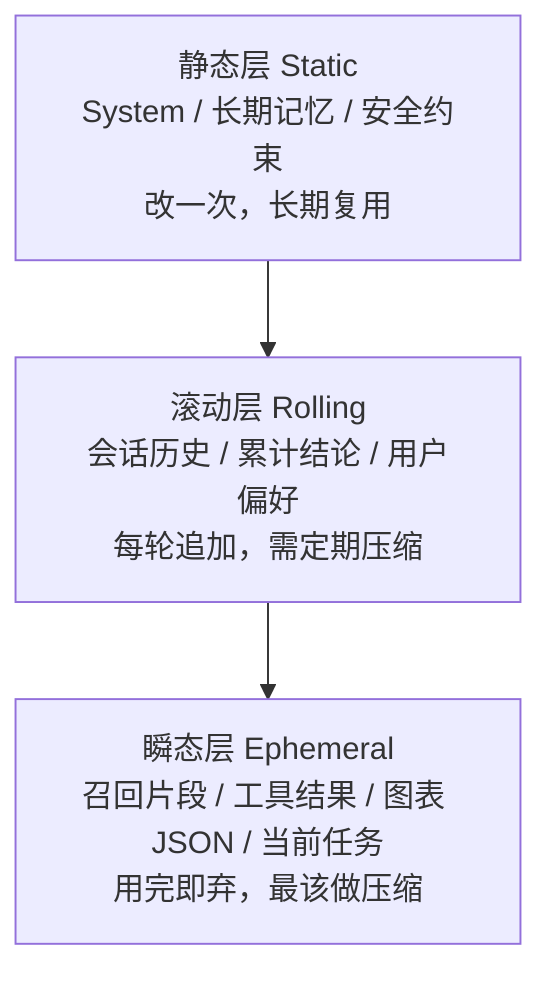
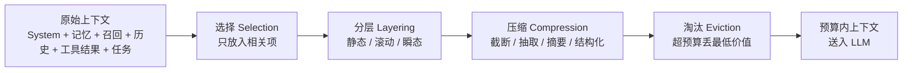
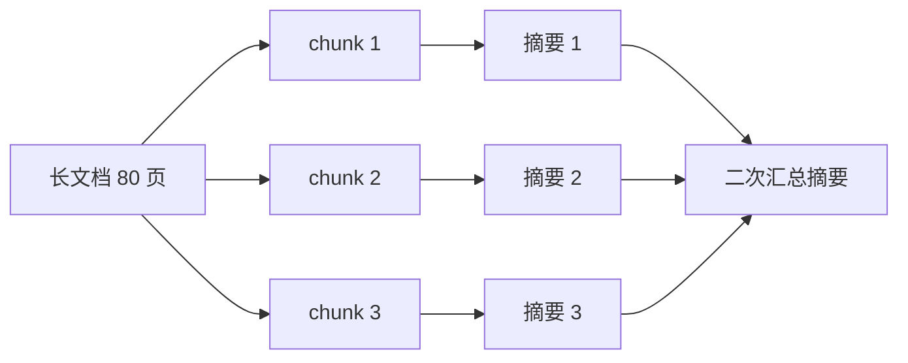
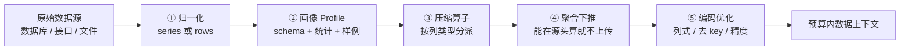
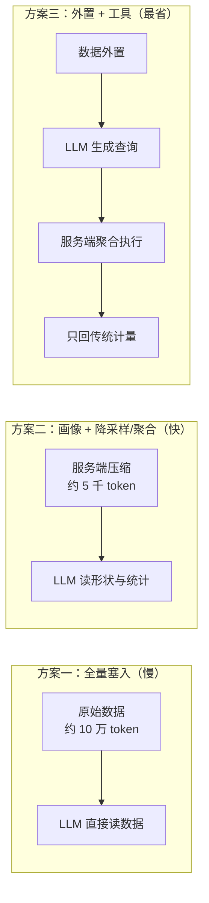

# 上下文工程

> 最后修改时间：2026-10-10 21:06

> 一句话定义：系统化设计送给 **LLM** /ˌel el ˈem/ （ **Large Language Model** /lɑːdʒ ˈlæŋɡwɪdʒ ˈmɒdl/ ，大语言模型）的上下文——选材、检索、压缩、记忆，让模型在正确信息下推理。

> 关联阅读： **RAG** /ræɡ/ （ **Retrieval-Augmented Generation** /rɪˈtriːvl ɔːɡˈmentɪd ˌdʒenəˈreɪʃn/ ，检索增强生成）全链路见 [01-RAG检索增强生成.html](01-RAG检索增强生成.html)；向量检索见 [04-向量模型Embedding.html](04-向量模型Embedding.html) 与 [03-向量数据库.html](03-向量数据库.html)；窗口硬约束见 [../06-大语言模型LLM/04-上下文窗口.html](../06-大语言模型LLM/04-上下文窗口.html)；Agent 侧"选 / 压 / 层 / 淘"见 [../../Agent开发知识/13-进阶与工程化/02-上下文工程.html](../../Agent开发知识/13-进阶与工程化/02-上下文工程.html)。

## 1. 定义

**上下文工程** （ **Context Engineering** /ˈkɒntekst ˌendʒɪˈnɪərɪŋ/ ）指：在每次调用 LLM 之前， **程序化地决定** "给模型看什么、看多少、按什么顺序看"，并在超出预算时执行选材、压缩、分层与淘汰。

与 **提示工程** （ **Prompt Engineering** /prɒmpt ˌendʒɪˈnɪərɪŋ/ ）的区别：

| 维度 | Prompt Engineering | Context Engineering |
|------|--------------------|---------------------|
| 关注点 | "怎么说"：措辞、格式、Few-shot | "给模型看什么"：选材、组织、压缩、淘汰 |
| 作用对象 | 一段提示文本 | 一次调用的 **全部输入** （System / 记忆 / 召回 / 历史 / 工具结果 / 当前任务） |
| 失效场景 | 单轮简单任务够用 | 多轮、长任务、Agent、海量数据 |
| 两者关系 | 子集 | 提示工程的超集 |

一句话： **提示工程决定"语气"，上下文工程决定"视野"。** 视野太窄会缺信息，视野太杂会淹没重点、拖慢响应、烧钱。

## 2. 上下文的分区模型

一次 LLM 调用的输入，可以拆成 6 个分区；每一区的"稳定性"和"易变性"不同，对应的压缩策略也不同。

| 分区 | 典型内容 | 稳定性 | 易变性 | 主要压缩/治理手段 |
|------|----------|--------|--------|-------------------|
| System（系统提示） | 角色、安全约束、输出格式 | 高 | 低 | 精简措辞；子模块按需加载 |
| 长期记忆 Memory | 用户画像、偏好、项目规范 | 中 | 低 | 按需注入命中的几条，不全量 |
| 召回 Recall | RAG 检索片段、知识库 **chunk** /tʃʌŋk/ （切片） | 中 | 高 | Top-K 收紧 + 重排 + 片段裁剪 |
| 会话历史 History | 多轮对话、累计结论 | 高 | 高 | 滑动窗口 + 滚动摘要 |
| 工具结果 Tool Result | 命令日志、接口返回、图表数据 | 低 | 极高 | 结构化抽取 + 只留关键字段 |
| 当前任务 Task | 本次目标、待办、约束 | 高 | 高 | 全量保留（是"锚"） |

### 2.1 三层结构（静态 / 滚动 / 瞬态）



- **静态层** ：尽量短、放最前，吃满 **KV Cache** /ˌkeɪ ˈviː kæʃ/ （Key-Value Cache，键值缓存）前缀命中收益。
- **滚动层** ：随对话增长，是"上下文膨胀"的主因，必须做滚动摘要。
- **瞬态层** ：单次任务里体积最大（尤其是工具结果与结构化数据），是压缩收益最高的地方。

### 2.2 贯穿案例：智小原 AI chatbot 的上下文清单

> 场景：企业内部数据分析助手「智小原」（ **chatbot** /ˈtʃætbɒt/ ，聊天机器人），日活约 3 000 用户、日均 1.2 万次对话请求；模型走 DeepSeek V4 Flash（高吞吐 Flash 档）；后端 Node.js 20 + **TypeScript** /ˈtaɪpskrɪpt/ 5（下称 TS）。

一次"帮我分析这张折线图"的请求，实际输入的上下文构成：

| 分区 | 实测 token | 说明 |
|------|-----------|------|
| System | 1 200 | 角色 + 输出格式 + 安全约束 |
| 长期记忆 | 800 | 用户所在部门、常看指标、报表口径 |
| 召回 Recall | 3 000 | 6 个知识片段 × 约 500 token |
| 会话历史 | 4 000 | 近 20 轮对话（含上文已分析过的 2 张图） |
| 当前任务 | 300 | 本次问题 + 分析维度 |
| **图表 JSON（瞬态）** | **95 000 ~ 100 000** | 30 天 × 5 分钟粒度 = 8 640 个点 |
| **合计** | **约 104 300** | 图表数据占了 **91%** |

结论：系统提示、召回、历史加起来才 9 000 token，真正把响应拖慢的是那坨图表 JSON。 **优化要打在"瞬态层的大对象"上，而不是先动 System 和历史。**

## 3. Token 预算：先定额度，再谈压缩

压缩的前提是"有个额度"。给每个分区设 token 上限，超了才触发压缩。

- 硬上限：模型窗口（或你愿意支付的输入长度），例如 128k。
- 有效预算： **实际不该吃满窗口** 。经验值是把注入总量控制在窗口的 10% ~ 25%，留余量给输出与 **Lost in the Middle** /ˌlɒst ɪn ðə ˈmɪdl/ （中间遗忘，指长上下文中间位置信息易被忽略）。
- 优先级： **当前任务 > System 硬约束 > 长期记忆 > 召回 > 历史 > 工具结果原始数据** 。

预算规划器（主示例，Node.js + TS）：

```typescript
import { encode } from "gpt-tokenizer"; // 用于估算；DeepSeek 分词器略有差异，估算 + 线上实测校准

export type SlotName = "system" | "memory" | "recall" | "history" | "task" | "tool";

export interface BudgetSlot {
  name: SlotName;
  /** 该分区 token 上限 */
  maxTokens: number;
  /** 越小越先保；预算不够时从大值开始丢 */
  priority: number;
}

/** 智小原默认预算：硬上限 16k，图表数据单列一项 */
export const BUDGET: BudgetSlot[] = [
  { name: "task", maxTokens: 1_000, priority: 0 },
  { name: "system", maxTokens: 1_500, priority: 1 },
  { name: "memory", maxTokens: 1_000, priority: 2 },
  { name: "recall", maxTokens: 3_000, priority: 3 },
  { name: "history", maxTokens: 3_000, priority: 4 },
  { name: "tool", maxTokens: 6_500, priority: 5 },
];

export const countTokens = (text: string): number => encode(text).length;

export interface SlotPayload {
  slot: BudgetSlot;
  text: string;
}

export interface AssembleResult {
  kept: SlotPayload[];
  /** 每个分区实际用量 */
  used: Partial<Record<SlotName, number>>;
  /** 被丢弃或截断的分区 */
  dropped: SlotName[];
  totalTokens: number;
}

/** 按分区上限 + 总上限组装上下文；超限先丢低优先级分区 */
export function assemble(payloads: SlotPayload[], hardLimit = 16_000): AssembleResult {
  const ordered = [...payloads].sort((a, b) => a.slot.priority - b.slot.priority);
  const kept: SlotPayload[] = [];
  const used: Partial<Record<SlotName, number>> = {};
  const dropped: SlotName[] = [];
  let total = 0;

  for (const p of ordered) {
    const cost = countTokens(p.text);
    if (cost > p.slot.maxTokens || total + cost > hardLimit) {
      dropped.push(p.slot.name);
      continue; // 真实系统这里应改为"调用该分区的压缩器"而非直接丢
    }
    kept.push(p);
    used[p.slot.name] = cost;
    total += cost;
  }

  return { kept, used, dropped, totalTokens: total };
}
```

**落地示例** ：智小原把 `tool` 分区上限设为 6 500 token。原始图表 JSON 是 9.5 万 token，直接触发压缩流程（见第 6 节），压到约 5 千后正常入框。

## 4. 上下文压缩：方法论

压缩不是"砍字"，而是 **在保留决策所需信息的前提下减少 token** 。用三个问题定位手段：

| 维度 | 选项 | 说明 |
|------|------|------|
| 何时压 | 事前 / 事中 / 事后 | 写入时压（建库、切分）、对话中压（滚动摘要）、超限时压（触发式） |
| 压什么 | 历史 / 召回 / 工具结果 / 结构化数据 | 对象不同，手段不同 |
| 怎么压 | 截断 / 抽取 / 摘要 / 结构化 / 改写 / 外置 | 保真度与成本不同，见下表 |



手段对比（保真度 = 信息损失程度，越高越好）：

| 手段 | 做法 | 压缩比 | 保真度 | 适用对象 |
|------|------|--------|--------|----------|
| 截断 Truncate | 直接砍头/砍尾 | 任意 | 低 | 日志、超长列表 |
| 抽取 Extract | 只留关键字段/行 | 5 ~ 50× | 中高 | API 返回、表格、JSON |
| 摘要 Summarize | 用模型改写为短文 | 5 ~ 20× | 中 | 对话历史、文档 |
| 结构化 Structurize | 换更省 token 的等价表示 | 2 ~ 10× | 高 | 结构化数据、图表 |
| 降采样 Downsample | 按形状保留代表点 | 10 ~ 100× | 中高 | 时间序列 |
| 外置 Offload | 数据留在服务端，按需查 | 100×+ | 高 | 大数据集、代码解释器 |

> 原则： **能用"结构化 / 降采样 / 外置"解决的，不要用"摘要"解决。** 摘要会引入模型幻觉，而结构化压缩是无损或可控损失的。

## 5. 常用压缩手段详解

### 5.1 滑动窗口 + 锚点保留

只保留最近 N 轮对话，但 **"锚点"必须常驻** ：用户身份、已确认结论、未完成待办、硬约束。

```typescript
interface Turn {
  role: "user" | "assistant";
  content: string;
  /** 事实型信息标记，命中则提升为锚点 */
  pinned?: boolean;
}

/** 取最近 keepRecent 轮 + 所有 pinned 轮，且保持原始顺序 */
export function slidingWindow(turns: Turn[], keepRecent = 6): Turn[] {
  const tail = turns.slice(-keepRecent);
  const pinned = turns.filter((t) => t.pinned && !tail.includes(t));
  const picked = new Set([...pinned, ...tail]);
  return turns.filter((t) => picked.has(t));
}
```

**落地示例** ：智小原的历史从"全量 20 轮（4 000 token）"改为"最近 6 轮 + 3 条 pinned（1 400 token）"，且用户上一句说的"只看华东区"被标为 pinned，不会在下一轮被挤掉。

### 5.2 滚动摘要（Rolling Summary）

滚动摘要（ **Rolling Summary** /ˈrəʊlɪŋ ˈsʌməri/ ）把窗口外（更早）的历史压缩成一段固定摘要， **每轮增量更新** ，而不是每次重新总结全部历史。

摘要提示词必须显式声明"保什么、丢什么"：

```typescript
import OpenAI from "openai";

const client = new OpenAI({ baseURL: "https://api.deepseek.com" });

const SUMMARY_SYSTEM_PROMPT = `你是对话压缩器。把给定历史压成不超过 200 字的纯文本摘要，必须保留：
① 用户身份与偏好；② 已确认的结论与关键数字；③ 未完成的待办与硬约束（如"只看华东区""同比口径"）。
丢弃：寒暄、重复确认、失败尝试的细节、模型自己的解释过程。不要 markdown，不要条目编号。`;

export async function rollingSummary(
  older: Turn[],
): Promise<string> {
  if (older.length === 0) return "";
  const resp = await client.chat.completions.create({
    model: "deepseek-chat", // 摘要用便宜模型即可，省成本
    temperature: 0,
    max_tokens: 300,
    messages: [
      { role: "system", content: SUMMARY_SYSTEM_PROMPT },
      { role: "user", content: older.map((t) => `${t.role}: ${t.content}`).join("\n") },
    ],
  });
  return resp.choices[0]?.message?.content?.trim() ?? "";
}
```

**落地示例** ：20 轮历史（4 000 token）→ 摘要 180 token + 最近 6 轮 1 400 token ≈ 1 580 token，降 **60%** ，且"华东区""同比口径"这类硬约束被显式保留。

### 5.3 分层 / 递归摘要（Map-Reduce）

超长内容（如一份 80 页报告）先分块各自摘要（Map），再对摘要做二级摘要（Reduce），即 **Map-Reduce** /mæp rɪˈdjuːs/ 。适合"事前压缩"——建库或入库时一次性做完。



注意：递归摘要的 **信息损失会累积** ，所以原始 chunk 必须落库（向量库 + 原文），需要细节时再按需召回原文——摘要只做"导航"，不做"唯一真相"。

### 5.4 提示压缩（Prompt Compression）

用专门的小模型对提示做 **逐 token 删减** ，在尽量不丢语义的前提下缩短输入，代表工作是 **LLMLingua** 系列（Jiang 等，2023 / 2024）。

- 适合：提示里塞了大量自然语言说明、少量固定模板的场景。
- 不适合：结构化数据、代码、数字（删一个字符就变义）。
- 代价：多一次模型调用（可用本地小模型，CPU 也能跑），且可能改写措辞，需回归验证。

### 5.5 检索侧压缩（Recollection 治理）

召回是"输入侧的压缩"，比在 **prompt** /prɒmpt/ 里再压缩更划算：

- **收紧 Top-K** ：从 `k=10` 收到 `k=4`，配合重排序（ **Rerank** /ˌriːˈræŋk/ ，重排）保精度。
- **片段裁剪** ：命中 chunk 只保留与问题最相关的句子窗口，而非整段。
- **两级加载** ：先给"标题 + 一句话概览"，模型需要时再取正文（渐进式披露）。
- **元数据过滤前置** ：先按部门/时间过滤，再向量检索，避免召回无关内容后还要压缩。

细节见 [01-RAG检索增强生成.html](01-RAG检索增强生成.html) 与 [03-向量数据库.html](03-向量数据库.html)。

### 5.6 工具结果治理

工具返回是"最脏、最长的输入"，常见形态有 **API** /ˌeɪ piː ˈaɪ/ （ **Application Programming Interface** /ˌæplɪˈkeɪʃn ˈprəʊɡræmɪŋ ˈɪntəfeɪs/ ，应用编程接口）返回的 **JSON** /ˈdʒeɪsən/ （ **JavaScript Object Notation** /ˈdʒɑːvəskrɪpt ˈɒbdʒekt nəʊˈteɪʃn/ ，JavaScript 对象表示法）、命令行日志、搜索结果、数据库结果。务必在 **进上下文之前** 先瘦身：

| 工具类型 | 原始返回 | 治理后 |
|----------|----------|--------|
| Shell / 构建日志 | 3 000 行 | 只留报错行 + 末 20 行 + 退出码 |
| 接口调用 | 完整 JSON | 只留模型下一步需要的字段 |
| 搜索结果 | 20 条全文 | Top-K 标题 + 摘要 + 链接 |
| 数据库查询 | 全表 5 000 行 | 聚合结果 + 前 10 行样例 + 行数 |
| 表格 / 图表数据 | 8 640 点 JSON / 50 万行明细 | 画像 + 聚合下推 + 降采样（见第 6 节） |

```typescript
/** 通用工具结果裁剪：保留结构化字段，剔除冗余 */
export function trimToolResult(
  raw: unknown,
  keepKeys: string[],
  maxChars = 4_000,
): string {
  const pick = (obj: Record<string, unknown>): Record<string, unknown> =>
    Object.fromEntries(keepKeys.filter((k) => k in obj).map((k) => [k, obj[k]]));

  const shaped = Array.isArray(raw)
    ? { rowCount: raw.length, sample: raw.slice(0, 10).map((r) => pick(r as Record<string, unknown>)) }
    : pick(raw as Record<string, unknown>);

  const text = JSON.stringify(shaped);
  return text.length > maxChars ? `${text.slice(0, maxChars)}…[truncated]` : text;
}
```

## 6. 专项：数据上下文的压缩（任意数据源）

> 前面的压缩对象多是"文本"（历史、召回片段）；本节专门处理 **压缩对象就是数据本身** 的情况。数据不限于折线图——还可能是 table 的 datasource、明细表、宽表、嵌套 JSON。好消息是： **思路完全通用** 。

### 6.1 先澄清：进上下文的到底是什么

一个常见误解：把数据交给工具 / 放在后端， **只是省了前端传输，最后不还是得传给模型？** 不是。一次带工具的调用，真正进入上下文窗口的只有三样东西：

| 进入上下文的内容 | 体积 | 与数据量的关系 |
|------------------|------|----------------|
| 工具定义（name / description / 参数 **schema** /ˈskiːmə/ ） | 200 ~ 500 token | **无关** （恒定） |
| 模型生成的调用参数（如 `{series:"CPU", op:"p95"}`） | 20 ~ 80 token | **无关** （恒定） |
| 工具的 **返回值** | 几十 ~ 几百 token | **取决于你返回什么** |

结论： **原始 10 万 token 的数据集，从头到尾不会进入上下文窗口** 。它留在服务端（Redis / 对象存储 / 数仓），模型做的是" **写查询** "，而不是" **读数据** "。

> 关键契约： **工具只返回"结论"（聚合值、行数、异常点），绝不返回"数据"（明细行）。** 并给返回值设 `maxReturnTokens` 硬上限（如 800）。

**必须知道的代价** ：工具化把"一次大 prefill"换成"多轮往返"（模型 → 工具 → 模型 → …）。

- token 大幅下降，但 **墙钟延迟可能不降反升** ：一次问答若触发 4 次工具调用，就多 4 次模型往返；
- 首 token 延迟变低，但"看到最终答案"的总时间可能更长。

所以： **结论型** 问题（精确数值、聚合、异常定位）适合工具化； **看形状** 的问题（"整体趋势如何"）用降采样把小段受控数据放进上下文更快。

> 顺带回答"采样不也还是把数据传给模型吗"：是，但传的是 **480 个代表点（约 5 千 token）** ，而不是 **8 640 个全量点（约 10 万 token）** 。采样点负责"形状"，精确值交给统计量与工具。这是把大数据变成 **受控小数据** 的合法手段，与"全量塞入"有本质区别。

### 6.2 为什么"数据一塞就慢"

现代解码器（ **Decoder-only** /dɪˈkəʊdə ˈəʊnli/ ，仅解码器）每轮生成分两段：

- **Prefill** /ˌpriːˈfɪl/ （预填充）：把整段输入过一遍，生成 **KV Cache** /ˌkeɪ ˈviː kæʃ/ （Key-Value Cache，键值缓存）。计算量随输入 token 数增长，注意力部分接近平方。
- **Decode** /diːˈkəʊd/ （逐 token 解码）：真正"写字"的阶段，速度基本恒定。

所以 Flash 档模型虽然单 token 很快，但 **输入 10 万 token 时，光 prefill 就要好几秒** ，表现为"响应慢"。这与模型快不快无关，是输入长度问题。

再看 token 效率：JSON 因为重复 key、引号、冒号、逗号，且数字会被逐位切分， **约 3 ~ 3.5 个字符才等于 1 个 token** 。

```text
8640 个点 × 约 42 字符/点 ≈ 363 000 字符 ≈ 10 万 token
```

> 关键认知： **数据不是"文本"，是"数值阵列"。** 用文本的方式喂给模型，等于把 3.6 MB 的数据当成散文发送。

### 6.3 通用管线：data → context 五步

不管数据是图表序列、table datasource 还是嵌套 JSON，都走同一条管线：



| 步骤 | 做什么 | 关键点 |
|------|--------|--------|
| ① 归一化 | 任意数据先变成"序列"或"记录集 + schema"两种形态之一 | 后续算子统一 |
| ② 画像 Profile | schema、行数、每列统计、少量样例 | 体积恒定，永远注入 |
| ③ 压缩算子 | 按列类型选算子（见 6.4） | 数值 / 类别 / 时间 / 文本各不同 |
| ④ 聚合下推 | `WHERE` / `GROUP BY` / top-k / 异常检测下沉到数据源 | **收益最大** |
| ⑤ 编码优化 | 列式、去 key、相对时间、精度裁剪 | 无损或可控损失 |

> **Profile** /ˈprəʊfaɪl/ （画像）：先用小体积的"数据地图"让模型知道有什么，再按需取细节。
> **聚合下推** （ **push-down aggregation** /ˈpʊʃ daʊn ˌæɡrɪˈɡeɪʃn/ ）：把计算放到离数据最近的地方（ **SQL** /ˌes kjuː ˈel/ （ **Structured Query Language** /ˈstrʌktʃəd ˈkwɪəri ˈlæŋɡwɪdʒ/ ，结构化查询语言）/ DuckDB / 数据源接口），只把结果传上来。

**落地示例** ：一个 200 万行的订单明细 datasource，模型问"哪个品类的退款率最高"。

- 不压缩：200 万行 × 15 列，约 3 000 万 token+，根本无法入框。
- 走管线：源头 `GROUP BY category` 聚合 → 返回 12 行（品类 / 订单数 / 退款率）+ 画像（schema + 行数 + 时间范围）≈ 900 token。 **压缩比 > 3 万倍** 。

### 6.4 按列类型分派压缩算子

这就是"数据不限于折线图"的核心： **不同列，不同压缩法** 。

| 列类型 | 压缩算子 | 例子 | 典型压缩比 |
|--------|----------|------|-----------|
| 时间列 | 分桶（hour / day）或保形降采样（见 6.6） | 5 分钟粒度 → 按天 | 10 ~ 300× |
| 数值列 | 聚合（sum / avg / p95 / 标准差）或直方图 | 1 万条金额 → 均值 + 分位 + 分布 | 1000×+ |
| 类别列 | `GROUP BY` 取 Top-K + "其他" | 200 个品类 → Top 10 + 其他 | 20× |
| 文本列 | 截断 / 取值域枚举（ **distinct** /dɪˈstɪŋkt/ ，去重计数） | 评论 → 长度统计 + 高频词 | 50× |
| ID / 主键列 | **直接丢弃** （只留 `count(distinct)`） | order_id | ∞ |
| 布尔列 | 计数（true / false 占比） | is_refunded | 1000×+ |
| 嵌套 JSON | 只展平需要的一层，其余丢弃 | 订单 items[] | 5 ~ 20× |

> 心法： **能聚合的绝不逐行，能分桶的绝不逐点，能丢弃的绝不传值。**

### 6.5 表格 datasource 实战：画像先行 + 聚合下推

表格和曲线的区别：表格没有天然的"排序形状"，不能靠降采样；它的核心手段是 **画像（Profile）+ 聚合** 。

思路是" **先给地图，再按需取地形** "（ **profile-then-fetch** /ˈprəʊfaɪl ðen fetʃ/ ）：把恒定大小的画像常驻上下文，明细一字不传。

```typescript
export type ColumnType = "number" | "category" | "time" | "text" | "id" | "boolean";

export interface ColumnProfile {
  name: string;
  type: ColumnType;
  nullRate: number;
  distinct?: number;
  /** 数值列 */
  min?: number;
  max?: number;
  mean?: number;
  p50?: number;
  p95?: number;
  /** 类别列：Top-K 取值与计数 */
  topValues?: Array<{ value: string; count: number }>;
}

export interface DatasetProfile {
  rowCount: number;
  columns: ColumnProfile[];
  /** 3 ~ 5 行样例，让模型知道"数据长什么样" */
  sampleRows: Array<Record<string, unknown>>;
}

/** 生成数据集画像：体积恒定（约 600 ~ 1 200 token），与行数无关 */
export function profileDataset(
  rows: Array<Record<string, unknown>>,
  types: Record<string, ColumnType>,
  sampleSize = 5,
  topK = 10,
): DatasetProfile {
  const columns = Object.keys(types).map((name): ColumnProfile => {
    const type = types[name];
    const vals = rows.map((r) => r[name]);
    const nullRate = rows.length === 0 ? 0 : vals.filter((v) => v == null).length / rows.length;

    if (type === "number") {
      const nums = vals
        .filter((v): v is number => typeof v === "number")
        .sort((a, b) => a - b);
      const at = (q: number) => nums[Math.min(nums.length - 1, Math.floor(q * nums.length))];
      return {
        name,
        type,
        nullRate,
        min: nums[0],
        max: nums[nums.length - 1],
        mean: Number((nums.reduce((a, b) => a + b, 0) / nums.length).toFixed(2)),
        p50: at(0.5),
        p95: at(0.95),
      };
    }

    const counts = new Map<string, number>();
    for (const v of vals) {
      if (v == null) continue;
      const key = String(v);
      counts.set(key, (counts.get(key) ?? 0) + 1);
    }

    return {
      name,
      type,
      nullRate,
      distinct: counts.size,
      topValues:
        type === "category"
          ? [...counts.entries()]
              .sort((a, b) => b[1] - a[1])
              .slice(0, topK)
              .map(([value, count]) => ({ value, count }))
          : undefined,
    };
  });

  return { rowCount: rows.length, columns, sampleRows: rows.slice(0, sampleSize) };
}
```

画像常驻上下文，明细则 **永不入框** ，只暴露成一个聚合查询工具，由服务端把计算 **下推** 到数据源：

```typescript
/**
 * 服务端执行聚合，把计算下推到数据源，只返回结果集。
 * 注意：SQL 必须来自受控模板 + 白名单，禁止模型直接拼 SQL。
 */
export async function aggregateQuery(
  template: { sql: string; params: Record<string, string | number> },
  limit = 50,
): Promise<Array<Record<string, unknown>>> {
  // 例：SELECT category, COUNT(*) AS orders FROM orders WHERE dt >= :since GROUP BY category
  const rows = await dataSource.query(template.sql, { ...template.params, limit });
  return rows; // ≤ 50 行，通常 < 400 token
}
```

模型只负责给"聚合意图"（维度 + 指标 + 过滤条件），SQL 模板与白名单在服务端，兼防 **SQL 注入** /ˌes kjuː ˈel ɪnˈdʒekʃn/ （ **SQL Injection** ，结构化查询语言注入）与全表扫描。

**落地示例** ：智小原的"明细表"tab 有 50 万行、18 列。模型要"看看本月各地区销售额分布"：

- 画像常驻：18 列统计 + 样例 5 行 ≈ 900 token；
- 模型调 `aggregateQuery`（`SELECT region, SUM(amount) ... GROUP BY region`）→ 返回 24 行 ≈ 300 token；
- 全程明细零上传， **数据上下文合计 ≈ 1 200 token** 。

### 6.6 时间序列实战：LTTB 降采样

时间序列有"天然形状"，所以能用降采样把曲线压成代表点。 **LTTB** /ˌel tiː tiː ˈbiː/ （ **Largest Triangle Three Buckets** /ˈlɑːdʒɪst ˈtraɪæŋɡl θriː ˈbʌkɪts/ ，最大三角形三桶）的要点是 **尽量保留峰谷** 。

```typescript
export interface Point {
  t: number; // 毫秒时间戳
  v: number;
}

export interface ChartSeries {
  name: string;
  unit: string;
  points: Point[];
}

/**
 * LTTB（Largest Triangle Three Buckets）降采样：
 * 把曲线压到 threshold 个点，同时尽量保留峰谷形状。
 * 参考：Steinarsson, "Downsampling Time Series for Visual Representation"（2013）
 */
export function lttb(data: Point[], threshold: number): Point[] {
  const n = data.length;
  if (threshold >= n || threshold <= 2) return data.slice();

  const sampled: Point[] = [data[0]];
  const every = (n - 2) / (threshold - 2);
  let a = 0;

  for (let i = 0; i < threshold - 2; i++) {
    // 下一个桶的平均点（决定三角形的第三个顶点）
    const nextStart = Math.floor((i + 1) * every) + 1;
    const nextEnd = Math.min(Math.floor((i + 2) * every) + 1, n);
    let avgX = 0;
    let avgY = 0;
    for (let j = nextStart; j < nextEnd; j++) {
      avgX += data[j].t;
      avgY += data[j].v;
    }
    const nextLen = Math.max(nextEnd - nextStart, 1);
    avgX /= nextLen;
    avgY /= nextLen;

    // 当前桶：选与 (a, avg) 构成三角形面积最大的点
    const curStart = Math.floor(i * every) + 1;
    const curEnd = Math.floor((i + 1) * every) + 1;
    const ax = data[a].t;
    const ay = data[a].v;
    let maxArea = -1;
    let maxIdx = curStart;

    for (let j = curStart; j < curEnd; j++) {
      const area = Math.abs(
        (ax - avgX) * (data[j].v - ay) - (ax - data[j].t) * (avgY - ay),
      );
      if (area > maxArea) {
        maxArea = area;
        maxIdx = j;
      }
    }

    sampled.push(data[maxIdx]);
    a = maxIdx;
  }

  sampled.push(data[n - 1]);
  return sampled;
}

export interface ChartContext {
  schema: string;
  stats: Record<string, number>;
  series: Array<{ name: string; unit: string; samples: Array<[number, number]> }>;
  question: string;
}

const MAX_POINTS = 480; // 单条曲线最多 480 点，够画一张折线图
const PRECISION = 2; // 数值保留 2 位小数

/** 把原始图表数据压缩成"低 token 但可分析"的上下文 */
export function buildChartContext(
  seriesList: ChartSeries[],
  question: string,
  maxPoints = MAX_POINTS,
): ChartContext {
  const round = (x: number) => Number(x.toFixed(PRECISION));
  const base = seriesList[0]?.points[0]?.t ?? 0;

  const stats: Record<string, number> = {};
  const series = seriesList.map((s) => {
    const vs = s.points.map((p) => p.v);
    const sum = vs.reduce((acc, v) => acc + v, 0);
    const sorted = [...vs].sort((a, b) => a - b);
    const pick = (q: number) => sorted[Math.min(sorted.length - 1, Math.floor(q * sorted.length))];

    stats[`${s.name}.min`] = round(Math.min(...vs));
    stats[`${s.name}.max`] = round(Math.max(...vs));
    stats[`${s.name}.avg`] = round(sum / vs.length);
    stats[`${s.name}.p50`] = round(pick(0.5));
    stats[`${s.name}.p95`] = round(pick(0.95));
    stats[`${s.name}.first`] = round(vs[0]);
    stats[`${s.name}.last`] = round(vs[vs.length - 1]);

    return {
      name: s.name,
      unit: s.unit,
      // 列式二元组 [相对秒, 值]：去掉 key、单位与重复时间戳前缀
      samples: lttb(s.points, maxPoints).map(
        (p) => [Math.round((p.t - base) / 1000), round(p.v)] as [number, number],
      ),
    };
  });

  return {
    schema: `series[].samples = [t_seconds_from_base, value]; time_base=${new Date(base).toISOString()}; 每点等间隔`,
    stats,
    series,
    question,
  };
}
```

拼装提示词时， **schema** 只解释一次，数据只给值：

```typescript
export function renderChartPrompt(ctx: ChartContext): string {
  const lines = [
    "## 数据格式",
    ctx.schema,
    "",
    "## 全量统计量（基于原始全量数据，非降采样）",
    JSON.stringify(ctx.stats),
    "",
    "## 曲线采样点（已降采样，仅用于看形状与拐点）",
    ...ctx.series.map((s) => `${s.name}(${s.unit}) = ${JSON.stringify(s.samples)}`),
    "",
    "## 分析要求",
    ctx.question,
    "注意：峰谷判断请以采样点为准，精确数值以上方统计量为准。",
  ];
  return lines.join("\n");
}
```

### 6.7 工具化：让模型"算"而不是"看"

如果分析只需要结论（如"哪一天跌得最狠""环比变化多少"），根本不用把数据塞进上下文——把数据留在服务端，用 **Function Calling** /ˈfʌŋkʃn ˈkɔːlɪŋ/ （函数调用）暴露查询工具：



```typescript
import type { ChatCompletionTool } from "openai/resources/chat/completions";

/** 暴露给模型的工具：只描述能力，不传数据 */
export const chartTools: ChatCompletionTool[] = [
  {
    type: "function",
    function: {
      name: "query_series",
      description:
        "对已加载的数据做统计查询。用于精确数值、区间聚合、异常点定位、同环比计算。",
      parameters: {
        type: "object",
        properties: {
          series: { type: "string", description: "字段/曲线名，如 amount、CPU使用率" },
          op: { type: "string", enum: ["min", "max", "avg", "p95", "sum", "delta_pct"] },
          from: { type: "string", description: "起始时间 ISO8601" },
          to: { type: "string", description: "结束时间 ISO8601" },
          groupBy: { type: "string", enum: ["none", "hour", "day", "category"], description: "聚合粒度" },
        },
        required: ["series", "op"],
      },
    },
  },
];
```

三条硬约束：

1. **返回值只放结论** ：如 `{"max": 98.1, "max_at": "2026-10-03 14:20", "delta_pct": -4.2}`，而不是明细数组。
2. **设 `maxReturnTokens`** ：超限先聚合再返回，绝不整表回传。
3. **控制轮次** ：设最大工具轮次（如 8），超了就基于已有统计量作答，避免无限往返。

> 适合"结论型"问题；需要看整体形状时，用 6.6 的降采样更快。两者常组合： **先看形状（降采样），再查精确值（工具）。**

### 6.8 压缩效果（智小原线上实测）

| 指标 | 优化前（全量数据） | 优化后（画像 + 降采样 / 聚合） | 变化 |
|------|--------------------|-------------------------------|------|
| 输入 token（图表曲线） | 104 300 | 5 200 | **-95%** |
| 输入 token（50 万行明细表） | 无法入框（3 000 万+） | 1 200 | **> 99.99%** |
| 首 token 延迟（ **TTFT** /ˌtiː tiː ef ˈtiː/ ， **Time To First Token** /taɪm tuː fɜːst ˈtəʊkən/ ，首 token 延迟） | 3.6 s | 0.5 s | -86% |
| 端到端 P95（第 95 百分位）延迟 | 9.4 s | 3.0 s | -68% |
| 单次输入成本 | 1.00（基准） | 0.05 | -95% |
| 分析结论准确率（100 条黄金集） | 91% | 93% | 略升 |

三点说明：

1. **延迟下降主要来自 prefill** 。若输出本身很长（如逐段解读），decode 段不会自动变快，还要靠 `max_tokens` 与输出 schema 约束。
2. **工具化省 token，但增加轮次** ：纯工具路径在结论型问题上 P95 可能只降 30% ~ 50%（多轮往返），可用"并行工具调用"或"先聚合再问答"减少轮次。
3. **准确率不降反升** ，因为画像给全局、采样给形状、聚合给精确值，反而减少了模型在 8 640 个数字里的"注意力漂移"。

### 6.9 决策：看 / 算 / 画

| 问题类型 | 用什么 | 为什么 |
|----------|--------|--------|
| "最大值多少""环比多少" | **算** （工具聚合） | 精确，且明细不进上下文 |
| "整体趋势如何""有没有异常" | **看** （画像 + 降采样） | 形状信息用采样点最省 |
| "哪个品类最好""分布如何" | **算** （`GROUP BY` / 直方图） | 聚合即可回答 |
| "为什么跌了" | 看 + 算 + 召回 | 形状定位 + 数值验证 + 业务知识 |
| "把这张图 / 表渲染出来" | **画** （前端本地渲染） | 渲染不需要模型，数据走前端通道，不进上下文 |

## 7. 端到端落地：智小原上下文压缩改造（4 周排期）

| 周 | 目标 | 关键动作 | 验收指标 |
|----|------|----------|----------|
| W1 | 能观测 | 接入 token 计数（`gpt-tokenizer`）+ 全链路埋点，记录每次调用各分区 token、TTFT、总延迟 | 拿到 7 天分位数基线（P50 / P95） |
| W2 | 先治历史 | 上滑动窗口 + 滚动摘要（5.2），锚点 pinned 机制 | 历史分区 token 降 50%+，目标不漂移 |
| W3 | 再治数据 | 图表走 LTTB 降采样（6.6），表格走画像 + 聚合下推（6.5），加 480 点 / 50 行上限 | 数据分区 < 6 500 token，TTFT < 1 s |
| W4 | 外置与回归 | 结论型问题走 `query_series` / `aggregateQuery` 工具（6.7）；100 条黄金集回归 | P95 延迟 < 4 s，准确率 ≥ 90% |

工具栈速查：

| 环节 | 选型 |
|------|------|
| 运行时 | Node.js 20 + TypeScript 5 |
| 模型 | DeepSeek V4 Flash（分析）+ `deepseek-chat`（摘要，成本更低） |
| token 估算 | `gpt-tokenizer`（估算）+ 线上 `usage.prompt_tokens` 校准 |
| 会话缓存 | Redis（存摘要、pinned 锚点、窗口游标） |
| 原始数据 | 对象存储（图表 JSON 外置，只把压缩结果进上下文） |
| 检索 | pgvector / Milvus + Rerank |
| 观测 | OpenTelemetry + Grafana（按分区打 token 与延迟标签） |

## 8. 关键原则

- **先清单后检索** ：先明确"这次推理需要什么"，再去拿，而不是先塞再删。
- **预算先行** ：每个分区先定额度，超限即触发压缩，而不是等撞窗口。
- **分区标签** ：用 **XML** /ˌeks em ˈel/ （ **Extensible Markup Language** /ɪkˈstensəbl ˈmɑːkʌp ˈlæŋɡwɪdʒ/ ，可扩展标记语言）/ Markdown 标签分隔来源（如 `<recall>`、`<chart_data>`），减少串味。
- **保留硬约束** ：摘要时宁可多留一句"不许做什么"，也不能丢。
- **优先无损压缩** ：结构化 / 降采样 / 外置 > 摘要 > 截断。
- **防污染** ：错误信息一旦进上下文会被当真；工具报错要标 `<error>` 并说明"未生效"。
- **锚点常驻** ：长期目标、用户身份、已确认结论不可被滑动窗口挤掉。
- **可回溯源** ：摘要只做导航，原文必须落库，需要时按需召回。
- **压缩要回归** ：任何压缩上线前，都用黄金集验证"结论是否还准"。

## 9. 度量与监控

不度量就无法优化。至少记录这些字段（每次 LLM 调用一行）：

| 指标 | 含义 | 目标（智小原） |
|------|------|----------------|
| `input_tokens`（分区明细） | 各分区实际注入量 | 总量 < 16k |
| `ttft_ms` | 首 token 延迟 | P95 < 1.5 s |
| `e2e_latency_ms` | 端到端延迟 | P95 < 4 s |
| `compress_ratio` | 压缩比（原始 / 压缩后） | 数据 > 20× |
| `cache_hit_rate` | KV 前缀缓存命中率（静态层复用） | > 60% |
| `task_success_rate` | 任务成功率 / 黄金集准确率 | ≥ 90% |
| `cost_per_call` | 单次成本 | 下降 > 80% |

阈值告警用 **SLO** /ˌes el ˈəʊ/ （ **Service Level Objective** /ˈsɜːvɪs ˈlevl əbˈdʒektɪv/ ，服务等级目标）方式定义：如"图表分析请求 P95 延迟 < 4 s，连续 30 分钟超标即告警"。配套方法见 [../../Agent开发知识/13-进阶与工程化/04-可观测性与LLMOps.html](../../Agent开发知识/13-进阶与工程化/04-可观测性与LLMOps.html)。

## 10. 常见坑

| 坑 | 后果 | 对策 |
|----|------|------|
| 把整张表 / 整份 JSON 直接塞进 prompt | token 爆炸、响应慢、注意力分散 | 画像 + 聚合下推 + 降采样 |
| 工具返回值把明细整表带回来 | token 从工具又灌回上下文，白折腾 | 工具只返回聚合结论 + `maxReturnTokens` |
| 摘要时把"硬约束"也删了 | 模型违反用户口径或安全边界 | 指定"必须保留"清单 |
| 只用截断（`slice`）做压缩 | 数字被截一半，语义失真 | 结构化后再截断，且只截文本不截数字 |
| 每轮都对全历史重新摘要 | 成本与延迟随轮次上涨 | 增量滚动摘要，只压窗口外 |
| 降采样后仍说"精确分析" | 峰谷丢失、结论偏差 | 采样点看形状，统计量给精确值 |
| 忽略 prefix cache | 静态层每轮重算，白花钱 | 稳定前缀放最前，保持字节级一致 |
| 压缩后不回归 | 悄悄变笨，用户先发现 | 黄金集 + A/B 灰度 |
| 把召回 `k` 调很大以求稳 | 上下文被无关片段淹没 | 收紧 k + 重排 + 片段裁剪 |

## 11. 在 Agent 中的重要性

- 长任务上下文易膨胀、易丢失目标；不做压缩，Agent 会"跑着跑着忘了要干嘛"。
- 上下文工程是 Agent 可靠性的基石： **选得准、压得狠、锚得住** 。
- 与记忆系统互补：记忆管"存 / 取 / 忘"，上下文工程管"组装与预算"。
- 与 **Loop Engineering** /luːp ˌendʒɪˈnɪərɪŋ/ 配合：长循环里每步注入什么、何时清理，都需要工程化策略。
- Agent 侧完整的"选 / 压 / 层 / 淘"四操作与 OpenViking 工程化实例，见 [../../Agent开发知识/13-进阶与工程化/02-上下文工程.html](../../Agent开发知识/13-进阶与工程化/02-上下文工程.html)。

## 12. 学习要点

- 上下文工程决定模型"看到什么"，直接影响输出质量、延迟与成本。
- 三大矛盾：窗口有限 vs 信息无限、速度要求 vs 输入长度、成本预算 vs 数据量。
- 压缩手段优先级： **外置 / 结构化 / 降采样 > 抽取 > 摘要 > 截断** 。
- 数据不是文本：先画像、再聚合、按列类型分派压缩算子；时间序列降采样看形状，表格聚合下推取结论，工具化查精确值。
- 工具化不是"换个地方传数据"：模型写查询、从不读原始数据，但要多付往返轮次。
- 长任务 / Agent 场景必须做上下文工程，且要 **可观测、可回归** 。
- 与提示工程是叠加而非替代：先写清"怎么说"，再决定"给什么看"。

## 13. 参考资料

- Anthropic Engineering, "Effective Context Engineering for AI Agents"（2025）
- Liu et al., "Lost in the Middle: How Language Models Use Long Contexts"（2023）
- Jiang et al., "LLMLingua: Compressing Prompts for Accelerated Inference of Large Language Models"（EMNLP 2023）；"LongLLMLingua"（2024）
- Packer et al., "MemGPT: Towards LLMs as Operating Systems"（2023）
- Steinarsson, "Downsampling Time Series for Visual Representation"（LTTB 算法，2013）
- DuckDB 官方文档（进程内 OLAP 引擎，适合做服务端聚合下推）
- 本仓库：[01-RAG检索增强生成.html](01-RAG检索增强生成.html)、[../06-大语言模型LLM/04-上下文窗口.html](../06-大语言模型LLM/04-上下文窗口.html)、[../../Agent开发知识/13-进阶与工程化/02-上下文工程.html](../../Agent开发知识/13-进阶与工程化/02-上下文工程.html)

## 14. 本文缩写

| 缩写 | 音标 | 全拼 | 中文 |
|------|------|------|------|
| **LLM** | /ˌel el ˈem/ | Large Language Model | 大语言模型 |
| **RAG** | /ræɡ/ | Retrieval-Augmented Generation | 检索增强生成 |
| **API** | /ˌeɪ piː ˈaɪ/ | Application Programming Interface | 应用编程接口 |
| **JSON** | /ˈdʒeɪsən/ | JavaScript Object Notation | JavaScript 对象表示法 |
| **SQL** | /ˌes kjuː ˈel/ | Structured Query Language | 结构化查询语言 |
| **XML** | /ˌeks em ˈel/ | Extensible Markup Language | 可扩展标记语言 |
| **TS** | /ˌtiː ˈes/ | TypeScript | 类型化 JavaScript 超集 |
| **KV Cache** | /ˌkeɪ ˈviː kæʃ/ | Key-Value Cache | 键值缓存 |
| **TTFT** | /ˌtiː tiː ef ˈtiː/ | Time To First Token | 首 token 延迟 |
| **LTTB** | /ˌel tiː tiː ˈbiː/ | Largest Triangle Three Buckets | 最大三角形三桶降采样 |
| **SLO** | /ˌes el ˈəʊ/ | Service Level Objective | 服务等级目标 |
