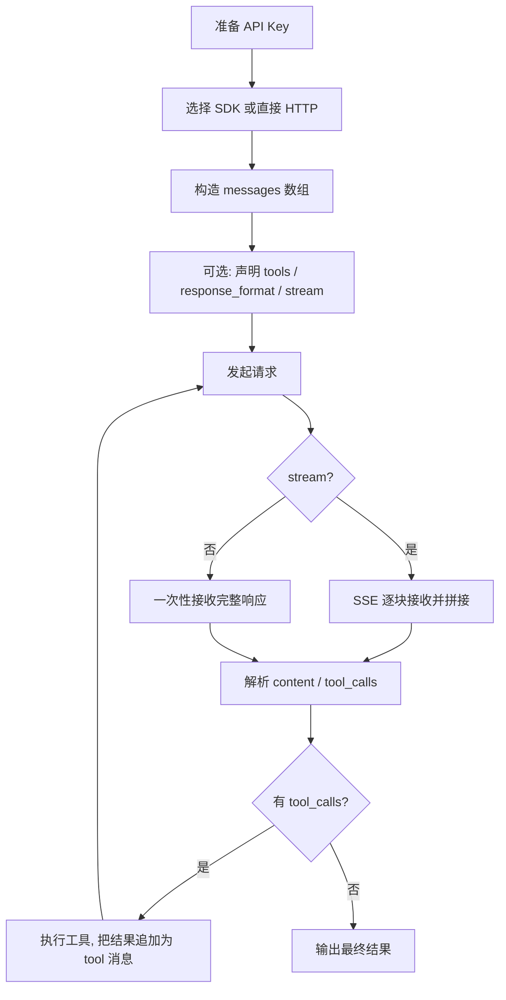

# LLM API 接口与调用实例

> 最后修改时间：2026-10-21 16:14

## 定义

LLM API 是大语言模型厂商对外提供的 **HTTP/SDK 编程接口** ，让开发者把模型能力集成到自己的应用中。当前主流厂商普遍采用"OpenAI 兼容"的 REST 风格（`/v1/chat/completions`），并以官方 SDK（Python/Node.js）封装鉴权、流式、工具调用等能力，降低集成门槛。

本篇聚焦**当前主流厂商的 API 形态与最小可运行调用实例**，覆盖 OpenAI、Anthropic、Google Gemini、以及 OpenAI 兼容的国产/开源模型（DeepSeek、通义、Kimi 等），并给出 Node.js 与 Python 双语言示例。

## 核心特点

1. **REST + SDK 双形态**：底层是 HTTP REST，上层提供 Python/Node.js/Go 等 SDK 封装。
2. **OpenAI 兼容成事实标准**：多数厂商提供与 OpenAI `/v1/chat/completions` 兼容的端点，可复用 OpenAI SDK 切换 `base_url`。
3. **流式响应**：SSE（Server-Sent Events）逐 token 返回，支持打字机效果与长文本。
4. **工具调用**：通过 `tools` 参数声明函数 schema，模型决定是否调用。
5. **多模态**：支持文本 + 图像（vision）+ 音频输入，部分支持图像/音频输出。
6. **结构化输出**：`response_format: { type: "json_schema" }` 强制模型输出符合 JSON Schema 的结构。
7. **鉴权统一**：Bearer Token（API Key）放在 `Authorization` 头。

## 主流厂商 API 速览

| 厂商 | 基座模型 | 端点风格 | SDK | 代表产品（编程 Agent） | 备注 |
|------|----------|----------|-----|------------------------|------|
| OpenAI | GPT-4o / o系列 | `/v1/chat/completions` + `/v1/responses` | openai（Py/JS） | Codex（CLI / IDE / Cloud） | Chat Completions 事实标准；Responses 为新推荐 |
| Anthropic | Claude Opus/Sonnet | `/v1/messages` | anthropic（Py/JS） | Claude Code（CLI / IDE / Desktop） | 自有协议，非完全兼容 |
| Google | Gemini 2.x | `/v1beta/models/generateContent` | google-genai | — | 自有协议 |
| DeepSeek | DeepSeek-V3/R1 | OpenAI 兼容 | openai（改 base_url） | — | 国产高性价比 |
| 阿里通义 | Qwen 系列 | OpenAI 兼容（DashScope） | openai / dashscope | — | 兼容模式 |
| 月之暗面 | Kimi K2 | OpenAI 兼容 | openai（改 base_url） | — | 长上下文 |
| 智谱 | GLM-4.6 | OpenAI 兼容 | openai / zhipuai | — | 兼容模式 |
| 开源自部署 | Llama/Qwen via vLLM | OpenAI 兼容 | openai（改 base_url） | — | 私有化 |

> 关键洞察：除 Anthropic 与 Google 外，多数厂商提供 OpenAI 兼容端点， **用 OpenAI SDK 改 `base_url` + `api_key` 即可切换模型** ，无需改业务代码。

> **API vs 产品**：本篇主体是「你去调厂商 API」； **Codex** （OpenAI）与 **Claude Code** （Anthropic）是厂商自己做的编程 Agent 产品——它们底层消费自家模型 API，但提供终端/IDE 里的读改代码、跑命令、开 PR 等完整 Agent 体验。做应用集成用 API/SDK；做日常写代码可直接用这些产品。

## 工作流程



## 上下文协议与入参全景

调用 LLM API 只有两件核心事： **把上下文拼对** （messages / contents 的结构约定）， **把参数传对** （请求体里几十个字段各自管什么）。这一节给出三家协议的对照、角色与消息形态、以及分组的完整入参表。

### 0.1 三家协议对照：同一件事的三种说法

| 维度 | OpenAI Chat Completions | Anthropic Messages | Gemini generateContent |
|------|--------------------------|--------------------|------------------------|
| 端点 | `POST /v1/chat/completions` | `POST /v1/messages` | `POST /v1beta/models/{model}:generateContent` |
| 对话历史载体 | `messages` 数组 | `messages` 数组 | `contents` 数组 |
| 系统提示 | 消息之一：`{"role":"system"}` | 独立顶层参数 `system` | 顶层 `systemInstruction` |
| 角色取值 | `system` / `developer` / `user` / `assistant` / `tool` | 只有 `user` / `assistant` | 只有 `user` / `model` |
| 内容载体 | `content`：字符串或多模态数组 | `content`：内容块数组（text / image / tool_use / tool_result / thinking） | `parts`：text / inlineData / functionCall / functionResponse |
| 工具结果回传 | 独立消息：`role:"tool"` + `tool_call_id` | user 内容块里的 `tool_result` | `functionResponse` part |
| 必填参数 | `model` + `messages` | `model` + `messages` + `max_tokens` | `contents`（模型名在 URL 里） |
| 多轮上下文 | 自己拼 messages | 自己拼 messages | 自己拼 contents（SDK 里有 Chat Session 帮你拼） |

最重要的一条认知： **上下文协议是无状态的——API 不帮你记对话，每一轮都要把完整历史重发一遍** 。唯一的例外是 OpenAI Responses API 的 `previous_response_id`（服务端替你续历史）。这就是为什么长对话的 token 账单会滚雪球，也是各家推出 Prompt Caching / Context Caching 的原因。

### 0.2 角色与消息形态（以 OpenAI 口径为准）

| 角色 | 谁写 | 用途 | 注意 |
|------|------|------|------|
| `system` | 开发者 | 人设、规则、输出约束 | o 系列 / GPT-5 官方建议改用 `developer` |
| `developer` | 开发者 | 同 system，但优先级高于用户输入 | 仅新模型支持 |
| `user` | 终端用户 | 用户输入 | 可以是多模态数组 |
| `assistant` | 模型 | 历史回复 | 多轮时必须原样回传；带 `tool_calls` 时 `content` 可为 `null` |
| `tool` | 开发者 | 工具执行结果 | 必须带 `tool_call_id` 与上一条 `tool_calls` 对齐 |
| `function` | — | 旧版函数调用的结果消息 | 已废弃，别再新建 |

消息内容有三种形态：

1. **纯文本** ：`content: "字符串"`；
2. **多模态数组** ：`content: [{type:"text"}, {type:"image_url"}, {type:"input_audio"}]`；
3. **工具调用链** ：assistant 消息带 `tool_calls` → 开发者执行 → `tool` 消息回传结果。

完整一轮「带工具调用的上下文」长这样（可直接当模板用）：

```json
{
  "messages": [
    { "role": "system", "content": "你是售后工单分类器，只能调用工具或输出 JSON。" },
    { "role": "user", "content": "冰箱买了 12 天不制冷，要求退货" },
    {
      "role": "assistant",
      "content": null,
      "tool_calls": [
        {
          "id": "call_1",
          "type": "function",
          "function": { "name": "query_order", "arguments": "{\"keyword\":\"冰箱\"}" }
        }
      ]
    },
    { "role": "tool", "tool_call_id": "call_1", "content": "{\"orderNo\":\"SN20261018009321\",\"days\":12}" },
    { "role": "assistant", "content": "已超 7 天无理由期，但属质量问题，可走特殊退货通道。" }
  ]
}
```

三个易错点：assistant 的 `tool_calls` 消息 **必须原样回传** （少一条下一轮就报 400）；`tool` 消息的 `tool_call_id` 要和 `tool_calls[].id` 一一对应；历史每条都要重发，所以 **历史裁剪要在应用层做，而不是指望 API** 。

### 0.3 Chat Completions 入参全景表

按「必填 / 高频 / 进阶 / 场景专用」四组列出，这张表覆盖了 OpenAI 兼容端点（DeepSeek / 通义 / Kimi / GLM / vLLM）的绝大多数字段。

**必填（只有 2 个）**

| 参数 | 类型 | 说明 |
|------|------|------|
| `model` | string | 模型 ID（如 `gpt-4o`）；生产建议锁定日期版本（如 `gpt-4o-2024-11-20`）防静默升级 |
| `messages` | array | 见 0.2；内容支持文本与 image_url / input_audio |

**采样与生成长度（高频）**

| 参数 | 类型 / 取值 | 作用 | 注意 |
|------|-------------|------|------|
| `temperature` | number 0–2，默认 1 | 越高越随机 | 分类 / 抽取 / 结构化输出建议 0–0.3 |
| `top_p` | number 0–1，默认 1 | 核采样截断 | 官方建议与 temperature 二选一调，不要同时调 |
| `max_completion_tokens` | integer | 限制输出 token 数 | 旧名 `max_tokens` 已废弃，o 系列 / GPT-5 只认新名 |
| `n` | integer 1–128，默认 1 | 一次生成几条候选 | 按候选数计费；评测 / 多样化场景用 |
| `stop` | string 或 array（≤4 个） | 命中即停止生成 | 返回文本不含停止词本身 |
| `seed` | integer | 尽力复现 | 同 seed + 同参数不保证逐字一致（服务端有波动） |

**结构化输出与工具（高频）**

| 参数 | 类型 / 取值 | 作用 | 注意 |
|------|-------------|------|------|
| `response_format` | `{"type":"text"\|"json_object"\|"json_schema"}` | JSON 模式 / 强 Schema | `json_schema` 需带 `name` + `schema`，`strict:true` 才严格；**仍要代码侧校验** |
| `tools` | array | 声明函数：`{type:"function", function:{name, description, parameters, strict}}` | `description` 写清「何时该用」，直接决定调用率 |
| `tool_choice` | `"none"` / `"auto"` / `"required"` / `{"type":"function","function":{"name":"…"}}` | 控制 是否 / 必须 / 调哪个 工具 | 固定流程用 `required` 或点名指定 |
| `parallel_tool_calls` | boolean，默认 true | 允许一次返回多个工具调用 | 要「一次只调一个」时显式设 false |
| `functions` / `function_call` | — | 旧版函数调用参数 | 已被 `tools` / `tool_choice` 取代，不要再用 |

**输出分布与概率（进阶）**

| 参数 | 类型 / 取值 | 作用 | 注意 |
|------|-------------|------|------|
| `presence_penalty` | number −2–2，默认 0 | 越高越倾向引入新话题 | 事实类任务保持 0 |
| `frequency_penalty` | number −2–2，默认 0 | 按出现次数惩罚重复 | 开太高会伤专有名词和数字 |
| `logit_bias` | map(token_id, −100–100) | 手动抬高 / 压低特定 token | −100 等效禁用；token id 需先用 tokenizer 转换 |
| `logprobs` + `top_logprobs` | boolean + integer 0–20 | 返回 top-N 概率分布 | 用于置信度路由、评测与蒸馏数据 |

**流式与服务（进阶）**

| 参数 | 类型 / 取值 | 作用 | 注意 |
|------|-------------|------|------|
| `stream` | boolean | SSE 流式返回 | 逐块收 `delta`，以 `[DONE]` 结束 |
| `stream_options` | `{"include_usage": true}` | 流式最后一帧附带 usage | 成本统计必开，否则流式拿不到 token 数 |
| `service_tier` | `auto` / `default` / `flex` / `priority` | 延迟与价格档位 | `flex` 更便宜但可能排队，批处理场景用 |
| `store` | boolean | 保存会话供评测 / 蒸馏 | 合规敏感场景记得关闭 |
| `metadata` | map（≤16 个键值对） | 给请求打业务标签 | 归因 / 检索用 |
| `user` | string | 终端用户标识 | 滥用检测用，别传真实手机号 |

**推理与多模态（o 系列 / GPT-5 / audio 专用）**

| 参数 | 适用模型 | 作用 |
|------|----------|------|
| `reasoning_effort` | o 系列、GPT-5 | `minimal` / `low` / `medium` / `high`，控制思考预算；省钱省延迟就降档 |
| `verbosity` | GPT-5 | `low` / `medium` / `high`，控制回答详略 |
| `modalities` + `audio` | gpt-4o-audio | 请求音频输出并指定 voice / format |
| `web_search_options` | 搜索型模型 | 联网搜索与上下文档位 |

### 0.4 全参数请求模板（Node.js + TS）

把上面的参数固化成一个类型 + 一个最小请求函数，业务代码按需传字段：

```typescript
interface ChatCompletionRequest {
  model: string;
  messages: {
    role: "system" | "developer" | "user" | "assistant" | "tool";
    content:
      | string
      | { type: "text"; text: string }[]
      | { type: "image_url"; image_url: { url: string } }[]
      | null;
    tool_calls?: {
      id: string;
      type: "function";
      function: { name: string; arguments: string };
    }[];
    tool_call_id?: string;
  }[];
  temperature?: number;
  top_p?: number;
  max_completion_tokens?: number;
  n?: number;
  stop?: string | string[];
  stream?: boolean;
  stream_options?: { include_usage: boolean };
  response_format?: { type: "text" | "json_object" | "json_schema" };
  tools?: {
    type: "function";
    function: { name: string; description: string; parameters: object; strict?: boolean };
  }[];
  tool_choice?: "none" | "auto" | "required" | { type: "function"; function: { name: string } };
  parallel_tool_calls?: boolean;
  seed?: number;
  reasoning_effort?: "minimal" | "low" | "medium" | "high";
}

export async function chat(body: ChatCompletionRequest): Promise<unknown> {
  const res = await fetch("https://api.openai.com/v1/chat/completions", {
    method: "POST",
    headers: {
      "Content-Type": "application/json",
      Authorization: `Bearer ${process.env.OPENAI_API_KEY ?? ""}`,
    },
    body: JSON.stringify(body),
  });
  if (!res.ok) throw new Error(`openai ${res.status}: ${await res.text()}`);
  return res.json();
}
```

### 0.5 Anthropic 与 Gemini 的入参差异

Anthropic `/v1/messages` 参数（节选，注意必填项和 OpenAI 不同）：

| 参数 | 必填 | 说明 |
|------|------|------|
| `model` | ✅ | 如 `claude-sonnet-4-5` |
| `messages` | ✅ | 只允许 `user` / `assistant` 两种角色；system 不放这里 |
| `max_tokens` | ✅ | **与 OpenAI 最大的差异：必填**，输出上限 |
| `system` | ❌ | 顶层字符串或块数组；可加 `cache_control` 做提示缓存 |
| `temperature` | ❌ | 取值 0–1（不是 0–2） |
| `top_p` / `top_k` | ❌ | `top_k` 是 OpenAI Chat Completions 没有的参数 |
| `stop_sequences` | ❌ | 最多 4 个 |
| `stream` | ❌ | SSE，但事件类型更细（message_start / content_block_delta / message_delta…） |
| `tools` / `tool_choice` | ❌ | `tool_choice` 取值 `auto` / `any` / `tool`（`any` = 必须调工具） |
| `thinking` | ❌ | `{type:"enabled", budget_tokens}` 显式思考预算 |
| `metadata` | ❌ | 只有 `user_id` 一个字段 |
| `mcp_servers` | ❌ | 直接在请求里挂 MCP Server（beta 能力） |

Gemini `generateContent` 参数（节选）：

| 参数 | 必填 | 说明 |
|------|------|------|
| `contents` | ✅ | `[{role:"user"\|"model", parts:[…]}]`；函数结果用 `functionResponse` part 回传 |
| `systemInstruction` | ❌ | 独立的系统提示，等价 OpenAI 的 system 消息 |
| `generationConfig` | ❌ | `temperature` / `topP` / `topK` / `maxOutputTokens` / `stopSequences`；`topK` 是特色 |
| `generationConfig.responseMimeType` + `responseSchema` | ❌ | `application/json` + Schema，等价 `response_format` |
| `generationConfig.thinkingConfig.thinkingBudget` | ❌ | 2.5 系列的思考预算，设 0 可关闭 |
| `tools` | ❌ | `functionDeclarations` / `googleSearch` / `codeExecution`（内置工具） |
| `toolConfig.functionCallingConfig.mode` | ❌ | `AUTO` / `ANY` / `NONE` |
| `safetySettings` | ❌ | 按类别调整安全阈值 |

### 0.6 同一需求的参数三家对照

| 需求 | OpenAI | Anthropic | Gemini |
|------|--------|-----------|--------|
| 限制输出长度 | `max_completion_tokens` | `max_tokens`（必填） | `generationConfig.maxOutputTokens` |
| 系统提示 | `role:"system"` 消息 | 顶层 `system` | `systemInstruction` |
| 强制 JSON | `response_format` | 工具点名（`tool_choice:{type:"tool"}`）或预填 assistant `{` | `responseMimeType:"application/json"` + `responseSchema` |
| 必须调工具 | `tool_choice:"required"` | `tool_choice:{type:"any"}` | `toolConfig…mode:"ANY"` |
| 控制思考量 | `reasoning_effort` | `thinking.budget_tokens` | `thinkingConfig.thinkingBudget` |
| 停止词 | `stop` | `stop_sequences` | `stopSequences` |
| 流式 | `stream:true`（以 `[DONE]` 结束） | `stream:true`（结构化事件流） | `:streamGenerateContent` |

一句话： **参数名各异但意图一一对应；写适配层时按这张表映射，别让业务代码感知厂商差异** 。

### 0.7 上下文怎么变成一次请求

拼装顺序（多轮 + 工具场景）：

```text
system/developer → 历史轮（user / assistant / tool 交替，按时间顺序） → 当前 user 输入
```

发送前做一次预算闸门（Node.js + TS）：

```typescript
interface UsageLike {
  prompt_tokens: number;
  completion_tokens: number;
  total_tokens: number;
}

// 估算上下文 + 预留输出，超限就裁最旧的历史轮（永远保留 system）
export function fitsBudget(estimatedPromptTokens: number, contextLimit: number, reserveForOutput: number): boolean {
  return estimatedPromptTokens + reserveForOutput <= contextLimit;
}
```

三条纪律： **每轮重发全部历史** （除 Responses API 的 `previous_response_id`）； **usage 字段每次记账** （prompt / completion / total 分开记，成本才算得清）； **超限先裁最旧的历史轮，永远不要裁 system** 。

## 一、OpenAI API

OpenAI 目前有两套主流生成端点：

| 端点 | 路径 | 定位 |
|------|------|------|
| Chat Completions | `/v1/chat/completions` | 经典对话补全，生态兼容面最广 |
| Responses API | `/v1/responses` | 官方推荐新端点，面向 Agent / 工具 / 推理；Codex 等产品底层也走这套 |

> Chat Completions 仍长期支持； **新项目优先用 Responses** 。多数国产/开源兼容层目前仍以 Chat Completions 为主。

### 1.1 Chat Completions：端点与参数

```
POST https://api.openai.com/v1/chat/completions
Authorization: Bearer $OPENAI_API_KEY
Content-Type: application/json
```

核心请求体：
```json
{
  "model": "gpt-4o",
  "messages": [
    {"role": "system", "content": "你是助手"},
    {"role": "user", "content": "用一句话解释 RAG"}
  ],
  "temperature": 0.7,
  "stream": false,
  "tools": [],
  "response_format": {"type": "json_schema", "json_schema": {}}
}
```

> 上面只列了 7 个字段； **完整入参清单见 [0.3](#03-chat-completions-入参全景表)** 。

### 1.2 Chat Completions：Python 调用实例

**安装**：`pip install openai`

**基本调用**：
```python
from openai import OpenAI

client = OpenAI()  # 默认读环境变量 OPENAI_API_KEY

resp = client.chat.completions.create(
    model="gpt-4o",
    messages=[
        {"role": "system", "content": "你是简洁的技术助手"},
        {"role": "user", "content": "用一句话解释 RAG"},
    ],
    temperature=0.7,
)
print(resp.choices[0].message.content)
```

**流式调用**：
```python
stream = client.chat.completions.create(
    model="gpt-4o",
    messages=[{"role": "user", "content": "写一首关于秋天的诗"}],
    stream=True,
)
for chunk in stream:
    delta = chunk.choices[0].delta.content
    if delta:
        print(delta, end="", flush=True)
```

**结构化输出（JSON Schema）**：
```python
from pydantic import BaseModel

class City(BaseModel):
    name: str
    population: int

resp = client.beta.chat.completions.parse(
    model="gpt-4o",
    messages=[{"role": "user", "content": "提取北京的城市名与人口"}],
    response_format=City,
)
city = resp.choices[0].message.parsed  # City 实例
print(city.name, city.population)
```

### 1.3 Chat Completions：Node.js 调用实例

**安装**：`npm install openai`

**基本调用**：
```javascript
import OpenAI from "openai";

const client = new OpenAI(); // 默认读环境变量 OPENAI_API_KEY

const resp = await client.chat.completions.create({
  model: "gpt-4o",
  messages: [
    { role: "system", content: "你是简洁的技术助手" },
    { role: "user", content: "用一句话解释 RAG" },
  ],
  temperature: 0.7,
});
console.log(resp.choices[0].message.content);
```

**流式调用**：
```javascript
const stream = await client.chat.completions.create({
  model: "gpt-4o",
  messages: [{ role: "user", content: "写一首关于秋天的诗" }],
  stream: true,
});
for await (const chunk of stream) {
  const delta = chunk.choices[0]?.delta?.content;
  if (delta) process.stdout.write(delta);
}
```

### 1.4 Responses API（推荐）

Responses 是 Chat Completions 的演进形态：输入用 `input`（可传字符串或消息列表），系统指引用 `instructions`，输出是类型化的 `output[]` Items（`message` / `function_call` / `reasoning` 等），可用 `previous_response_id` 做服务端状态链式续写。内置工具（web search、file search、code interpreter、MCP 等）也在这套 API 上原生支持。

#### 端点与参数

```
POST https://api.openai.com/v1/responses
Authorization: Bearer $OPENAI_API_KEY
Content-Type: application/json
```

核心请求体：
```json
{
  "model": "gpt-4o",
  "instructions": "你是简洁的技术助手",
  "input": "用一句话解释 RAG",
  "store": true
}
```

与 Chat Completions 的关键差异：

| 维度 | Chat Completions | Responses |
|------|------------------|-----------|
| 输入 | `messages` | `input`（字符串或 Items）+ 可选 `instructions` |
| 输出 | `choices[0].message.content` | `output[]`；SDK 可用 `output_text` |
| 状态 | 客户端自行拼历史 | `previous_response_id` / Conversations |
| 结构化输出 | `response_format` | `text.format` |
| 工具形态 | `tools[].function` 嵌套 | 扁平 function 定义 + 内置工具 |
| 默认存储 | 视账户策略 | 默认 `store: true`（可显式 `false`） |

#### Python 调用实例

```python
from openai import OpenAI

client = OpenAI()

resp = client.responses.create(
    model="gpt-4o",
    instructions="你是简洁的技术助手",
    input="用一句话解释 RAG",
)
print(resp.output_text)

# 用 previous_response_id 续写多轮（无需重传完整历史）
resp2 = client.responses.create(
    model="gpt-4o",
    previous_response_id=resp.id,
    input="再给一个更偏工程落地的版本",
)
print(resp2.output_text)
```

流式（事件流，按类型处理文本增量）：
```python
stream = client.responses.create(
    model="gpt-4o",
    input="写一首关于秋天的诗",
    stream=True,
)
for event in stream:
    if event.type == "response.output_text.delta":
        print(event.delta, end="", flush=True)
```

#### Node.js 调用实例

```javascript
import OpenAI from "openai";

const client = new OpenAI();

const resp = await client.responses.create({
  model: "gpt-4o",
  instructions: "你是简洁的技术助手",
  input: "用一句话解释 RAG",
});
console.log(resp.output_text);

const resp2 = await client.responses.create({
  model: "gpt-4o",
  previous_response_id: resp.id,
  input: "再给一个更偏工程落地的版本",
});
console.log(resp2.output_text);
```

> 说明：应用侧直接集成时用上面的 SDK 即可；不必单独对接「Codex API」。

### 1.5 厂商产品：Codex

**Codex** 是 OpenAI 的编程 Agent 产品（CLI / IDE 插件 / Cloud），面向「在仓库里写代码、跑命令、改多文件」的工作流，而不是让你手写 HTTP 调模型。

| 维度 | 说明 |
|------|------|
| 定位 | 官方 Coding Agent，封装工具循环、沙箱、会话与审批 |
| 底层 API | 默认走 **Responses API** （含 WebSocket 长连接，降低多轮工具调用延迟） |
| 与 API 关系 | 产品消费 API；你的业务系统仍应直接调 `/v1/responses` 或 Chat Completions |
| 典型形态 | `codex` CLI、IDE 扩展、云端任务 |
| 何时用产品 | 日常开发、本地/云端 Agent 协作 |
| 何时用 API | 把模型能力嵌进自有应用、后端服务、自定义 Agent 框架 |

## 二、Anthropic Claude API

### 2.1 端点与参数

```
POST https://api.anthropic.com/v1/messages
x-api-key: $ANTHROPIC_API_KEY
anthropic-version: 2023-06-01
Content-Type: application/json
```

核心请求体：
```json
{
  "model": "claude-opus-4-5",
  "max_tokens": 1024,
  "system": "你是助手",
  "messages": [
    {"role": "user", "content": "用一句话解释 RAG"}
  ]
}
```

> 注意：Claude 的 `system` 是顶层字段而非 messages 内的一条；`max_tokens` 必填。

### 2.2 Python 调用实例

**安装**：`pip install anthropic`

```python
from anthropic import Anthropic

client = Anthropic()  # 默认读环境变量 ANTHROPIC_API_KEY

resp = client.messages.create(
    model="claude-opus-4-5",
    max_tokens=1024,
    system="你是简洁的技术助手",
    messages=[{"role": "user", "content": "用一句话解释 RAG"}],
)
print(resp.content[0].text)
```

**流式调用**：
```python
with client.messages.stream(
    model="claude-opus-4-5",
    max_tokens=1024,
    messages=[{"role": "user", "content": "写一首关于秋天的诗"}],
) as stream:
    for text in stream.text_stream:
        print(text, end="", flush=True)
```

### 2.3 Node.js 调用实例

**安装**：`npm install @anthropic-ai/sdk`

```javascript
import Anthropic from "@anthropic-ai/sdk";

const client = new Anthropic(); // 默认读环境变量 ANTHROPIC_API_KEY

const resp = await client.messages.create({
  model: "claude-opus-4-5",
  max_tokens: 1024,
  system: "你是简洁的技术助手",
  messages: [{ role: "user", content: "用一句话解释 RAG" }],
});
console.log(resp.content[0].text);
```

### 2.4 厂商产品：Claude Code

**Claude Code** 是 Anthropic 的编程 Agent 产品（终端 / IDE / Desktop / Web），在本地或云端读代码库、改文件、跑命令，并与 GitHub/GitLab 等开发工具联动。

| 维度 | 说明 |
|------|------|
| 定位 | 官方 Agentic Coding 工具，封装工具使用、子 Agent、权限与项目配置（如 `CLAUDE.md`） |
| 底层能力 | 基于 Claude 模型；应用集成侧对应的是 **Messages API** （`/v1/messages`） |
| 与 API 关系 | 产品 ≠ API。自建应用用 Messages SDK；要把 Claude Code 同款 Agent 能力嵌进自己的程序，可看 Anthropic 的 Agent SDK（以 Claude Code 的工具环为库） |
| 典型形态 | `claude` CLI、VS Code / JetBrains 扩展、Desktop、Web |
| 何时用产品 | 日常写代码、排查、开 PR、多 Agent 并行任务 |
| 何时用 API | 把 Claude 嵌进自有 Chat/Agent/后端；完全自定义工具循环 |

## 三、Google Gemini API

### 3.1 端点与参数

```
POST https://generativelanguage.googleapis.com/v1beta/models/gemini-2.0-flash:generateContent?key=$GEMINI_API_KEY
```

核心请求体：
```json
{
  "contents": [
    {"parts": [{"text": "用一句话解释 RAG"}]}
  ]
}
```

> 注意：Gemini 用 `contents` 而非 `messages`，文本放在 `parts[].text`。

### 3.2 Python 调用实例

**安装**：`pip install google-genai`

```python
from google import genai

client = genai.Client()  # 默认读环境变量 GEMINI_API_KEY

resp = client.models.generate_content(
    model="gemini-2.0-flash",
    contents="用一句话解释 RAG",
)
print(resp.text)
```

### 3.3 Node.js 调用实例

**安装**：`npm install @google/genai`

```javascript
import { GoogleGenAI } from "@google/genai";

const client = new GoogleGenAI({}); // 默认读环境变量 GEMINI_API_KEY

const resp = await client.models.generateContent({
  model: "gemini-2.0-flash",
  contents: "用一句话解释 RAG",
});
console.log(resp.text);
```

## 四、OpenAI 兼容端点（DeepSeek / 通义 / Kimi / GLM / vLLM）

这是**最实用的模式**：用 OpenAI SDK，只改 `base_url` 与 `api_key`，即可切换到任意兼容厂商。

### 4.1 各厂商兼容端点

| 厂商 | base_url | 模型名示例 |
|------|----------|-----------|
| DeepSeek | `https://api.deepseek.com/v1` | `deepseek-chat` / `deepseek-reasoner` |
| 通义（兼容模式） | `https://dashscope.aliyuncs.com/compatible-mode/v1` | `qwen-plus` |
| Kimi | `https://api.moonshot.cn/v1` | `moonshot-v1-32k` / `kimi-k2` |
| 智谱 GLM | `https://open.bigmodel.cn/api/paas/v4` | `glm-4.6` |
| vLLM 自部署 | `http://localhost:8000/v1` | 任意本地模型名 |

### 4.2 Python 调用实例（以 DeepSeek 为例）

```python
from openai import OpenAI

client = OpenAI(
    api_key="your-deepseek-key",
    base_url="https://api.deepseek.com/v1",
)

resp = client.chat.completions.create(
    model="deepseek-chat",
    messages=[{"role": "user", "content": "用一句话解释 RAG"}],
)
print(resp.choices[0].message.content)
```

### 4.3 Node.js 调用实例（以 Kimi 为例）

```javascript
import OpenAI from "openai";

const client = new OpenAI({
  apiKey: process.env.MOONSHOT_API_KEY,
  baseURL: "https://api.moonshot.cn/v1",
});

const resp = await client.chat.completions.create({
  model: "kimi-k2",
  messages: [{ role: "user", content: "用一句话解释 RAG" }],
});
console.log(resp.choices[0].message.content);
```

### 4.4 vLLM 自部署调用

vLLM 启动后默认暴露 OpenAI 兼容端点：
```bash
vllm serve Qwen/Qwen2.5-7B-Instruct --port 8000
```

调用（Python）：
```python
from openai import OpenAI

client = OpenAI(
    api_key="EMPTY",                      # vLLM 默认不校验
    base_url="http://localhost:8000/v1",
)
resp = client.chat.completions.create(
    model="Qwen/Qwen2.5-7B-Instruct",    # 与启动时模型名一致
    messages=[{"role": "user", "content": "你好"}],
)
print(resp.choices[0].message.content)
```

## 五、工具调用（Function Calling）实例

以 OpenAI 为例，声明工具让模型决定调用：

### 5.1 Python

```python
import json

tools = [{
    "type": "function",
    "function": {
        "name": "get_weather",
        "description": "获取指定城市的天气",
        "parameters": {
            "type": "object",
            "properties": {
                "city": {"type": "string", "description": "城市名"}
            },
            "required": ["city"],
        },
    },
}]

resp = client.chat.completions.create(
    model="gpt-4o",
    messages=[{"role": "user", "content": "北京今天天气怎么样？"}],
    tools=tools,
)

msg = resp.choices[0].message
if msg.tool_calls:
    call = msg.tool_calls[0]
    args = json.loads(call.function.arguments)  # {"city": "北京"}
    # 执行真实工具，拿到结果
    result = get_weather(args["city"])
    # 把结果回传给模型
    resp2 = client.chat.completions.create(
        model="gpt-4o",
        messages=[
            {"role": "user", "content": "北京今天天气怎么样？"},
            msg,
            {"role": "tool", "tool_call_id": call.id, "content": str(result)},
        ],
        tools=tools,
    )
    print(resp2.choices[0].message.content)
```

### 5.2 Node.js

```javascript
const tools = [{
  type: "function",
  function: {
    name: "get_weather",
    description: "获取指定城市的天气",
    parameters: {
      type: "object",
      properties: { city: { type: "string", description: "城市名" } },
      required: ["city"],
    },
  },
}];

const resp = await client.chat.completions.create({
  model: "gpt-4o",
  messages: [{ role: "user", content: "北京今天天气怎么样？" }],
  tools,
});

const msg = resp.choices[0].message;
if (msg.tool_calls?.length) {
  const call = msg.tool_calls[0];
  const args = JSON.parse(call.function.arguments);
  const result = await getWeather(args.city);
  const resp2 = await client.chat.completions.create({
    model: "gpt-4o",
    messages: [
      { role: "user", content: "北京今天天气怎么样？" },
      msg,
      { role: "tool", tool_call_id: call.id, content: String(result) },
    ],
    tools,
  });
  console.log(resp2.choices[0].message.content);
}
```

## 六、多模态（Vision）调用实例

以 OpenAI GPT-4o 为例，传入图像（base64 或 URL）：

### 6.1 Python

```python
resp = client.chat.completions.create(
    model="gpt-4o",
    messages=[{
        "role": "user",
        "content": [
            {"type": "text", "text": "这张图里有什么？"},
            {"type": "image_url", "image_url": {"url": "https://example.com/cat.jpg"}},
        ],
    }],
)
print(resp.choices[0].message.content)
```

### 6.2 Node.js

```javascript
const resp = await client.chat.completions.create({
  model: "gpt-4o",
  messages: [{
    role: "user",
    content: [
      { type: "text", text: "这张图里有什么？" },
      { type: "image_url", image_url: { url: "https://example.com/cat.jpg" } },
    ],
  }],
});
console.log(resp.choices[0].message.content);
```

## 优缺点

### 优点

- **低门槛集成**：SDK 封装鉴权与流式，几行代码即可调用。
- **OpenAI 兼容生态**：一次封装，多厂商复用，切换模型只改 `base_url`。
- **能力丰富**：流式、工具调用、结构化输出、多模态开箱即用。
- **按量付费**：无需自建 GPU，按 token 计费，弹性伸缩。

### 缺点

- **延迟与限流**：网络往返与厂商限流影响实时性。
- **成本不可控**：高频调用成本累积，需做缓存与预算控制。
- **数据合规**：敏感数据出域风险，需评估合规与私有化部署。
- **厂商差异**：Anthropic/Google 协议不兼容，跨厂商迁移需改代码。
- **版本漂移**：模型版本迭代快，行为可能变化，需锁定版本做回归。

## 注意事项

1. **密钥管理**：API Key 用环境变量/密钥管理服务，绝不硬编码或提交到仓库。
2. **锁定模型版本**：生产环境显式指定模型版本（如 `gpt-4o-2024-11-20`），避免静默升级导致行为漂移。
3. **错误与重试**：处理 429（限流）/5xx，做指数退避重试，避免雪崩。
4. **流式拼接**：流式响应需自行拼接 `delta.content`，注意空块与结束信号。
5. **token 预算**：监控 prompt + completion token，设上限防止成本失控。
6. **缓存层**：对相同请求做缓存（如 Redis），降低重复调用成本与延迟。
7. **超时设置**：SDK 与 HTTP 层都设超时，避免长请求挂死。
8. **私有化评估**：敏感场景考虑 vLLM 自部署 + OpenAI 兼容端点，数据不出域。
9. **结构化输出校验**：即使声明 `response_format`，仍需校验返回 JSON，模型偶有不合规。
10. **工具调用循环**：工具调用可能多轮，需循环处理 `tool_calls` 直到模型给出最终文本。

## 与相邻范式的关系

| 范式 | 关系 |
|------|------|
| Function Calling | LLM API 的 `tools` 参数是其实现基础 |
| RAG | 检索结果通过 LLM API 的 messages / input 注入 |
| Agent | Agent 循环每步调用 LLM API 决策；厂商产品如 Codex / Claude Code 是开箱即用的编程 Agent |
| MCP | MCP Server 暴露的工具最终经 LLM API 的 tools 调用 |
| Fine-tuning | 微调后的模型仍通过相同 API 调用 |

## 本文缩写

| 缩写 | 音标 | 全拼 | 中文 |
|------|------|------|------|
| **API** | /ˌeɪ piː ˈaɪ/ | Application Programming Interface | 应用程序接口 |
| **CLI** | /ˌsiː el ˈaɪ/ | Command-Line Interface | 命令行界面 |
| **IDE** | /ˌaɪ diː ˈiː/ | Integrated Development Environment | 集成开发环境 |
| **JSON** | /ˈdʒeɪsən/ | JavaScript Object Notation | 一种轻量数据交换格式 |
| **LLM** | /ˌel el ˈem/ | Large Language Model | 大语言模型 |
| **MCP** | /ˌem siː ˈpiː/ | Model Context Protocol | 模型上下文协议 |
| **RAG** | /ræɡ/ | Retrieval-Augmented Generation | 检索增强生成 |
| **REST** | /rest/ | Representational State Transfer | 表述性状态转移（一种 HTTP 接口风格） |
| **SDK** | /ˌes diː ˈkeɪ/ | Software Development Kit | 软件开发工具包 |
| **SSE** | /ˌes es ˈiː/ | Server-Sent Events | 服务器单向推送事件 |
| **TS** | /ˌtiː ˈes/ | TypeScript | 类型化的 JavaScript 超集 |

## 参考资料

- OpenAI API 文档：https://platform.openai.com/docs/api-reference
- OpenAI Responses API / 迁移指南：https://developers.openai.com/api/docs/guides/migrate-to-responses
- OpenAI Codex：https://openai.com/codex/
- Anthropic API 文档：https://docs.anthropic.com/en/api
- Claude Code 文档：https://code.claude.com/docs/en
- Google Gemini API：https://ai.google.dev/gemini-api/docs
- DeepSeek API 文档：https://api-docs.deepseek.com/
- 通义 DashScope 兼容模式：https://help.aliyun.com/zh/model-studio/developer-reference
- Kimi（Moonshot）API：https://platform.moonshot.cn/docs
- 智谱 GLM API：https://open.bigmodel.cn/dev/api
- vLLM OpenAI 兼容服务：https://docs.vllm.ai/en/latest/serving/openai_compatible_server.html
