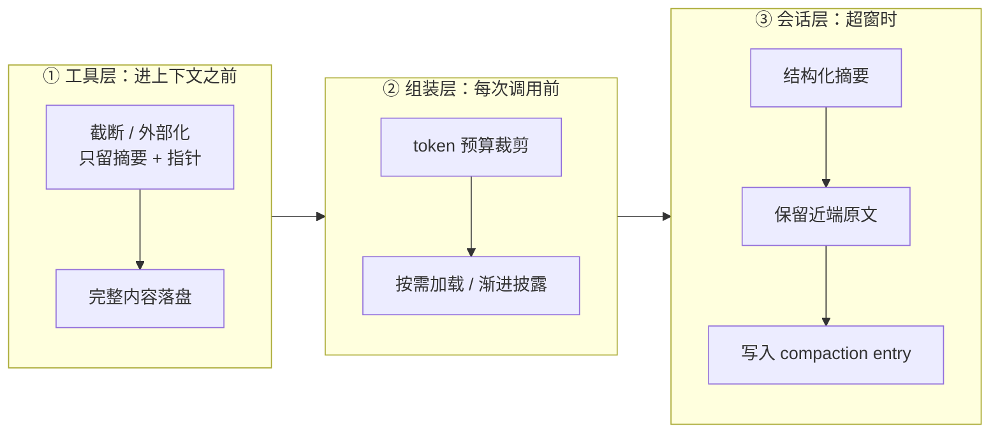
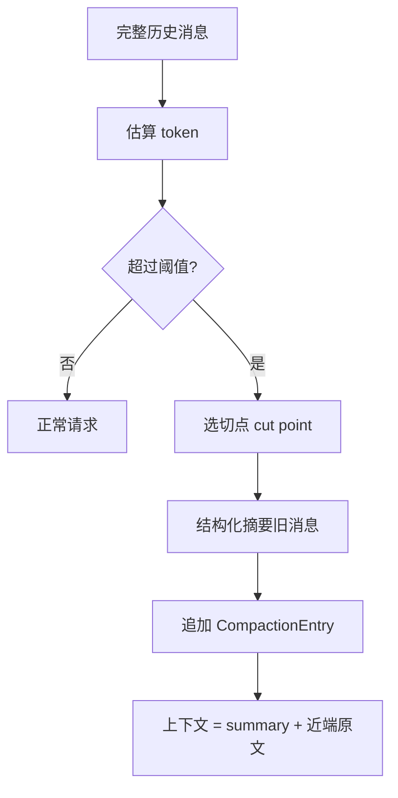

# 上下文压缩机制对比：PI / OpenClaw / Codex / WorkBuddy

> 最后修改时间：2026-10-10 21:43

> 一句话定义：上下文压缩是 **harness** /ˈhɑːnɪs/ （运行外壳）的"内存管理"——进上下文之前瘦身、组装时裁剪、超窗时摘要续命；四家实现细节不同，骨架高度一致。

> 关联阅读：压缩方法论与预算分配见 [../AI知识库/09-RAG与上下文/02-上下文工程.html](../AI知识库/09-RAG与上下文/02-上下文工程.html)；harness 是什么见 [../AI编程范式/AI辅助编程范式/09-harness-engineering.html](../AI编程范式/AI辅助编程范式/09-harness-engineering.html)；执行隔离层见 [sandbox沙箱.html](sandbox沙箱.html)；Agent 侧的"选 / 压 / 层 / 淘"见 [../Agent开发知识/13-进阶与工程化/02-上下文工程.html](../Agent开发知识/13-进阶与工程化/02-上下文工程.html)。

## 1. 为什么压缩是 harness 的第一等问题

**LLM** /ˌel el ˈem/ （ **Large Language Model** /lɑːdʒ ˈlæŋɡwɪdʒ ˈmɒdl/ ，大语言模型）能力固定、窗口有限，而 Agent 的输入只增不减：每一轮工具调用都会往上下文里灌进命令日志、文件内容、 **API** /ˌeɪ piː ˈaɪ/ （ **Application Programming Interface** /ˌæplɪˈkeɪʃn ˈprəʊɡræmɪŋ ˈɪntəfeɪs/ ，应用编程接口）返回、搜索结果。 **膨胀的来源不是对话，是工具结果。**

所以压缩不是"聊天记录太长时删一点"，它是 harness 四件事里的一件：

| harness 的职责 | 对应问题 | 压缩所处位置 |
|---------------|---------|-------------|
| 工具层 | 模型能做什么 | 工具结果 **在进上下文之前** 就瘦身 |
| 执行环境 | 在哪做、权限多大 | 被压掉的内容落盘到工作区，仍可回查 |
| 上下文托管 | 看到什么 | 预算裁剪 + 按需加载 + 超窗摘要 |
| 循环编排 | 怎么迭代 | 每轮装配与回收上下文 |

一句话铁律，四家都遵守： **窗口是 RAM** /ræm/ （ **Random Access Memory** ，随机存取存储器）， **磁盘才是真相。** 压缩只改变"模型下一轮看到什么"，完整历史一律落盘——可恢复、可回放、可审计。

**落地示例** ：本文写作过程中抓取某开源仓库 README（113 KB）。工具层没有把 113 KB 塞进上下文，而是返回 **截断视图** 并提示 `truncated output`，原文留在临时文件；模型拿到的是可读片段 + 一个指针。这就是最廉价、收益最大的一层压缩。

## 2. 三层压缩框架

把四家做法抽象出来，压缩固定在三个层次上， **顺序就是从便宜到昂贵** ：



| 层 | 触发时机 | 典型手段 | 是否落盘 | 收益 |
|----|---------|---------|---------|------|
| ① 工具层 | 工具返回的瞬间 | 截断、 **offload** /ˌɒfˈləʊd/ （外部化）、只留指针 | ✅ 落盘到工作区 | **最大** |
| ② 组装层 | 每次调用前 | 预算裁剪、技能按需加载、渐进披露 | ❌ 仅本轮视图 | 大 |
| ③ 会话层 | 超出窗口时 | **compaction** /kəmˈpækʃn/ （摘要压缩）+ 保留近端 | ✅ 写进 transcript | 中（续命） |

**为什么顺序不能颠倒** ：摘要是有损的（会丢路径、丢精确标识符、丢错误堆栈），而工具层压缩可以做到无损或可控损失。 **能用①解决的，不要用③解决。**

**落地示例** ：同一个"读完 200 个文件再回答"的任务：

| 做法 | 下一轮上下文 | 备注 |
|------|------------|------|
| 全塞 | 200 × 3 000 token ≈ 60 万 token | 直接超窗，无法入框 |
| 只用③摘要 | 约 800 token | 结论留下，但文件路径 / 行号大概率丢 |
| ①+②（推荐） | 摘要 800 + 按需读的 5 个文件 4 000 ≈ 4 800 token | 需要细节再读，路径与行号都精确 |

## 3. 四家总览

| 维度 | PI | OpenClaw | Codex | WorkBuddy |
|------|-----|----------|-------|-----------|
| 开源可验证 | ✅ 白盒 | ✅ 白盒 + 文档最细 | ❌ 行为可观测 | ❌ 闭源 |
| 摘要落盘 | ✅ 会话树 entry | ✅ **transcript** /ˈtrænskrɪpt/ entry | ✅ 原生线程 | ✅ **JSONL** /ˌdʒeɪsən ˈel/ （ **JavaScript Object Notation Lines** ，JSON 行格式） |
| 工具结果单独治理 | ✅ 截断 / 摘要 | ✅ **pruning** /ˈpruːnɪŋ/ 独立一层 | ✅ 截断 + 落盘指针 | ✅ tool-result swap |
| 切点与工具配对 | ✅ 强制配对 | ✅ 强制配对 | 未公开 | 未公开 |
| 保留近端策略 | `keepRecentTokens` | 默认 20 000 token | 未公开 | 未公开 |
| 溢出自恢复 | ✅ 压缩后重试 | ✅ 保留原请求、不重放 | ✅ 原生处理 | 未见公开 |
| 分支 / 会话树摘要 | ✅ `branch_summary` | 支持回退 / 分支 | — | — |
| 压缩器可插拔 | 模块化 | ✅ provider + context engine | ❌ | ❌ |
| 服务端压缩 | — | ✅ Anthropic 侧清除 | ✅ 原生（app-server） | — |

> 表中"未公开"表示没有任何一手来源能证实，本文不猜测。

## 4. PI：压缩是会话树里的一个 entry

PI（`earendil-works/pi`，官网 `pi.dev`）是开源编码 Agent harness；社区教学仓库 `cellinlab/how-pi-agent-works` 把它的压缩链路完整拆了出来。

### 4.1 机制

PI 把会话建模为 **会话树（Session Tree）** ，消息以只追加的 JSONL 落盘。压缩不是外部旁路，而是 **往树里追加一个 `compaction` entry** ：

1. 估算当前路径上的 token 用量，超阈值（或用户敲 `/compact`）触发；
2. 选 **cut point** /kʌt pɔɪnt/ （切点），把"旧范围"与"保留近端"分开；
3. 用模型把旧范围压成 **结构化摘要** ；
4. 追加 `CompactionEntry`，记录 `summary` + `firstKeptEntryId` + `tokensBefore`；
5. 后续组装上下文 = **摘要 + `firstKeptEntryId` 之后的原文** 。



### 4.2 四条关键不变式

| 不变式 | 内容 | 为什么必须 |
|--------|------|-----------|
| **工具配对** | 切点若落在 `assistant` 工具调用与它的 `toolResult` 之间，边界要挪开 | 拆散配对会破坏协议，模型看到"孤儿工具结果" |
| **split turn** | 单个 turn 本身就超 `keepRecentTokens` 时，turn 前缀单独摘要、后缀保留原文 | 保住连续性，又不把巨大工具输出整块塞进下一轮 |
| **续算边界** | 下次压缩从上次 `firstKeptEntryId` 附近算起，而非从上一个 compaction entry 之后算起 | 否则"上次被保留的"永远进不了摘要，近端越滚越大 |
| **branch summary** /brɑːntʃ ˈsʌməri/ | 切分支时，把"离开的那条分支"的发现摘要带走 | 探索式编程里，走过的弯路本身就是资产 |

摘要内容同样是结构化的：官方实现包含 `<read-files>`、`<modified-files>` 这类 **文件操作追踪** ，以及 `details` 字段—— **`details` 给程序读，自然语言 `summary` 给模型读。**

**落地示例** ：仓库里有 `README.md` 与 `src/api.ts`。

| 事件 | 记录 |
|------|------|
| 第 8 轮读了 `README.md`、改了 `src/api.ts` | 进 `details.readFiles` / `details.modifiedFiles` |
| 第 40 轮压缩 | 摘要写"已确认鉴权逻辑在 `src/api.ts:118`，待补测试" |
| 第 41 轮 | 模型直接读 `src/api.ts:118`，不再全仓搜索—— **省掉一次 20 次工具调用的探索** |

### 4.3 落地示例：最小 compaction 模块

主示例用 **TS** /ˌtiː ˈes/ （ **TypeScript** /ˈtaɪpskrɪpt/ ）。下面这段把四条不变式都实现出来，`summarize` 换成真实模型调用即可上线：

```typescript
/** 会话条目：与 PI / OpenClaw 的 transcript entry 同构 */
export type EntryType = "user" | "assistant" | "toolResult" | "compaction";

export interface Entry {
  id: string;
  type: EntryType;
  text: string;
  /** assistant 发起工具调用时的 callId；toolResult 用同一 callId 回指 */
  callId?: string;
  toolName?: string;
}

export interface CompactionDetails {
  readFiles: string[];
  modifiedFiles: string[];
}

export interface CompactionEntry extends Entry {
  type: "compaction";
  summary: string;
  /** 保留原文的起始 entry id；下次压缩从这个边界附近续算 */
  firstKeptEntryId: string | null;
  tokensBefore: number;
  details: CompactionDetails;
}

/**
 * 粗略 token 估算：CJK 字符约 1 字 1 token，其余约 4 字符 1 token。
 * OpenClaw 同样按 CJK 的近似权重计数；生产环境应改为读 provider 的 usage。
 */
export function estimateTokens(text: string): number {
  let cjk = 0;
  for (const ch of text) {
    if (/[\u3000-\u9fff\uff00-\uffef]/.test(ch)) cjk += 1;
  }
  return Math.ceil(cjk + (text.length - cjk) / 4);
}

export const tokensOf = (entries: Entry[]): number =>
  entries.reduce((sum, e) => sum + estimateTokens(e.text), 0);

/**
 * 选切点（不变式 ①②）：从尾部向前累加直到超过 keepRecentTokens；
 * 若切点落在 toolResult 上，把它配对的 assistant 调用一起保留。
 */
export function pickCutPoint(entries: Entry[], keepRecentTokens: number): number {
  let kept = 0;
  let cut = entries.length;
  for (let i = entries.length - 1; i >= 0; i--) {
    kept += estimateTokens(entries[i].text);
    if (kept > keepRecentTokens) break;
    cut = i;
  }
  while (cut > 0 && entries[cut]?.type === "toolResult" && entries[cut - 1]?.type === "assistant") {
    cut -= 1;
  }
  return cut;
}

/** 续算边界（不变式 ③）：找不到 firstKeptEntryId 时，退回上一个 compaction 之后 */
export function resumePoint(entries: Entry[]): number {
  const last = [...entries].reverse().find((e): e is CompactionEntry => e.type === "compaction");
  if (!last) return 0;
  const idx = entries.findIndex((e) => e.id === last.firstKeptEntryId);
  return idx >= 0 ? idx : entries.indexOf(last) + 1;
}

export interface CompactionOptions {
  /** 模型上下文窗口 */
  contextWindow: number;
  /** 预留：给输出与摘要本身留空间（OpenClaw 内嵌默认 20 000） */
  reserveTokens: number;
  /** 保留近端原文（OpenClaw 默认 20 000） */
  keepRecentTokens: number;
  summarize: (older: Entry[]) => Promise<{ summary: string; details: CompactionDetails }>;
}

/** 超窗才压缩；返回「摘要 entry + 保留的近端原文」 */
export async function compactIfNeeded(
  entries: Entry[],
  opts: CompactionOptions,
): Promise<Entry[]> {
  const used = tokensOf(entries);
  if (used + opts.reserveTokens <= opts.contextWindow) return entries;

  const cut = pickCutPoint(entries, opts.keepRecentTokens);
  const older = entries.slice(0, cut);
  const tail = entries.slice(cut);
  // 单个 turn 就超窗：真实实现走 split turn（前缀摘要 + 后缀保留）
  if (older.length === 0) return entries;

  const { summary, details } = await opts.summarize(older);
  const entry: CompactionEntry = {
    id: `cmp-${older[older.length - 1].id}`,
    type: "compaction",
    text: summary,
    summary,
    firstKeptEntryId: tail[0]?.id ?? null,
    tokensBefore: used,
    details,
  };
  return [entry, ...tail];
}
```

**代入数字** （`contextWindow = 128 000`、`reserveTokens = 20 000`）：

| 轮次 | 压缩前 token | 动作 | 压缩后 token |
|------|------------|------|------------|
| 第 40 轮 | 112 000 | 触发（112 000 + 20 000 > 128 000） | 摘要 900 + 近端 19 500 ≈ 20 400 |
| 第 90 轮 | 118 000 | 再次触发，从上次 `firstKeptEntryId` 续算 | 摘要 1 100 + 近端 19 800 ≈ 20 900 |

## 5. OpenClaw：compaction 与 pruning 分工最清楚

OpenClaw（`github.com/openclaw/openclaw`，文档 `docs.openclaw.ai`）是本文 **公开资料最细** 的一家，设计最值得直接照抄。

### 5.1 两套机制，职责不重叠

| | Compaction（摘要） | Pruning（剪枝） |
|---|---|---|
| 做什么 | 摘要旧对话 | 只剪 **旧工具结果** |
| 是否落盘 | ✅ 写进 transcript（持久） | ❌ 仅请求期投影（不重写原文） |
| 范围 | 整个会话 | 仅 `toolResult` |

> 心法： **摘要治"对话"，剪枝治"工具输出"。** 两者互补——剪枝让工具输出在两个压缩周期之间保持精简。

### 5.2 compaction 的分层预算采样

内置压缩 **一次模型请求** 处理完旧历史，但单次请求输入被限制在 **160 000 字符（约 40 000 token）** ；超了按固定分层填充：

| 份额 | 内容 | 规则 |
|------|------|------|
| 1/2 | 最新消息 **原文** | 保证近期细节不失真 |
| 1/4 | 较旧的 **用户消息** | 承载诉求 / 决策 / 纠正；每条 ≤ 2 000 字符，均匀铺开 |
| 1/10 | 最旧消息 | 保留起始语境 |
| 其余 | 剩余消息 **均匀取样** | 每段 ≤ 6 000 字符 |

每个空档都标注"漏了多少条"，并明确指示摘要器 **"不要猜测被省略的内容，且要继承上一版摘要里的事实"** 。中 / 日 / 韩（ **CJK** /ˌsiː dʒeɪ ˈkeɪ/ ， **Chinese Japanese Korean** /ˌtʃaɪˈniːz ˌdʒæpəˈniːz kəˈriːən/ ，中日韩字符）按近似 token 权重计数。

**为什么这样采样而不是简单截断** ：用户消息是 **纠正与决策** 的载体（"改成只看华东区""按同比口径"），所以单独给 1/4 份额；简单截断会把中途改过的口径丢掉。

### 5.3 safeguard 质量门：摘要不合格就不写

现在默认开启 **safeguard** /ˈseɪfɡɑːd/ （安全护栏）模式，摘要必须过质量审计：

1. 生成的正文里必须有 **规定的标题** ；
2. 即将落盘的确切文本里必须保留 **待办诉求** 与 **精确标识符** （文件名、路径、ID、数字）；
3. 不合格只允许有限次纠正重试； **全部不通过就不写 entry、保留原历史** ——而不是写入一段坏摘要。

### 5.4 pruning：软剪、硬清除、服务端清除

| 档位 | 触发条件 | 动作 |
|------|---------|------|
| **软剪** | 单条工具结果 > 4 000 字符 | 保留首尾各 1 500 字符，中间替换为 `...` |
| **硬清除** | 上下文用量 ≥ 约 50%，且可剪工具内容 ≥ 50 000 字符 | 整条替换为 `[Old tool result content cleared]` |
| **服务端清除** | Anthropic 直连（API Key） | 交给服务端 tool-result clearing，不再本地剪 |

服务端路径的参数是 **推导出来** 的，不需要额外配置：

| 参数 | 取值 |
|------|------|
| `trigger` | `max(50 000, floor(窗口 × 0.3))` |
| `keep` | 最近 **3** 次工具调用及其结果 |
| `clear_at_least` | `max(12 500, floor(窗口 × 0.05))` |
| `clear_tool_inputs` | `false`（保留工具入参） |

两条容易忽略的细节：

- **TTL** /ˌtiː tiː ˈel/ （ **Time To Live** /taɪm tuː lɪv/ ，存活时间）门控：客户端剪枝要等缓存 TTL 过期才动手（默认 5 分钟，Anthropic 插件播种为 1 小时）， **避免打碎 prompt cache** /prɒmpt kæʃ/ （提示缓存）前缀——否则省下的输入 token 还不够付缓存重建的钱。
- **图片清理** ：至少保留最近 3 个完整 turn 逐字节不变，之后每 8 个 turn 推进一次边界，旧图替换为已处理标记，防止图片负载反复打爆 prompt cache。

### 5.5 保留量与触发路径

| 配置 | 默认值 | 含义 |
|------|--------|------|
| `keepRecentTokens` | 20 000 | 保留近端原文的预算（手动 `/compact` 也用它） |
| `reserveTokens` | 20 000（窗口 ≥ 80 000 时） | 给输出与压缩摘要预留；上限为窗口的 1/4 |

触发三条路：

1. **阈值** ：接近上限时自动压缩；
2. **溢出恢复** ：provider 报上下文超限 → **压缩后重试** ，保留原请求、不重放已完成的动作；
3. **手动** ：`/compact`，可聚焦话题（如 `/compact Focus on <topic>`）。

另外，压缩前还会做一次 **memory flush** /ˈmeməri flʌʃ/ （记忆刷新）：用静默 turn 把要点写进长期记忆，避免摘要把关键约束丢掉。

**落地示例** ：数据分析类会话的调参取舍。

| 会话特点 | 调参方向 |
|----------|---------|
| 工具输出巨大（图表 JSON / 明细表） | 优先开 pruning 让它先剪，别指望摘要兜底 |
| 多轮反复改口径（"只看华东区"） | `keepRecentTokens` 调高，并在摘要指令里强制保留硬约束 |
| Anthropic 直连 | 走服务端清除，本地别再叠一层 |
| 本地小模型（窗口 32 k） | `reserveTokens` 被压到窗口 1/4，此时必须靠 pruning 而不是 compaction |

## 6. Codex：原生压缩归 app-server

### 6.1 机制

> ⚠️ 来源说明：本文写作时本机网络对 `developers.openai.com`、`platform.openai.com` 一律返回 `403`，官方文档抓取脚本同样被拒。因此本节以 **产品实际行为** 为准，并引用 OpenClaw 对其集成路径的观察作为交叉验证。

- **压缩归 app-server 所有** ：OpenClaw 的 Codex harness 运行时文档明确写"token 压力压缩与手动线程压缩由 Codex app-server 原生负责"，压缩完成会发出 `contextCompaction` 完成项。
- **两条入口** ：自动的 token 压力压缩，以及手动 `/compact`（集成方通过 `thread/compact/start` 请求，并等待对应完成项）。
- **原生线程是唯一真相** ：集成方只能维护 **只读镜像** ，不能改写 Codex 的原生线程记录。
- **集成方兜底** ：当集成方自身镜像字节数超阈值时，会先做一次它的语义压缩；若不成功，则退化为"最近整 turn 的有界投影"，并 **明确提示用户重发关键细节** （被省略的历史无法再回到上下文）。

### 6.2 可观测的三层（本会话实证）

| 层 | 我在本次会话中观察到的现象 |
|----|--------------------------|
| ① 工具层 | 抓取 113 KB README 时，输出被标注 `truncated output`，我只拿到截断样本，原文在磁盘 |
| ② 组装层 | 注入的 skill 我只看到 **名称与描述** （元数据），要用时才读 `SKILL.md`；`AGENTS.md` 是常驻指令 |
| ③ 会话层 | 上下文吃紧时把更早历史压成检查点，线程继续往下走， **且压缩内部细节不对外暴露** |

### 6.3 明确的不确定项

以下问题 **没有一手来源** ，本文不下结论：切点如何与工具调用配对、摘要模板长什么样、`keepRecent` 具体阈值、是否支持分支摘要。

这条"不透明"本身与 OpenClaw 文档相互印证：它记录原生压缩的起止状态，但 **不暴露人类可读的压缩摘要，也不暴露 Codex 保留了哪些条目** ——说明这些细节没有公开接口。

## 7. WorkBuddy：闭源，但"记忆外置"是主线

### 7.1 先说证据边界

WorkBuddy 属腾讯 CodeBuddy 家族， **闭源、无公开压缩规范** 。因此本节只写两类可验证材料：

1. **本仓库可观测配置** ：`.workbuddy/memory/MEMORY.md` + 按日期笔记 + `.workbuddy/rules/*.mdc`（与 `.cursor/rules/`、`.codebuddy/rules/` 三端同步）；
2. **社区 clean-room 教学仓库** `adongwanai/learn-workbuddy`（明确声明是教学复刻、非源码提取）。

> 不做机制臆测：凡是它内部怎么切分、摘要模板如何，本文一律留白。

### 7.2 公开可验证的三条主线

| 主线 | 内容 | 对应本文框架 |
|------|------|-------------|
| **tool-result swap** | 大输出外部化，history 只留摘要 + 指针 | ① 工具层 |
| **append-only JSONL transcript** | 会话事件只追加，可恢复可回放 | ③ 会话层的落盘形态 |
| **记忆分层** | workspace memory / user memory / remote profile | ② 组装层的长期输入 |

教学仓库把心法写成一句话： **上下文窗口是 RAM，JSONL、SQLite、记忆文件和 tool-results 是磁盘。** 它还专门为"压缩不变量"和"压缩后能否 fresh-process 恢复"设计了评测用例——这一点比多数 harness 更工程化。

### 7.3 落地示例：文件式记忆注入

WorkBuddy 的规则 / 记忆是 **磁盘文件** ，所以注入时同样是"索引 + 预算"，而不是全文搬运：

```typescript
export interface MemorySource {
  path: string;
  /** 命中相关性 0~1，由检索或规则匹配给出 */
  score: number;
  /** 单文件注入上限，防单文件吃光预算 */
  maxChars: number;
}

export interface MemorySlot {
  path: string;
  text: string;
  truncated: boolean;
}

/**
 * 记忆注入：按分数排序 + 逐条限长 + 总预算封顶。
 * 全文始终留在磁盘，模型只看到"命中片段 + 路径指针"。
 */
export function buildMemoryContext(
  sources: MemorySource[],
  read: (path: string) => string,
  budgetChars = 12_000,
): { slots: MemorySlot[]; usedChars: number; omitted: string[] } {
  const slots: MemorySlot[] = [];
  const omitted: string[] = [];
  let used = 0;

  for (const src of [...sources].sort((a, b) => b.score - a.score)) {
    const full = read(src.path);
    const cap = Math.min(src.maxChars, budgetChars - used);
    if (cap <= 0) {
      omitted.push(src.path);
      continue;
    }
    const text = full.length > cap ? full.slice(0, cap) : full;
    slots.push({ path: src.path, text, truncated: text.length < full.length });
    used += text.length;
  }

  return { slots, usedChars: used, omitted };
}
```

**代入数字** ：3 条规则文件 + 1 份 `MEMORY.md`，单文件上限 4 000 字符、总预算 12 000 字符。命中 4 条时实际注入 ≈ 11 400 字符（约 3 000 token）， **超预算的第 5 条只留路径** 由模型按需读——和 OpenClaw 的"分层预算"是同一个思路。

## 8. 三条可复用结论

1. **先做工具层，再谈摘要。** 四家都在"进上下文之前"动手（截断 / 外部化 / 只留指针），摘要只是兜底。你的大数据（图表 JSON、明细表）就应该走这条。
2. **摘要必须结构化 + 保标识符 + 可校验。** OpenClaw 的 safeguard 模式（必留标题 / 待办 / 精确标识符 + 质量审计 + 不合格不写）是现成的模板。
3. **压缩要能"续算"。** PI 的 `firstKeptEntryId` 规则解决一个隐藏坑：被保留的原文下一轮该有机会重新进摘要，否则近端越滚越大。

## 9. 自建 harness 落地清单

| 周 | 目标 | 关键动作 | 验收指标 |
|----|------|---------|---------|
| W1 | 工具层 | 工具输出截断 + 完整内容落盘 + 返回指针；补 token 埋点 | 单条工具结果入上下文 ≤ 2 000 token |
| W2 | 组装层 | 预算分配 + 技能只注入索引 + 剪枝（TTL 门控） | prompt cache 命中率 > 60% |
| W3 | 会话层 | compaction entry + 工具配对 + 结构化摘要（含 `details`） | 压缩后上下文 < 窗口 25%，路径/ID 不丢 |
| W4 | 回归 | 黄金集回归 + 溢出恢复演练 + 续算验证 | 结论准确率 ≥ 90%，溢出 0 失败 |

工具栈速查：

| 环节 | 选型 |
|------|------|
| 运行时 | Node.js 20 + TypeScript 5 |
| 落盘 | JSONL（transcript）+ SQLite（会话索引） |
| token 计数 | `gpt-tokenizer` 估算 + provider `usage` 校准 |
| 观测 | OpenTelemetry + Grafana（按层打 token 与延迟标签） |
| 回归 | 50 ~ 100 条黄金集 + 压缩前后结论对比 |

## 10. 常见坑

| 坑 | 后果 | 对策 |
|----|------|------|
| 只做摘要，不做工具层压缩 | 摘要刚压完，下一轮工具输出又把窗口塞满 | pruning 与 compaction 同时上，见 5.1 |
| 切点切在工具调用与结果之间 | 出现"孤儿工具结果"，协议错乱 | 强制配对（4.2 不变式①） |
| 压缩后从"上一个 compaction 之后"续算 | 近端越滚越大，压缩越来越无效 | 从 `firstKeptEntryId` 续算 |
| 摘要里丢掉精确标识符 | 模型凭空编造路径 / 数字 | 审计 + 强制保留清单（5.3） |
| 每轮都摘要 | 成本与延迟随轮次上涨 | 只在超阈值 / 溢出 / 手动时触发 |
| 忽略 prompt cache 前缀 | 剪枝省下的 token 不够付缓存重建 | TTL 门控 + 保持前缀字节稳定 |
| 压缩后不回归 | 悄悄变笨，用户先发现 | 黄金集 + 灰度 |

## 11. 学习要点

- 压缩分三层： **工具层（最赚）→ 组装层 → 会话层（兜底）** ，顺序不能颠倒。
- 铁律： **窗口是 RAM，磁盘是真相** ；压缩只改"下一轮看到什么"。
- 两条必须写进代码的不变式： **工具调用与结果配对** 、 **摘要续算边界** 。
- 摘要要结构化并保留精确标识符；不合格宁可不写。
- 三家开源实现给出的默认值（`keepRecentTokens` 20 000、`reserveTokens` 20 000、单次摘要输入 ≤ 40 000 token）可以直接当起点。

## 12. 资料来源与可信度

| 对象 | 来源 | 可信度 |
|------|------|--------|
| PI | 官方仓库 `earendil-works/pi` + 教学仓库 `cellinlab/how-pi-agent-works`（`docs/concepts/context.md`、`docs/source/advanced-compaction.md`、`docs/source/session-compaction.md`） | 高（白盒 + 二手教学） |
| OpenClaw | 官方文档 `docs.openclaw.ai`：`concepts/compaction`、`concepts/session-pruning`、`reference/session-management-compaction/compaction`、`plugins/codex-harness-runtime/compaction`；仓库 `github.com/openclaw/openclaw` | 高（一手官方文档） |
| Codex | 产品实际行为 + OpenClaw 集成文档的观察 | 中（官方文档返回 `403`，未取到一手页面） |
| WorkBuddy | 本仓库 `.workbuddy/` 可观测配置 + 社区 clean-room 教学仓库 `adongwanai/learn-workbuddy` | 低-中（闭源，无官方规范） |
| 通用方法论 | [../AI知识库/09-RAG与上下文/02-上下文工程.html](../AI知识库/09-RAG与上下文/02-上下文工程.html)、[../Agent开发知识/13-进阶与工程化/02-上下文工程.html](../Agent开发知识/13-进阶与工程化/02-上下文工程.html) | 高（本仓库已整理） |

## 13. 本文缩写

| 缩写 | 音标 | 全拼 | 中文 |
|------|------|------|------|
| **LLM** | /ˌel el ˈem/ | Large Language Model | 大语言模型 |
| **API** | /ˌeɪ piː ˈaɪ/ | Application Programming Interface | 应用编程接口 |
| **RAM** | /ræm/ | Random Access Memory | 随机存取存储器 |
| **TTL** | /ˌtiː tiː ˈel/ | Time To Live | 存活时间 |
| **CJK** | /ˌsiː dʒeɪ ˈkeɪ/ | Chinese Japanese Korean | 中日韩字符 |
| **JSONL** | /ˌdʒeɪsən ˈel/ | JavaScript Object Notation Lines | JSON 行格式 |
| **TS** | /ˌtiː ˈes/ | TypeScript | 类型化 JavaScript 超集 |

