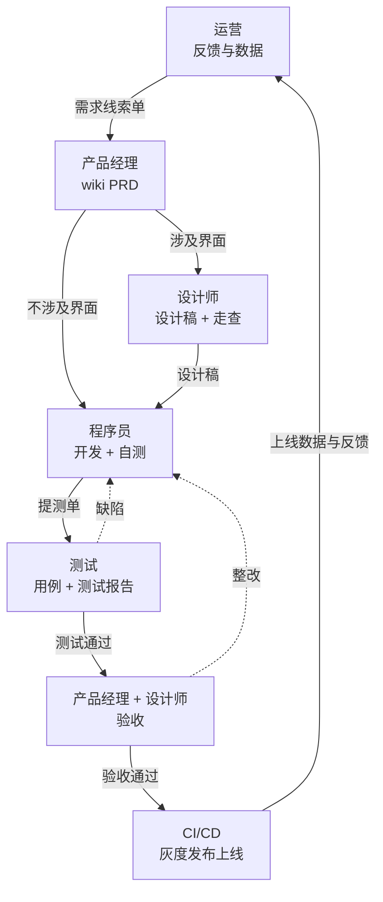

# 智能员工（软件公司）：角色拆分与场景地图

> 整理日期：2026-10-26
> 状态：🟢 程序员篇已补齐（2026-10-26）；其余 4 篇角色文档骨架待补正文
> 定位：以「角色」为单位，拆解智能员工在软件公司交付流水线中的职责、交接物与场景
> 主线：运营 → 产品经理 → 设计师（按需）→ 程序员 → 测试 → 产品经理 + 设计师验收 → CI/CD 上线
> 范围：`软件公司/` 下 5 个角色文档；`传统企业/` 保留，后续按岗位平移

这套拆分不按流程节点铺开，而是按角色收口：每个角色只对自己那段输入、输出和签字负责。智能员工嵌在角色内部，替角色完成可验收的那部分工作，角色保留最终判断权。

产品经理在 **wiki** /ˈwɪki/ 上维护的 **PRD** /ˌpiː ɑːr ˈdiː/ （ **Product Requirements Document** /ˈprɒdʌkt rɪˈkwaɪəmənts ˈdɒkjumənt/ ，产品需求文档）是唯一需求源；最后一段由 **CI/CD** /ˌsiː ˈaɪ siː ˈdiː/ （ **Continuous Integration** /kənˈtɪnjuəs ˌɪntɪˈɡreɪʃn/ / **Continuous Delivery** /kənˈtɪnjuəs dɪˈlɪvəri/ ，持续集成 / 持续交付）把变更送上线。

**智能员工** （ **AI** /ˌeɪ ˈaɪ/ 即 **Artificial Intelligence** /ˌɑːtɪˈfɪʃl ɪnˈtelɪdʒəns/ ，人工智能； **AI Employee** /ˌeɪ ˈaɪ ɪmˈplɔɪiː/ ）在这里指：一段可命名的职责 + 工具权限 + 可验收交付物 + 指标与审计。缺任何一项，都只是助手。

| 判据 | 追问 | 不满足时 |
|------|------|----------|
| 岗位职责 | 有没有稳定、可命名的一段职责？ | 聊天机器人 |
| 工具权限 | 能不能读数据、调系统、把结果写回去？ | 问答助手 |
| 交付物 | 有没有可验收的产物（PRD、设计稿、提测单、测试报告）？ | 建议工具 |
| 指标与审计 | 有没有指标、留痕、复核与回滚？ | 自动化脚本 |

## 一、角色流水线



固定 7 步，只有第 3 步可以按需跳过：

1. 运营 → 产品经理：提交需求线索单。
2. 产品经理：在 wiki 写 PRD，定验收标准与优先级。
3. 产品经理 → 设计师：涉及界面时，出设计需求单与设计稿。
4. 程序员：按 PRD（和设计稿）开发，自测后提交提测单。
5. 测试：按提测单执行测试，出测试报告。
6. 产品经理 + 设计师：逐条验收需求与视觉。
7. 程序员触发 CI/CD，灰度发布上线；运营接手数据与反馈。

两条硬规则：

- PRD 以 wiki 页面为准。聊天、会议、口头变更必须回写 wiki，否则视为没发生。
- 上线不是终点。运营的数据与反馈回到第 1 步，流水线才闭环。

## 二、五个角色一览

| 顺序 | 角色 | 上游 | 核心输入 | 核心产出 | 下游 | 目标等级 | 文档 |
|------|------|------|----------|----------|------|----------|------|
| 1 | 运营 | 用户、客服、销售、数据看板 | 反馈、工单、埋点、竞品动态 | 需求线索单、上线效果日报 | 产品经理 | L2 | [运营.md](软件公司/运营.md) |
| 2 | 产品经理 | 运营、老板、客户 | 需求线索、业务目标、历史 PRD | wiki PRD、验收记录 | 设计师 / 程序员 / 测试 | L2–L3 | [产品经理.md](软件公司/产品经理.md) |
| 3 | 设计师 | 产品经理 | PRD、设计需求单 | 设计稿、走查清单 | 程序员 / 产品经理 | L1–L2 | [设计师.md](软件公司/设计师.md) |
| 4 | 程序员 | 产品经理、设计师 | PRD、设计稿、接口约束 | 技术方案、代码、提测单、发布单 | 测试 / CI/CD | L3 | [程序员.md](软件公司/程序员.md) |
| 5 | 测试 | 程序员 | 提测单、PRD、历史缺陷 | 用例、缺陷单、测试报告 | 产品经理 / 设计师 / 程序员 | L3 | [测试.md](软件公司/测试.md) |

CI/CD 不是第六个角色：程序员维护流水线，测试守质量门禁，产品经理签上线，运营盯上线后指标。

`传统企业/` 不照搬这 5 个角色，而是按财务、人力、客服、供应链、销售等岗位切；复用同一套「角色边界 + 交接物 + 场景卡 + 指标」框架，只换数据源与签字人。

## 三、交接物与退回条件

每个角色只对交接物负责。交接物不合格，下游有权退回，不算「不配合」。

| 交接物 | 产出 | 接收 | 必填字段 | 退回条件 |
|--------|------|------|----------|----------|
| 需求线索单 | 运营 | 产品经理 | 来源、场景、频次、影响用户数、证据链接、期望收益 | 无证据；影响面说不清 |
| 设计需求单 | 产品经理 | 设计师 | 页面清单、状态、约束、验收标准、参考 | 缺状态；缺组件约束 |
| wiki PRD | 产品经理 | 设计师 / 程序员 / 测试 | 背景、目标、范围、流程、验收标准、边界、埋点、上线计划 | 验收标准不可测；未决问题无负责人 |
| 设计稿 + 走查清单 | 设计师 | 程序员 / 产品经理 | 页面、标注、组件映射、空 / 加载 / 错误 / 无权限 | 四态缺失；组件不在库 |
| 提测单 | 程序员 | 测试 | 变更范围、环境、自测结果、影响面、回滚方案、已知风险 | 单测未过；主流程未自测；无回滚 |
| 测试报告 | 测试 | 产品经理 / 设计师 / 程序员 | 覆盖范围、执行率、通过率、缺陷分级、遗留风险、结论 | 用例未执行完；阻断缺陷无结论 |
| 验收记录 | 产品经理 + 设计师 | 程序员 / 发布 | 验收标准逐条结论、视觉走查、整改项 | 有阻断项；验收标准未逐条勾 |
| 发布单 + 灰度报告 | 程序员 + 测试 | 全员 | 变更、配置、灰度策略、观察指标、回滚阈值、结论 | 无回滚；无观察窗口 |

数字门槛建议（可按团队调整）：

- 提测：单测通过率 100%，主流程自测 100%，阻断与严重缺陷 0，回滚方案必填。
- 测试：用例执行率 100%，通过率 ≥ 98%，遗留缺陷必须有分级与风险结论。
- 验收：PRD 验收标准逐条勾选，视觉阻断项 0。
- 发布：灰度 10% → 50% → 100%，每段观察 ≥ 30 分钟。

## 四、角色 × 决策权

A 拍板，R 执行，C 被咨询，I 知会。

| 事项 | 运营 | 产品经理 | 设计师 | 程序员 | 测试 |
|------|------|----------|--------|--------|------|
| 需求是否立项 | C | A | I | I | I |
| 需求优先级 | C | A | I | C | I |
| PRD 定稿 | C | A | C | C | C |
| 设计定稿 | I | C | A | C | I |
| 提测准入 | I | I | I | A | C |
| 测试结论 | I | I | I | C | A |
| 上线准入 | I | A | C | R | C |
| 回滚决策 | I | C | I | A / R | C |

一条底线：A 必须是人。智能员工可以准备材料、给建议、执行动作，但不拍板。

## 五、每个角色的智能员工场景

### 5.1 运营

| 场景 | 触发 | 输入 | 输出 | 人机分工 | 指标 | 等级 |
|------|------|------|------|----------|------|------|
| 反馈聚类与去重 | 每周固定 + 反馈突增 | 客服记录、社群、工单、应用商店评论 | 主题簇、频次、影响用户数、原文证据 | AI 聚类，运营定优先级 | 聚类准确率 ≥ 85%；处理 2 小时 → 20 分钟 | L2 |
| 需求线索初筛 | 新反馈进入 | 聚类结果、客户分层、历史需求 | 需求线索单 | AI 起草，运营确认 | 字段完整率 100%；无效需求下降 30% | L2 |
| 上线效果日报 | 每日 09:00 | 埋点、订单、客服量、告警 | 日报 + 异常项 + 假设 | AI 生成，运营解读 | 异常发现 < 1 天 | L2 |
| 活动配置与文案 | 活动上线前 | 活动规则、库存、客群、历史文案 | 配置草稿 + 3 版文案 | AI 生成，运营审核 | 配置错误 0；文案采纳率 ≥ 60% | L1–L2 |
| 舆情与异常升级 | 差评突增 / 告警 | 评论、工单、监控 | 事件单 + 升级建议 | AI 初判，运营决策 | 15 分钟内升级 | L2 |

边界：运营不拍需求优先级，不改 PRD，不承诺上线时间。

### 5.2 产品经理

| 场景 | 触发 | 输入 | 输出 | 人机分工 | 指标 | 等级 |
|------|------|------|------|----------|------|------|
| 需求澄清问答 | 收到线索单 | 线索、历史 PRD、数据 | 澄清问题清单 | AI 提问，产品经理确认 | 澄清轮次 3 → 1 | L2 |
| wiki PRD 生成 | 需求立项 | PRD 模板、线索、竞品、历史需求 | PRD 草稿（八段） | AI 起草，产品经理定稿 | 初稿 2.5 人日 → 0.5 人日 | L2–L3 |
| 验收标准与边界 | PRD 起草中 | 用户故事、流程图 | 可测验收标准 + 边界清单 | AI 生成，产品经理签字 | 验收标准可测率 100% | L3 |
| 历史需求与竞品检索 | 评审前 | 需求库、竞品页面 | 相似需求、冲突点、竞品做法 | AI 检索，产品经理判断 | 重复需求下降 20% | L2 |
| 评审纪要与决议 | 评审会结束 | 会议记录 | 纪要、决议、负责人、截止日 | AI 整理，产品经理确认 | 24 小时内发出 | L2 |
| 验收清单 | 测试完成 | PRD 验收标准、测试报告 | 逐条验收清单 | AI 预填，产品经理 + 设计师确认 | 验收漏项 0 | L2 |

边界：产品经理不替设计师定视觉，不替程序员定技术方案，不替测试下质量结论。

### 5.3 设计师

| 场景 | 触发 | 输入 | 输出 | 人机分工 | 指标 | 等级 |
|------|------|------|------|----------|------|------|
| 信息架构与流程草图 | 收到设计需求单 | PRD、页面清单 | 流程图 + 低保真 | AI 生成，设计师定稿 | 草图 2 小时 → 30 分钟 | L1 |
| 组件库匹配 | 设计开始 | 设计系统、组件库 | 组件映射表 | AI 推荐，设计师确认 | 组件复用率 ≥ 80% | L2 |
| 设计稿变体 | 高保真阶段 | 草图、品牌规范 | 2–3 套视觉方案 | AI 生成，设计师挑选 | 方案探索 1 天 → 2 小时 | L1 |
| 状态覆盖走查 | 设计定稿前 | 设计稿、PRD | 空 / 加载 / 错误 / 无权限 / 超长清单 | AI 检查，设计师补全 | 四态覆盖 100% | L2 |
| 设计验收 | 测试通过后 | 实现页面、设计稿 | 视觉走查清单 | AI 比对，设计师签字 | 视觉缺陷遗漏 ≤ 1 | L1–L2 |
| 文案与国际化 | 设计 / 开发中 | 页面文案、术语表 | 文案 + 多语言 key | AI 生成，设计师确认 | 术语一致率 100% | L1 |

边界：没有 PRD 不接设计需求；不做技术实现决策；验收只对视觉与交互负责。

### 5.4 程序员

| 场景 | 触发 | 输入 | 输出 | 人机分工 | 指标 | 等级 |
|------|------|------|------|----------|------|------|
| 技术方案与影响面 | PRD 定稿 | PRD、代码库、架构约束 | 方案选项、影响文件、风险 | AI 起草，开发负责人定稿 | 方案评审 1 小时 → 20 分钟 | L2 |
| 接口契约与数据模型 | 方案确定 | PRD、现有 schema | 契约、类型、迁移脚本 | AI 生成，开发确认 | 契约返工 ≤ 1 次 | L3 |
| 编码实现 | 任务开始 | PRD、设计稿、契约 | 代码 + 单测 | AI 执行，人评审 | 单测覆盖 ≥ 80% | L3 |
| 提测单 | 开发完成 | 变更、自测结果 | 提测单 | AI 汇总，开发签字 | 提测退回率 25% → 5% | L2–L3 |
| 代码评审 | 提交合并 | 变更、规范、历史缺陷 | 分级意见 + 证据 | AI 预审，人裁决 | 首轮评审 78 → 34 分钟 | L3 |
| CI 修复与发布单 | CI 失败 / 发布前 | 日志、变更、配置 | 修复补丁、发布单、回滚方案 | AI 执行，人确认 | CI 平均修复 30 → 8 分钟 | L3 |

边界：不自行改 PRD 验收标准；不绕过测试上线；不把「能跑」当「可提测」。

完整实践见 [程序员.md](软件公司/程序员.md)：十项最佳实践、任务包、CR 四镜与 REQ-2026-042 落地样例。

### 5.5 测试

| 场景 | 触发 | 输入 | 输出 | 人机分工 | 指标 | 等级 |
|------|------|------|------|----------|------|------|
| 测试计划与用例 | 收到提测单 | PRD、提测单、历史缺陷 | 用例集 + 覆盖矩阵 | AI 生成，测试评审 | 用例设计 8 小时 → 2 小时 | L3 |
| 自动化脚本 | 用例确定 | 用例、页面结构 | 端到端 / 接口脚本 | AI 生成，测试维护 | 回归 6 小时 → 1.5 小时 | L3 |
| 缺陷定位 | 用例失败 | 日志、链路、变更 | 复现步骤 + 根因假设 | AI 分析，测试确认 | 定位 2 小时 → 20 分钟 | L2–L3 |
| 回归范围选择 | 每次提测 | 变更影响面、历史缺陷 | 回归清单 | AI 推荐，测试确认 | 阻断与严重缺陷漏测 0 | L3 |
| 测试报告 | 测试完成 | 执行结果、缺陷 | 报告 + 风险结论 | AI 汇总，测试签字 | 报告 2 小时 → 15 分钟 | L2 |
| 发布质量门禁 | 发布前 | 报告、灰度指标 | 放行 / 拦截建议 | AI 判定，测试 + 产品经理签字 | 变更失败率 18% → 10% | L3 |

边界：不替产品经理判断需求价值；不替程序员修业务代码（可提修复建议）；测试报告必须给结论，不能只贴数据。

## 六、CI/CD：不是角色，是共同门禁

发布单至少七项：变更清单、依赖顺序、配置差异、灰度策略、观察指标、回滚阈值、通知对象。

- 灰度三段：10% → 50% → 100%，每段观察 ≥ 30 分钟。
- 回滚阈值（示例）：5xx 错误率 > 1%，95 分位延迟 > 基线 1.5 倍，核心转化下降 > 5%。
- 签字：程序员执行发布，测试确认质量门禁，产品经理确认业务，运营知会。
- 智能员工：生成发布单、比对配置差异、盯灰度指标、起草回滚动作、生成发布复盘。

发布质量用 **DORA** /ˈdɔːrə/ （ **DevOps Research and Assessment** /ˈdevɒps rɪˈsɜːtʃ ənd əˈsesmənt/ ，DevOps 研究与评估）四项看：部署频率、变更前置时间、变更失败率、平均恢复时间。

## 七、角色场景卡模板

角色文档里的每个场景都按这张卡写，缺项视为未完成：

| 字段 | 要写清什么 |
|------|------------|
| 1. 角色边界 | 上游是谁、下游是谁、这个角色不负责什么 |
| 2. 触发与频次 | 事件触发还是定时；一周几次 |
| 3. 输入与权限 | 数据源、系统、读写范围、脱敏 |
| 4. 输出物 | 对应哪份交接物，字段是否齐全 |
| 5. 人机分工 | AI 做哪段、人做哪段、谁签字 |
| 6. 成熟度 | 当前 L?、目标 L?、为什么封顶 |
| 7. 指标 | 效率、质量、风险各至少 1 个 |
| 8. 失败模式与护栏 | 前三种失败方式、拦截手段、回滚 |
| 9. 落地示例 | 带数字的端到端例子 |
| 10. 工具与提示词 | 现有系统、模板、提示词版本 |
| 11. 对应交接物 | 需求线索单 / PRD / 设计稿 / 提测单 / 测试报告 / 验收记录 / 发布单 |

## 八、落地样例：批量导入客户从反馈到上线

背景：一家 120 人的企业软件公司，6 个研发小队，双周迭代。运营收到「批量导入客户」相关反馈 12 条，影响 38 家客户。

| 时间 | 角色 | 动作 | 交接物 | 智能员工参与 | 结果 |
|------|------|------|--------|--------------|------|
| D1 | 运营 | 12 条反馈聚类、去重、补证据 | 需求线索单 | AI 聚类、生成初筛 | 影响 38 家客户，证据 12 条 |
| D2 | 产品经理 | 澄清 3 个问题，写 PRD | wiki PRD v0.1 | AI 起草八段 + 验收标准 | 初稿 40 分钟，未决问题 3 个 |
| D3 | 设计师 | 出列表页、导入弹窗、失败结果页 | 设计稿 + 走查清单 | AI 草图、组件映射 | 组件复用 85%，四态齐全 |
| D4–D6 | 程序员 | 方案、契约、编码、单测、自测 | 提测单 | AI 方案、契约、编码、预评审 | 单测覆盖 84%，提测一次通过 |
| D7–D8 | 测试 | 42 条用例、接口与端到端回归 | 测试报告 | AI 用例、脚本、缺陷定位 | 发现 7 个缺陷，通过率 98%，遗留 1 个低优先级 |
| D9 | 产品经理 + 设计师 | 逐条验收 + 视觉走查 | 验收记录 | AI 预填验收清单 | 2 条整改，1 天完成 |
| D10 | 程序员 + 测试 | 灰度 10% → 50% | 灰度报告 | AI 盯指标、比对配置 | 无回滚 |
| D11 | 程序员 + 运营 | 放量 100%，出效果日报 | 发布单 + 日报 | AI 生成复盘与日报 | 转化 +6%，无阻断故障 |

对比试点前：需求到上线 21 → 11 天；返工 2 → 1 次；提测退回率 25% → 4%；缺陷逃逸 3 → 0；变更失败率 18% → 10%。

以上数字是用于写作的示例假设，落地时按自己的基线重测。

## 九、先做哪个角色

| 顺序 | 角色 | 首个场景 | 为什么先做 |
|------|------|----------|------------|
| 1 | 产品经理 | wiki PRD + 验收标准 | 所有下游的输入；PRD 不清楚，后面全是返工 |
| 2 | 测试 | 用例生成 + 测试报告 | 输出最容易当场验证，两周能看到数字 |
| 3 | 程序员 | 提测单 + 代码评审 | 高频、可量化，但要等 PRD 与设计基线稳定 |
| 4 | 运营 | 反馈聚类 + 上线日报 | 数据依赖低，适合做需求源头治理 |
| 5 | 设计师 | 状态走查 + 设计验收 | 依赖设计系统与组件库，前置条件最多 |

先做「输入质量」，再做「执行速度」。顺序反了，只会把错误的需求更快地送上线。

## 十、目录结构与写作约定

```text
posts/AI/智能员工/
├── README.md                 # 本文件：角色地图、交接物、决策权、场景索引
├── 传统企业/                  # 按职能岗位切（待建）
└── 软件公司/
    ├── 运营.md                # ⬜ 骨架已建，正文待写
    ├── 产品经理.md            # ⬜ 骨架已建，正文待写
    ├── 设计师.md              # ⬜ 骨架已建，正文待写
    ├── 程序员.md              # ⬜ 骨架已建，正文待写
    └── 测试.md                # ⬜ 骨架已建，正文待写
```

写角色文档时遵守七条：

1. 固定七段：角色边界、日常动作、智能员工场景、交接物模板、指标与护栏、落地示例、工具与提示词。
2. 每个场景按场景卡 11 项写，缺项视为未完成。
3. 每个场景至少 1 个数字指标和 1 个失败模式。
4. 不写「AI 替代某角色」，只写「AI 接手哪段可验收工作，谁签字」。
5. 需求优先级、设计定稿、上线准入、回滚决策不由智能员工拍板。
6. `README.md` 里的相对链接用 `.md`，构建脚本会改写；非 README 正文互链用 `.html`。
7. 英文术语首次出现加 IPA，缩写给全拼与中文，文末汇总。

## 十一、已有相关文档

| 主题 | 文档 | 怎么用 |
|------|------|--------|
| 智能体基础 | [什么是 Agent](../Agent开发知识/01-基础概念/01-什么是Agent.md) | 工具、记忆、规划的能力底座 |
| 架构范式 | [设计模式总览](../Agent设计模式/00-总览.md) | 选推理、规划执行、反思等形态 |
| 智能体编程 | [Agentic Coding](../AI编程范式/AI辅助编程范式/02-agentic-coding.md) /eɪˈdʒentɪk ˈkəʊdɪŋ/ | 程序员的编码与评审基线 |
| 规格驱动 | [Spec-Driven Development](../AI编程范式/AI辅助编程范式/04-spec-driven-development.md) /spek ˈdrɪvn dɪˈveləpmənt/ | 产品经理的 PRD 与验收标准 |
| 工作流编排 | [什么是 WorkFlow](../WorkFlow/00-什么是WorkFlow.md) /ˈwɜːkfləʊ/ | 多角色串成流水线时的编排 |
| 终端智能体 | [Claude Code 使用指南](../Harness/成品harness/Claude%20Code/Claude-Code使用指南.md) /klɔːd kəʊd/ | 程序员的工程化参考 |
| 全库目录 | [归档页（全库目录）](/archive.html) | 回到上层知识地图 |

## 十二、下一步

1. 程序员篇已补齐；按 产品经理 → 测试 → 运营 → 设计师 的顺序补其余 4 篇。
2. 每篇已建「角色边界 + 交接物模板 + 指标」骨架，下一步补 3–6 个场景卡与落地示例。
3. 决定是否把 `智能员工` 挂到 `posts/AI/README.md` 总索引（本次未改父级索引）。

## 本文缩写

| 缩写 | 音标 | 全拼 | 中文 |
|------|------|------|------|
| **AI** | /ˌeɪ ˈaɪ/ | Artificial Intelligence | 人工智能 |
| **PRD** | /ˌpiː ɑːr ˈdiː/ | Product Requirements Document | 产品需求文档 |
| **CI/CD** | /ˌsiː ˈaɪ siː ˈdiː/ | Continuous Integration / Continuous Delivery | 持续集成 / 持续交付 |
| **DORA** | /ˈdɔːrə/ | DevOps Research and Assessment | DevOps 研究与评估 |
